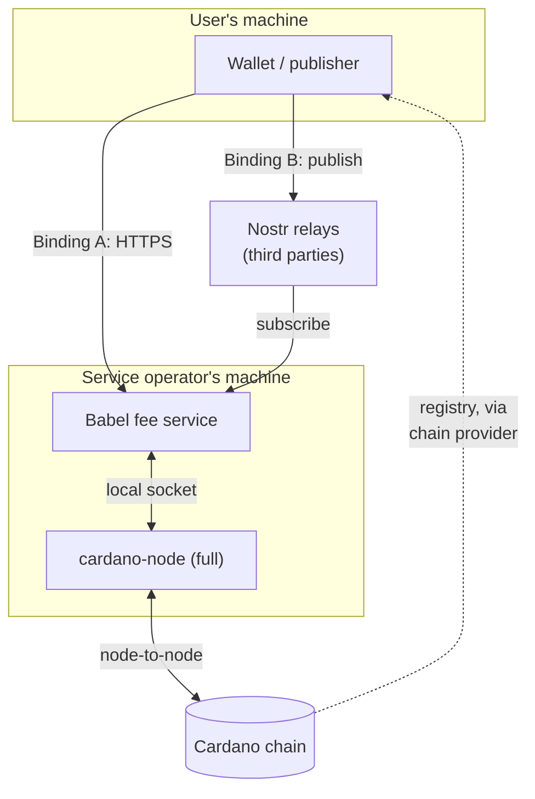
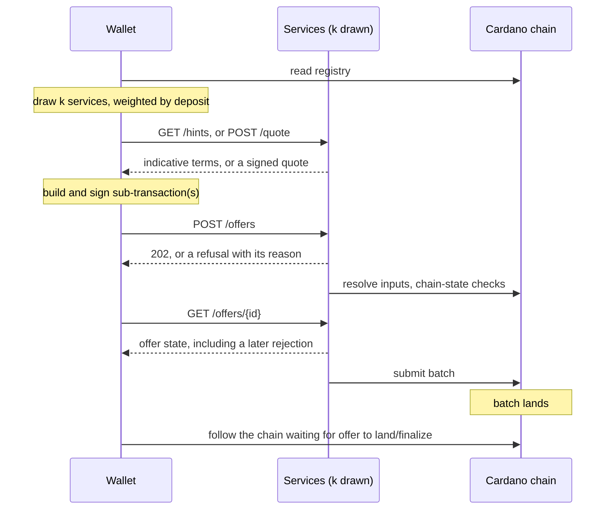
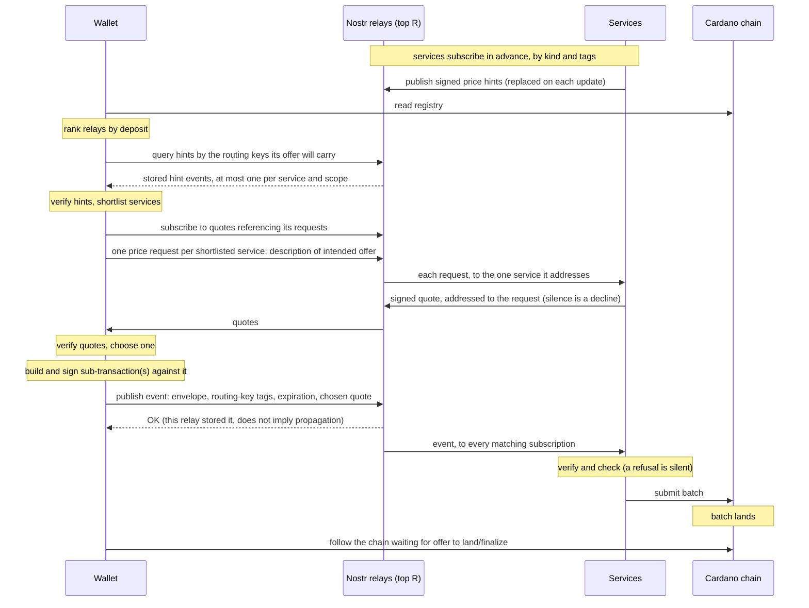

## Abstract

[CIP-0118][] lets a user author a sub-transaction 
that does not balance on its own, e.g.
having more of a user-defined token in the inputs than the outputs, and vice-versa
for ADA (such type of sub-transaction is called a *babel fee offer*). 
Another party can include this sub-transaction in a fully valid 
top-level transaction, which can then be posted on-chain. 
The Nested Transactions CIP specifies the required ledger changes to support
this, but the ledger rules alone are not enough to use it: a sub-transaction
that does not balance cannot be posted as-is, so the feature does nothing
until some other party finds it, judges it worth completing, and builds the
top-level transaction that carries it. That party, and the means of reaching it, are
entirely off-chain, and no such mechanism exists.

This CIP specifies such a mechanism, including all the relevant on-chain infrastructure: the offer- and interest-communication protocol, service discovery and customization, and batch construction. For each of these functionalities, we indicate what functions each of the two roles involved in this infrastructure performs. The two roles are anonymous publishers of sub-transactions (wallets) and services (babel aggregators of sub-txs into top-level txs). 


## Motivation: Why is this CIP necessary?

[CIP-0118][] defines ledger changes needed to support a specific kind of 
transaction batching. 
Incomplete transactions (e.g. unable to pay fees in ADA) are not propagated 
across the Cardano network. 
Off-chain infrastructure is needed to build 
valid batches called *top-level transactions* out of partially 
valid sub-txs. These batches can then be posted 
on-chain. Building such a mechanism can allow the experience of 
submitting sub-transactions to reach the 
level of the experience of submitting a complete transaction: create a 
transaction, send it across a network, see it on-chain quickly. It would
introduce the following new business opportunities:

- **Users holding no ADA can transact**, paying in whatever asset they have,
  removing the onboarding obstacle of not having ADA (including supporting 
  paying fees in non-ADA tokens, i.e. *babel fee offers*).
- **Multi-user, multi-UTxO swaps get cheaper, faster and less contended**: each
  party signs their own sub-transaction rather than serialising through one batcher.
- **New business becomes viable** for individual users, for markets and DEXs
  quoting across assets, and for DApps sponsoring their users' fees.
- **Arbitrary intents come within reach.** An offer is already a signed
  statement of what a user wants and will pay for it. We propose 
  a possible intent fulfilling protocol for clients that do not have chain state access.


## Specification

Such a mechanism requires the components we describe in this CIP, which can be 
roughly classified into support for the following functions expected from the 
infrastructure:

- **off-chain network protocol for offer and interest communication** — the
  [envelope](#offer-envelope) an offer travels in, the
  [validation](#validation) each party owes, the [routing and
  filtering](#routing-and-filtering) that decides where it goes, and the
  [lifecycle](#offer-lifecycle) that says what became of it;
- **service registration for discovery** —
  [on-chain registration](#on-chain-registration-of-services);
- **batch construction** — [batch construction](#batch-construction), the
  [constraint language](#constraint-language) a service plans against, and the
  [liquidity strategy](#liquidity-strategy) that funds it;
- **service customization** — the [service profile](#service-profile) and
  [price hints](#price-hints) an operator publishes, within the
  [protocol constants](#protocol-constants) everyone shares.

### Architecture

A service must run beside a full node and talks to it locally. Nostr relays are
third-party infrastructure, not a role this CIP defines. Wallets read the
registry through whatever chain provider they already use.



**Binding A — HTTPS.** The publisher talks to services it has chosen, and every
step has an answer.



**Binding B — Nostr.** The publisher reads every service's price hints from relays, asks a shortlist of them for quotes, then hands the offer to relays and hears nothing more from services.



### Terminology

#### Imported from CIP-0118, not redefined by this CIP

*sub-transaction*, *top-level transaction*, *batch*, *guard*, *required top-level
guards*, *isolation mode*. 

#### Defined by this CIP

**envelope** — The wire container for exactly one offer: `[envelope_version, era_tag, subtx_bytes]`. 

**offer** — A published envelope-wrapped sub-transaction.

**offer identity** — The sub-transaction's TxId. Distinct from the **transport dedup key**, a hash over the complete envelope bytes.

**pool** — The offers a party is holding (whether batched or not)

**candidate** — An offer a service has verified and could put in a batch. Which candidates it actually selects is its own business and is not specified here.

**imbalance** — Amount of each asset a sub-transaction gives its batch and takes from it.

**binding** — A concrete transport for carrying offers: how an envelope travels, and what the transport itself checks before handing it over. 

**message** — What a binding carries when it carries an offer. Its payload is then always an envelope; a binding may carry other traffic of its own. On a transport that routes by topic, a message is a topic and a payload together, and the topic is not part of the envelope.

**publisher** — Any party that emits an envelope. 

**service** (equivalently **aggregator**, **babel fee service**) — A party that ingests offers, verifies them, selects a jointly satisfiable set, builds a top-level transaction, and submits it.

**open transport** — A binding in which a publisher propagates messages to as many services as possible, rather than specific recipients. 

**interest filter** — A service's advertised intake specification: either a set of filter keys it accepts or the marker *all*, together with a set it rejects, rejection taking precedence.

**filter key** / **routing key** — A **filter key** is a value deterministically derived from an offer and used to decide whether a service wants it. A **routing key** is the wire encoding of a filter key for topic-based transports. 

**service profile** — The operator-authored specification a service follows: its accept and reject sides as filter keys, rate source, budgets, supported constraint-language versions, and two disclosures.

**satisfier** — The search a service runs to find out whether it can complete a batch that makes a constraint hold, and what to add if so. 

**registration** / **registry** — A **registration** is the on-chain record of a service: one UTxO, one NFT, and a registration record as its datum. The **registry** is all of them together, and is both how a party is discovered and the set entry points are drawn from. 

**declared constraint** — A constraint expressed in this CIP's constraint language (constraint DSL) and carried in a guard datum. 

**interpreter guard** — A published script that evaluates DSL-specified constraint on-chain. 


### Offer envelope

**Structure**

```cddl
envelope =
  [ envelope_version : uint                     ; this specification's revision
  , era_tag          : uint                     ; ledger era whose CDDL subtx_bytes conforms to
  , subtx_bytes      : #6.24(bytes .cbor subtx) ; the sub-transaction, verbatim
  ]
```

`subtx_bytes` is a byte string carrying encoded CBOR, wrapped in CBOR tag 24 
(the same construction Cardano uses for inline
datums and script references). 
Values for `envelope_version` and `era_tag` are
given in [Protocol constants].

**Offer identity.** The envelope carries no identity field. An offer's identity
is the TxId of the sub-transaction inside `subtx_bytes`, which every recipient
derives from the payload it already holds and which the publisher can compute at
construction time. Field 23 is itself keyed by TxId, so this is the identity the
ledger will use.

**Transport dedup key** 
An envelope's transport dedup key is Blake2b-256 over its bytes exactly as
received, witness set included. It is computed locally and not transmitted 
as part of the envelope. 
Two
witness-mutated copies of one offer have *different* dedup keys and the *same*
offer identity.

### Network topology and roles

The goal this design aims to achieve is that every offer must reach at least one honest service whose profile matches it before its validity bound, and no service should be systematically starved of offers. We will achieve this goal by relying on an open set of Nostr relays; publishers may publish to those relays, and services may read from them.

**Roles.**

| Role | Must |
|---|---|
| Publisher | Construct offers that pass the [offer checks](#stateless-checks--performed-by-publishers-services), which needs chain state a wallet has anyway. No identity, no registration, nothing ongoing. |
| Service | Every check, including [chain-state](#chain-state-checks--performed-by-publishers-services) and [pre-inclusion](#pre-inclusion-checks--performed-by-services) checks, and honouring its own [advertised interest](#routing-and-filtering). |

**Publishers vs. services.**
Publishers are many, anonymous, short-lived and mostly offline. Services are few, long-lived, and addressable. These populations want different treatment. Publishers never register; they find services and relays through the registry, and connect only for as long as it takes to submit an offer. Services may register, so that publishers can find them, and stay connected to the relays they read.

**Full node usage**
A service must be able to resolve inputs, run scripts, follow rollbacks, etc. For this reason, it must run beside a full node at all times (communicating with the node frequently).

**Registration** is optional, and requires an on-chain deposit. Services may register an endpoint, a set of relays, and a profile on-chain. 

The registry is a discovery aid; what a registration contains is in [Service profile](#service-profile). Running an unregistered service is possible, as long as consumers have some other way to find it.

**Censorship resistance**
The Nostr protocol is served by an open network of relays, operating independently of this CIP's services. Nostr has no general expectation that relays will forward messages to each other, so publishers are expected to publish to several relays, and services are expected to read from many. No offer is censored from any set of services, and no service is systematically starved of offers, as long as a sufficient number of honest relays are available.

Nostr is an existing and popular protocol, so there are a large number of general-purpose public relays. However, due to the nature of the protocol, these relays may aggressively ratelimit or ultimately block large volumes of protocol traffic (see [Security considerations](#security-considerations)). To mitigate this, we expect some Cardano operators to run their own Nostr relays.

**Service selection**

**Entrypoint selection (HTTPS).** Publishers will come and go, with short-lived connections to the rest of the network. Connecting to a "well known" service or set of services would give those services disproportionate censorship/price-setting power. To counter this, those publishers will be able to consult the on-chain service registry; they may connect to *k* (configurable) services drawn from the registry.

The draw takes *k* distinct registrations, each with probability proportional to the deposit it holds. Weighting by deposit rather than counting entries makes the draw indifferent to how a party splits itself: one registration of *D* and ten of *D/10* carry the same weight in total, so buying draw share costs the same however it is arranged. A uniform draw prices share by entry count instead, which makes the cheapest way to buy it a large number of minimum-sized registrations. Deposit weighting also removes the need for a minimum deposit, since a small operator registers a small deposit and is drawn in proportion rather than being priced out. 

**Relay selection (Nostr).** Nostr relays are shared infrastructure, but we must ensure that publishers can discover a large and dynamic set of relays to publish across. To support this, the registry includes information about which relays each service is listening on.

Publishers may build a weighted list of relays from the registry, and select the top *R* from that list, plus a few randomly-selected entries with less weight. Our recommendation is to weight all *N* of a registry entry's relays with *1/N* of that entry's deposit. Publishers should connect to these relays in ranked order, skipping unreachable relays, to cope with system outages.

As long as publishers follow this recommendation, it is difficult for any attacker to censor their messages. Popular relays will be weighted by the deposit of many honest services, and an attacker would need *R* times as much deposit to remove relays from the set which all publishers used.

**Entrypoints/relays set by hand.** A publisher may pin services and relays, which are kept alongside the drawn set rather than replacing it. This allows publishers to reach unpublished services/relays without a dependency on the registry.

### Transport bindings

This specification defines two bindings, with room for more. No binding may require publisher identity. An offer's own witnesses are the only authentication the protocol can potentially access.

#### Binding A — HTTPS

A service running this binding is an HTTPS server. Each row below is one request it answers, named by an *endpoint*: an HTTP method and a path.

| Endpoint | What it answers |
|---|---|
| `POST /offers` | Submit one envelope. `202` once accepted for verification, which is asynchronous — acceptance is not a promise to batch. A resubmission of a known offer is also `202`; replay is idempotent. |
| `GET /offers/{offer_id}` | The offer's state. |
| `GET /interest` | The advertised interest filter: accept side, reject side, and whether it accepts everything. |
| `GET /profile` | The [service profile](#service-profile), off chain — the same policy the (optional) on-chain registration carries. |
| `GET /hints` | The service's current price hints: what it would indicatively charge to carry an offer, quoted per accepted asset, for all offers or for those [in a scope](#price-hints). |
| `POST /quote` | Optional. Asks the service what it would charge for one intended offer, described by its assets, its size and ExUnits estimate, and any filter keys it will carry. Answers a signed [quote](#quotes) or declines. |
| `GET /offers/stream` | A feed of accepted offers, so services can source from each other rather than only from publishers. |
| `GET /health` | Whether the party is *able* to act on an offer right now, which is not the same question as whether it is reachable. See [Readiness]. |
| `GET /status` | Optional. Live operating state: uncommitted liquidity per asset, and a recent inclusion rate. Non-binding, as [hints](#price-hints) are. |
| `GET /` | Name, network, and the versions a counterparty needs before it builds: the API version, the [protocol revision](#versioning), the interpreter hashes it can satisfy, and any wire versions it accepts beyond what its revision implies. Also the oldest offer bound it still answers about, which is the one local limit nobody can discover by reaching it. |

Price hints are an endpoint. A service cannot negotiate with an offer that is already signed, so it states indicative terms in advance and a wallet reads them and does its own arithmetic. See [Price hints]. `POST /quote` is the optional per-offer form, for a wallet that wants terms priced for its own offer, and signed by the service that set them, before it signs. On this binding a wallet can only ask the services it has drawn, so the best quote it sees is the best of *k*; on [Binding B](#price-discovery) it reads every service's hints from relays and asks only the best-looking for quotes.

`/interest` is made up of the accept and reject sides of the profile. A service advertising an interest is expected to honour it. See [Routing and filtering] for when each part of a filter applies.

Nothing on this binding relays, so an offer reaches exactly the services its publisher sends it to.

**Encoding**

This binding follows the conventions Cardano tooling already uses over HTTP, so a wallet can reuse what it has for [CIP-0030][] and chain indexers. A request carrying one CBOR item is sent the way transactions are commonly submitted. Every response is JSON with any CBOR inside as hex, the way indexers return it.

- **A request body that is exactly one CBOR item** is sent as raw bytes with `Content-Type: application/cbor`. These are the envelope a wallet sends to `POST /offers` and the [`quote_request`](#quotes) it sends to `POST /quote`.
- **Every response body is JSON** (`application/json`). Within JSON, a CBOR item or any other binary value is a string of lowercase hex, with no `0x` prefix. This covers the offer state, the interest filter, readiness, status, `GET /`, and every refusal.
- **CBOR structures are returned as hex, not translated into JSON.** `POST /quote` answers `{"quote": "<hex>"}` with a signed [`quote`](#quotes). `GET /profile` answers `{"profile": "<hex>"}` with the [`service_profile`](#on-chain-registration-of-services). `GET /hints` answers a JSON array of hex strings, one per signed [`hints`](#price-hints) set. A wallet therefore holds exactly the bytes a signature covers, or that a registration datum carries.
- **Identifiers are hex** wherever they appear, including the `offer_id` (the sub-transaction's TxId) in a path.
- **Filter keys in JSON are routing-key strings.** The interest filter from `GET /interest` lists its accept and reject sides as [routing keys](#routing-keys), the same strings Binding B uses as topics, rather than as CBOR.
- **A quote presented with an offer** travels in a `Subtx-Quote` request header on `POST /offers`, as hex, so that the body stays the bare envelope whether or not a quote is attached.
- **`GET /offers/stream`** is a stream of server-sent events, one per accepted offer, each event's data being the envelope as hex.

A recipient MUST reject uppercase hex, a `0x` prefix, or a body whose `Content-Type` does not match its endpoint, for the same reason [Binding B](#binding-b--nostr) fixes one base64 form: two implementations should never disagree about whether a payload decodes.

The two bindings encode differently on purpose. Each follows its own transport's convention: hex and raw CBOR on Cardano's HTTP APIs, base64 in Nostr events, where hex would also double a payload against relay size limits. Only the text encoding differs. The CBOR inside, and so every signature over it, is identical on both.

**Readiness**

Reachable and ready are different states. A service may be up and not ready to function, e.g. because of a full buffer or a lagging node. An offer carries a finite validity upper bound, and there is [no free cancel message](#offer-lifecycle). Readiness awareness lets publishers avoid wasting time on not-ready parties. `GET /health` answers one of three states:

| State | Holds when | What a publisher does |
|---|---|---|
| `ready` | the party will act on an offer arriving now | send |
| `degraded` | reachable, but not currently acting: a service whose node is behind the tip or whose wallet is unsynced | do not send; try another party |
| `failed` | reachable, and not acting until an operator intervenes | do not send; try another party |

A service answering `degraded` or `failed` should also report its tip lag in slots. Silence (i.e. a party is unreachable) and `degraded` are distinguishable, and only the first is grounds for suspecting a silent cut.

Readiness is advertised, never enforced. A party may answer `ready` and decline the next offer, for the same reason [hints bind nothing](#price-hints).

**Rejection reasons**

Every offer refusal on this binding carries a machine-readable reason from the closed set below. The prose accompanying it is for humans and carries no protocol meaning.

A refusal reaches the publisher at one of two moments. The stateless checks and the body-derivable half of the interest filter run while the request is open, so those refusals replace the `202`. Chain-state verification is asynchronous, so a refusal after acceptance is recorded against the offer and read from `GET /offers/{offer_id}` — the [`rejected` state](#offer-lifecycle). Same codes either way, so a publisher polls once rather than treating `202` as final.

Binding B has no back-channel for offers; its only replies are [quotes](#price-discovery), which come before an offer exists. A refusal on an open transport is silence, and indistinguishable from nobody having seen the offer.

| Code | Holds when | What the publisher should do |
|---|---|---|
| `malformed` | a [stateless check](#stateless-checks--performed-by-publishers-services) failed | repair; the same bytes fail identically everywhere |
| `unsupported-version` | an envelope version, era tag, schema version or interpreter hash the recipient does not recognise | repair, or try a party whose `GET /` accepts it |
| `not-interested` | excluded by the [interest filter](#routing-and-filtering) or by an unadvertised [profile](#service-profile) refinement | try another service; the offer itself is sound |
| `over-budget` | exceeds one of the recipient's published [budgets](#service-profile) | try a service with larger budgets |
| `duplicate` | the recipient already holds this same offer, in a copy no larger | nothing — the offer is held |
| `settled` | the chain has settled this offer: confirmed, expired or invalidated | read `GET /offers/{offer_id}`, which says which of the three |
| `expired` | the validity upper bound is behind the recipient's tip | reissue with a new bound |
| `invalidated` | one of the offer's spend inputs is no longer unspent | rebuild against current state |
| `superseded` | the recipient already holds a *different* live offer spending one of these inputs, up to [`MAX_LIVE_OFFERS_PER_UTXO`](#protocol-constants) | wait, or spend a different input |
| `busy` | a rate limit or a full pool, and nothing about this offer | retry after the stated interval |
| `not-ready` | the recipient is `degraded` or `failed` per [Readiness] | retry after the stated interval, or try another party |

`superseded`, `busy` and `not-ready` are the three that are worth retrying at the same party, and each carries the interval after which to do so. Of the rest, `duplicate` and `settled` mean the offer is already accounted for and the publisher has nothing to do. The others mean it is wrong, or wrong *for this recipient*, and repeating it only costs both sides. A recipient that wants to refuse without saying why answers `not-interested`, which is the least informative code in the set and therefore the safe one to overuse. A publisher meeting a code it does not recognise treats it as `not-interested` and moves on.

Rejection reasons are not verifiable. The set exists so that an honest refusal is actionable, not so that a dishonest one can be detected.

#### Binding B — Nostr

This open transport allows an offer to reach services its publisher does not choose, and lets a publisher ask all of those services for a price before it signs (see [Price discovery](#price-discovery)). A message on this binding is a Nostr event ([NIP-01][]), published to one or more relays. The fields of an offer event are described below.

| Nostr event field | Value |
|---|---|
| id | As NIP-01 computes it. Not the offer's identity; see below |
| `kind` | [`NOSTR_OFFER_KIND`](#protocol-constants), a regular (stored) kind |
| `content` | The envelope bytes, [base64-encoded](#binding-b--nostr) |
| `tags` | One [`NOSTR_TOPIC_TAG`](#protocol-constants) tag per routing key the offer is published under, and one `expiration` tag ([NIP-40][]). If the offer was built against a quote, also one `p` tag naming the quoting service's event key and one `quote` tag carrying the quote; see [Price discovery](#price-discovery) |
| `pubkey`, `sig` | Any key; see below. Meaningless to recipients |
| `created_at` | Time of publication |

**Base64.** Every binary payload on this binding (the `content` of offer, hint, request and quote events, and the value of the `quote` tag) is encoded in the standard base64 alphabet with padding, as defined in [RFC 4648][] §4. The URL-safe alphabet of §5, omitted padding, line breaks and whitespace are all not allowed, and a recipient MUST reject a payload that is not in exactly this form rather than repair it. Fixing one form means two implementations never disagree about whether a payload decodes. It is the same choice [NIP-44][] makes for its payloads.

**Topics are tags.** Each routing key the offer is published under is carried as `["<NOSTR_TOPIC_TAG>", "<routing key>"]`. Relays index single-letter tags, so a service subscribes to its accept side with a filter on `kind` and the tag's values. Relays may cap the size of a filter, so a service with a large accept side may split it across subscriptions, or filter on `kind` alone and apply its interest filter locally. The reject side is always applied locally.

**Expiration.** The `expiration` tag is the sub-transaction's validity upper bound converted to POSIX seconds, rounded down, and is never set independently. Relays discard expired events without having to parse the offer.

**The event key.** Nostr requires every event to be signed, but that signature authenticates nothing this protocol uses: an offer's own witnesses remain its only authentication. The key MUST NOT be one used for anything else, in particular a user's Nostr identity key (e.g. one held by a [NIP-07][] signer), which would publicly tie the offer to that identity. A fresh key per offer, per session or per installation all comply.

**Event ids are not offer identity.** The event id covers the event, not the offer: two events carrying the same envelope have different ids and the same transport dedup key. Recipients deduplicate by transport dedup key and offer identity, never by event id.

**Where to publish and where to read.** A relay is not assumed to forward events to other relays, so an offer reaches a service only through a relay both of them use. This is how Nostr works rather than a choice of this CIP: relays are independent stores, and while operators may configure relays to sync with each other, for example by periodic relay-to-relay [NIP-77][] reconciliation or by streaming events between chosen relays, this is not default behaviour, and this CIP does not rely on it.

To reach services, a publisher therefore publishes to several relays, chosen as described under [Relay selection](#network-topology-and-roles). A service reads the relays listed in live registrations, as many as it can, plus any others it chooses.

**Missed offers.** Relays store events until they expire, so a service that connects late can query for events still live. A service SHOULD periodically reconcile what it holds against the relays it reads using [NIP-77][], which is how this binding lets a consumer tell that it has missed something.

**Message size** is set by each relay. [`MAX_SUBTX_BYTES`](#protocol-constants) should leave the encoded envelope within common relay limits.

Nothing may be assumed about ordering or delivery. A relay's `OK` reply means only that this relay accepted the event, not that any service has seen it.

##### Price discovery

On Binding A a publisher can only ask the *k* services it drew, so the best price it sees is the best of a sample. This binding lets a publisher see the whole market's prices, and then ask the most competitive services for prices on its own offer, in two steps:

1. **Read hints.** Every service publishes its [price hints](#price-hints) to the relays it reads, as an addressable event that each new set replaces. A publisher reads them with an ordinary relay query, and so sees the indicative prices of every service on its relays without sending anything.
2. **Ask a shortlist.** While it is still building its offer, the publisher sends a *price request* to each of the few services whose hints look best. A request describes the intended offer (the assets it needs and would pay in, bounds on its size and execution units, and any filter keys it wants priced), not the sub-transaction itself. Each request is addressed to exactly one service, which may answer with a [quote](#quotes) priced for that offer.

Either step may be skipped. A publisher may sign against a hint without asking, publish an offer without either, or send a request to a service it learned of some other way. A service may publish no hints and ignore every request.

**Why two steps.** A request broadcast to every service would draw one reply per service, which an attacker could use to [amplify](#security-considerations) its traffic on public relays. So requests are addressed to one service each, and the whole-market view comes from hints, which relays serve from storage.

**The hint event.**

| Nostr event field | Value |
|---|---|
| `kind` | [`NOSTR_HINT_KIND`](#protocol-constants), an addressable kind |
| `content` | The CBOR encoding of a signed [`hints`](#price-hints) structure, base64-encoded |
| `tags` | A `d` tag identifying the set, as below; one [`NOSTR_TOPIC_TAG`](#protocol-constants) tag per routing key in its [scope](#price-hints), or, for an unscoped set, per routing key the service accepts, or the single [catch-all hint tag](#routing-keys) if it accepts everything, so that a publisher can query for the hints that might apply to its offer; and one `expiration` tag, `HINT_TTL` after the hints were produced |
| `pubkey`, `sig` | The service's event key. Requests are addressed to it, so the service keeps it stable for as long as it publishes hints under it, and for `MAX_QUOTE_TTL` after |

Each set of hints a service publishes is its own event. The `d` tag is the registration asset name in hex for the unscoped set, and for a scoped set that name, a `/`, and the hex Blake2b-256 hash of the CBOR encoding of the `scope` as it appears in the hints. An addressable event is replaced, not added to, when its author publishes a newer one with the same `d` tag, so a relay holds at most one event per event key and scope however often the service reprices. A set the service stops publishing, such as one for a scope it has dropped, is not replaced, and lingers until it expires.

The `d` tag exists only for that replacement, and nothing queries by it. A publisher finds hints through their topic tags instead, in one query listing every routing key its intended offer will carry, plus the [catch-all hint tag](#routing-keys). A Nostr tag filter matches an event carrying *any* of the listed values, so the query returns every set whose scope (or, for an unscoped set, whose service's accept side) shares at least one key with the offer. The publisher then keeps the sets whose whole scope its offer carries, and discards the rest. An offer that invokes scripts A and B and pays to script C needs one query, not one per combination of its keys. It may also receive a set scoped to C and some script D, which it discards. The `expiration` tag lets relays drop hints that have gone stale on their own.

A service publishes its hint event only to relays it reads, so that a publisher who found the hint on a relay can reach the service through that relay.

**Verifying a hint event.** A publisher ignores a hint event whose `content` fails [verification](#price-hints) as a set of hints, or whose `d` tag is not the one derived from the registration and scope those hints carry.

**The exchange.**

1. The publisher queries its relays for hint events whose topic tags match any routing key its intended offer will carry or the catch-all hint tag, verifies them, keeps the sets whose scope its offer satisfies, and shortlists the services whose hints look best. How many it shortlists is its own choice.
2. It builds a [`quote_request`](#quotes) and, for each shortlisted service, signs a request event addressed to that service's event key.
3. On each relay it will send requests through, it subscribes to `{"kinds": [NOSTR_QUOTE_KIND], "#e": [<request event ids>]}`, then publishes the requests. Subscribing first matters because both kinds are ephemeral: a quote that arrives before the subscription is lost.
4. A service answers a request addressed to it with at most one quote event, published to the relay it received the request from.
5. The publisher collects quotes until a deadline of its own choosing, no later than the requests' expiration, verifies them, and picks one. It builds and signs its offer against that quote's terms and publishes it as an ordinary offer event, adding the `p` and `quote` tags.

**The request event.**

| Nostr event field | Value |
|---|---|
| `kind` | [`NOSTR_PRICE_REQUEST_KIND`](#protocol-constants), an ephemeral kind |
| `content` | The CBOR encoding of a [`quote_request`](#quotes), base64-encoded |
| `tags` | Exactly one `["p", <service event key>]`, and one `expiration` tag no more than [`MAX_PRICE_REQUEST_TTL`](#protocol-constants) after `created_at` |
| `pubkey`, `sig` | A fresh key, under the same rules as [the event key](#binding-b--nostr) of an offer. The requests a publisher sends for one intended offer may share it, since they carry the same `quote_request` anyway; requests for different offers MUST NOT, since that links them |

A request carries no topic tags, so it reaches no one through a topic subscription. A service receives requests by subscribing to `{"kinds": [NOSTR_PRICE_REQUEST_KIND], "#p": [<its own event key>]}`, and ignores a request that carries more than one `p` tag, so that no single event can draw more than one reply.

A request is ephemeral because it is worth answering only while its publisher is waiting. Relays forward it to live subscribers and need not store it, and a service that connects after it was sent has nothing useful to say.

**The quote event.**

| Nostr event field | Value |
|---|---|
| `kind` | [`NOSTR_QUOTE_KIND`](#protocol-constants), an ephemeral kind |
| `content` | The CBOR encoding of a signed [`quote`](#quotes), base64-encoded |
| `tags` | `["e", <request event id>]` and `["p", <request event pubkey>]` |
| `pubkey`, `sig` | The service's event key, the one the request was addressed to |

The Nostr signature is not what attributes a hint or a quote. Both are signed under the service's [registration key](#on-chain-registration-of-services), carried inside `content`, and that signature is what the publisher checks and the service later recognises. The event key only routes, and a registration never names it.

##### Verifying a quote

A publisher discards a quote unless all of the following hold:

- the `request` it carries is byte-for-byte the request the publisher sent;
- the signature verifies under the `issuer_vkey` it carries;
- the Blake2b-224 hash of `issuer_vkey` is the `key` in the commitment of the live registration named by `registration`, or a key the publisher has pinned;
- `valid_until` is in the future and no more than `MAX_QUOTE_TTL` after the request was sent.

A quote from a key the publisher cannot tie to a registration or a pin is unverifiable, and a publisher treats it as at most an indicative [hint](#price-hints).

**Choosing.** Which quote a publisher takes is its own business and is not specified. The cheapest is the obvious choice. A publisher may also weigh the issuer's deposit or its own history with that issuer, since a quote does not promise inclusion.

**Publishing a quoted offer.** The offer event carries `["p", <quote event pubkey>]` and `["quote", <base64 quote>]` alongside its usual tags. A service SHOULD subscribe to offer events whose `p` tag names its own event key, in addition to its topic subscriptions, so that an offer quoted by it reaches it whatever topics it follows. The `quote` tag lets the issuer [check its own signature](#quotes) without having stored anything.

A quoted offer is still published under its routing keys, and any service may batch it: the quote speaks only for its issuer, and the publisher has already signed what it is willing to pay. A publisher that wants only the issuer to see the offer may omit the topic tags and publish with the `p` tag alone, giving up the fallback of other services picking it up if the issuer does not.

**Silence.** A request that draws no verifiable quote by the publisher's deadline tells it nothing: the service chose not to answer, was not connected, or the relay dropped the request. The publisher may ask further down its shortlist, sign against the hints it already holds, or publish an offer at a price of its own choosing and accept that it may not be taken.

**What a service may price on.** Hints are what every service shows the whole market, and they are as expressive as their [format](#price-hints) allows. A quote is priced for one described offer, so it can depend on anything the request says (the assets involved, their amounts, the offer's size and execution units, and the filter keys it will carry, such as which DApp it pays into) and on anything the service knows at that moment: its inventory, the depth of its pool, market conditions, or how much it wants this particular flow. A service whose pricing model does not fit the hint format can still publish hints that approximate it, to make the shortlist, and price precisely in its quotes.

#### Further bindings

A transport qualifies if it can carry anonymous publishers, carry an envelope whole, and let a consumer tell that it has missed something. The last is the one that decides between candidates, because it is what distinguishes a quiet network from one that is cutting a service off.

The cost of additional bindings is extra integration effort for services; they will need to integrate with any binding to receive offers from that binding. This protocol does not rely on gossip (unless a future binding itself does so), so a service which doesn't listen to any Nostr relays will never see offers published over them.

We evaluated [CIP-0137][] (the Cardano Decentralized Message Queue), and found it currently unfit for this purpose. Every DMQ message must be signed with the KES key of a stake pool in the current stake distribution, so only SPOs can publish, which fails the first criterion above. The network is carried by `dmq-node`, a separate binary from `cardano-node` which in practice is run by SPOs. Its reference implementation also accepts at most one message per pool every 60 seconds, with message bodies of at most 2000 bytes and lifetimes of at most 30 minutes. CIP-0137 could only be adopted here if it gained an authentication mode admitting anonymous publishers, and limits suited to offer traffic.

### Validation

#### Transport-binding checks — imposed by the binding

These are properties of the binding rather than of the offer, performed by whatever software terminates the protocol. An implementation inherits whichever set belongs to the transport it uses, and they neither replace nor satisfy any check below.

[Binding B](#binding-b--nostr) contributes:

- **Event well-formed:** NIP-01 event id and signature valid, `kind` is [`NOSTR_OFFER_KIND`](#protocol-constants), and `content` decodes as [base64 in the required form](#binding-b--nostr).
- **`expiration` present and not passed**, and no later than the value [derived from the validity upper bound](#binding-b--nostr).
- **Event size** within the relay's limit.
- **Quote tag**, where present: decodes as a [`quote`](#quotes) whose
  signature verifies, issued by this service if the `p` tag names it.
- **Price requests:** `kind` is
  [`NOSTR_PRICE_REQUEST_KIND`](#protocol-constants), `content` decodes as a
  [`quote_request`](#quotes) for the recipient's network, `expiration` is
  present, not passed, and within
  [`MAX_PRICE_REQUEST_TTL`](#protocol-constants) of `created_at`, and exactly
  one `p` tag, naming the recipient's event key.
- **Hint events:** `kind` is [`NOSTR_HINT_KIND`](#protocol-constants),
  `content` decodes as signed [`hints`](#price-hints), and the `d` tag names
  the registration those hints name. Checked by publishers, which are the
  readers of this kind.

Relays may not enforce these, so services re-check them on receipt.

[Binding A](#binding-a--https) contributes nothing about the offer — only transport framing, which the checks below do not depend on.

#### Stateless checks — performed by publishers, services

Publishers must construct offers satisfying every offer check. Services must apply the offer checks before storing an offer, and must also perform the recipient checks. None require chain state.

**Offer checks** 

- **Envelope well-formed.** Envelope deserialization fully succeeds
- **Era.** `era_tag` must name an era the recipient can read. A decoder that ignores it reads every offer under whatever era it implements.
- **Sub-transaction deserializes** under the CDDL for the era named by `era_tag`
- **Size.** `subtx_bytes` must NOT exceed the sub-transaction size ceiling in [Protocol constants]. Implementations may impose a stricter local bound.
- **Validity interval** present, internally consistent, and with a finite upper bound not exceeding the maximum offer TTL in [Protocol constants]. An offer whose bound is already behind the current slot may be rejected here: slot arithmetic is static configuration rather than chain state, and once the clock is past the bound no later block can carry the offer. The `expired` lifecycle state is the tip-relative one, and answers a different question.
- **Network.** `network_id` must match the network the recipient serves.
- **Signatures** verify against the sub-transaction body hash.
- **Guard-constraint shape caps.** A declared constraint exceeding the maximum depth, node count, or backtracking budget in [Protocol constants], or containing an empty `All` or `AnyOf`, must be rejected here, before the offer reaches a pool.
- **At least one spend input** is required for offers diffused over an open transport. 

**Recipient checks** — obligations of whoever receives the offer:

- **Duplicate.** An arrival whose transport dedup key the recipient is currently suppressing must not be stored again. A service ignores the offers it currently holds, as well as any offers the chain has settled. An offer dropped for any other reason loses its key with it, and is readmitted on re-arrival — see [Offer lifecycle]. 
- **Filter-key policing.** A routing key is an address and never evidence. On transports where the publisher chooses where to send an offer, a service may re-derive the keys that need no chain state — guard, paid script, ExUnits band, and the two feature keys — and drop an offer whose [arrival topic](#routing-keys) is not among them.


#### Chain-state checks — performed by publishers, services

These are the phase-1 rules that bind a sub-transaction in isolation, together
with phase-2 evaluation of its own scripts (not top-level guards).

- **Inputs currently unspent**.
- **Reference inputs exist**, where used.
- **Witness set complete.** 
- **Validity interval covers the current tip.** 
- **Min-UTxO floors** 
- **Output, transaction, and value sizes**, and **declared ExUnits**, within current protocol
  parameter limits.
- **Script integrity hash** Compute it and check against the field.
- **Cost-model cliff.** Is the cost model scheduled to change before its validity upper bound?
- **Sub-transaction scripts succeed** under phase-2 evaluation
- **Imbalance derivation.** `consumed − produced` per asset: a positive entry is what the sub-transaction offers its batch, a negative entry what it needs from it. Resolving the inputs is what makes this a chain-state check. **Consumed** is the resolved spend inputs, withdrawals, minted quantities, and deposits refunded by unregistration certificates; **produced** is the outputs, direct deposits, the treasury donation, burned quantities, deposits locked by registration certificates, and governance proposal deposits. An asset whose sides cancel is absent rather than zero. The list is exhaustive because everything routes on the result: two recipients disagreeing about what counts would derive different keys for one offer, and each would read the other's honest placement as a lie. Note that stake-pool registration and retirement take their deposit from a protocol parameter rather than carrying it, so they are the one case the imbalance cannot be read from the body and inputs alone.
- **Filter-key policing.** On a binding where the publisher chooses where to send an offer, a service re-derives **every** one of the offer's keys and drops it if the arrival topic is not among them. 

#### Pre-inclusion checks — performed by services

1. Phase-2 validation of guard scripts must be evaluated for amount of ExUnits used. 
2. Sufficient fee and collateral is included to cover the total (size- and ExUnits-based) fee 
3. Full phase-1 validation must be performed on the assembled top-level transaction before submitting it for block inclusion. 

**Bounding execution units**
In (1), a service stops once script execution exceeds its own [`max_ex_units_*` budget](#service-profile) and drops the guard-requiring sub-transaction from the batch. The author's own [`Bounds::ex_units`](#constraint-language) is a separate bound on the same guards, specified via the constraint language. Whichever of the two is lower binds. The [ExUnits band](#filter-key-kinds) a service subscribes to keeps most of what the service would refuse from reaching it at all.

### Routing and filtering

Services take only the offers they want, and can check an offer is what it was
sent as. Three separate things do that work (see details below)
- A **filter key** is a label computed locally from an offer. Filter keys divide in two:
  some can be derived from the signed body alone, the rest need the inputs
  resolved;
- An **interest filter** is what a service says it wants, using the same syntax as for filter keys;
- A **routing key** is a filter key written as a string.

What each role does with each:

| Activity | Publisher | Service |
|---|---|---|
| Declare a filter key | never | never |
| Derive body-only keys | its own |yes |
| Derive chain-state keys | its own | yes |
| Check the arrival topic against the offer's keys | — | must, all keys |
| Choose which topics to publish on | yes | — |
| Subscribe to topics | — | yes, its accept side |
| Define an interest filter | — | yes |
| Advertise one | — | yes, both sides |
| Apply one | — | body-derivable keys at ingest, the rest once inputs resolve |
| Post filter keys on-chain | — | may, as its registered accept side |

A dash means the activity is not part of that role at all.

Posting keys on-chain is advertisement and never subscription. 

What is carried over each kind of channel:

| What travels | HTTPS | Open transport | On-chain |
|---|---|---|---|
| Filter key | never | never | never |
| Routing key | as the advertised accept side | as the message topic | in a registered profile, as advertisement only |
| Interest filter | both sides, from `GET /interest` | never | both sides of a registered profile |
| Envelope | request body | message payload | never (its sub-transaction may end up on-chain later) |

Routing keys and topics exist only on bindings that route by topic; interest
filters, as the HTTPS column shows, do not depend on them.

#### Filter-key kinds

Each kind below is read off the sub-transaction body, or off the body together
with its resolved inputs. Nothing in the envelope names them: a recipient works
out which kinds apply and derives a key for each. The kinds are:

| Code name | Kind | Carries | Derived from | Needs chain state |
|---|---|---|---|---|
| `OfferedPolicy` | Offered policy | a `policy_id` | a policy on the positive side of the imbalance | yes |
| `NeededPolicy` | Needed policy | a `policy_id` | a policy on the negative side | yes |
| `PureBabel` | Pure babel | nothing | needs only ADA | yes |
| `SponsorshipOnly` | Sponsorship only | nothing | balanced; needs only fee and collateral | yes |
| `Priority` | Priority | nothing | needs nothing and offers value: paying for inclusion rather than asking for it | yes |
| `Guard` | Guard | a `credential`, key or script | a credential in required top-level guards | no |
| `InvokesScript` | Invoked script | a `script_hash` | a script the sub-transaction itself runs | yes |
| `PaysToScript` | Paid script | a `script_hash` | the script payment credential of one of the sub-transaction's outputs | no |
| `ExUnits` | ExUnits band | one of `none`, `low`, `medium`, `high` | declared execution units, banded | no |
| `UsesDirectDeposits` | Direct deposits | nothing | uses direct deposits | no |
| `UsesAccountBalanceIntervals` | Balance intervals | nothing | uses account balance intervals | no |

**`Guard`, `InvokesScript` and `PaysToScript` name different scripts.** `Guard` names a script the *batch* must satisfy. `InvokesScript` names one the *sub-transaction* runs for its own reasons. `PaysToScript` names one the sub-transaction sends value to without running it, such as a DApp's order or escrow validator, which is how an offer that creates an order for a DApp is recognised: creating the order runs no script, so `InvokesScript` does not see it. Only an output's payment credential counts; a script in the stake part of an address, or an account credited by direct deposit, does not.

A kind that carries a payload defines a family, one key per distinct payload. `ExUnits` carries a *band* rather than a number of execution units. The [routing-key grammar](#routing-keys) is the wire spelling of exactly these payloads.

The three class kinds (`PureBabel`, `SponsorshipOnly`, `Priority`) are mutually exclusive.

Several kinds usually apply to one offer, and it is published under all of them:

```
offer: offers TokenX, needs only ADA, no scripts

filter keys                topics published to
───────────────────────────────────────────────────────────
OfferedPolicy(X)     →     subtx/v1/mainnet/offered/{X}
PureBabel            →     subtx/v1/mainnet/class/pure-babel
ExUnits(NoScripts)   →     subtx/v1/mainnet/exunits/none
```

Deduplication by offer identity is mandatory. Subscription is always a union.

#### Routing keys

A routing key is a filter key written as a topic name, together with the two pieces of context a topic needs and a filter key does not carry: which network, and which version of this grammar.  It is a string, used verbatim as the topic identifier:

```abnf
routing-key = "subtx/v1/" network "/" kind

network     = "mainnet" / "preprod" / "preview"

kind        = "offered/" policy-id
            / "needed/" policy-id
            / "class/pure-babel"
            / "class/sponsorship"
            / "class/priority"
            / "guard/key/" hash28
            / "guard/script/" hash28
            / "invokes/" hash28
            / "pays/" hash28
            / "exunits/" band
            / "feature/direct-deposits"
            / "feature/balance-intervals"

band        = "none" / "low" / "medium" / "high"
policy-id   = 56lc-hex
hash28      = 56lc-hex
lc-hex      = DIGIT / %x61-66          ; 0-9 a-f, lower case only
```

Every character is ASCII and lower case, including hex digits; there is no trailing separator. For example `subtx/v1/mainnet/class/pure-babel`, or `subtx/v1/preprod/offered/` followed by 56 hex characters.

The `subtx/v1` prefix is fixed by this specification. Its version segment covers the routing-key grammar itself — which kinds exist and how each is spelled — so a later revision that adds or respells keys publishes under `subtx/v2`, and subscribers to one version never receive keys shaped for another.

The `network` segment puts each network on its own topics, so a mainnet subscriber never receives a preprod offer at all. This does not replace the `network_id` check on the body.

An offer whose keys span several kinds is published under every corresponding routing key; subscribers deduplicate by offer identity.

**Firehose**. There is no catch-all routing key. A service wanting everything subscribes without a topic filter, where its binding allows it (on [Binding B](#binding-b--nostr), a filter on `kind` alone), and applies its interest filter locally on ingest. 

**Catch-all hint tag.** [Hint events](#price-discovery) need one tag value that offers never use: `subtx/v1/<network>/any`, for example `subtx/v1/mainnet/any`. A service whose accept side is *all* tags its unscoped hints with it, having no accept keys to tag them with, and every publisher includes it when querying for hints, so those hints are found by the same single query as everyone else's. It is not a routing key. An offer event carrying it is not addressed to anyone by it, and services ignore it there. Its version and network segments mean the same as in a routing key.

**Interest filters.** An interest filter is an accept side — either a set of filter keys or the marker **all** — and a set of rejected keys. An offer is ingested when none of its keys is rejected, and either the accept side is *all* or at least one of its keys is accepted. Offers on HTTP  allow the publisher to learn about their offer's rejection from the `POST /offers` response. On an open transport, rejection is silent.

**Further refinement.** Services can implement additional local filters that can be posted on-chain as part of their [service profile](#service-profile), as well as without any announcement strategy. 


### Constraint language

As part of this CIP,
we provide a small constraint language.
A constraint is a predicate over a candidate batch, provided by a 
publisher as a way to constrain the top-level tx over which 
their sub-transaction has otherwise no control. The constraint language 
is a tool we provide to enable constructing script-datum pairs that 
encode the DSL's constraints and are checked on-chain.

**Evaluation**
We provide an encoder (and corresponding decoder) for the constraint 
language. It takes a DSL
expression and returns a `Datum`. A Plutus script is to be provided
that acts as an interpreter for the (specific version of) the 
constraint language. When a top-level tx is constructed, the interpreter
Plutus script is included as a guard, and the encoded DSL expression 
is included as its datum. The result of the on-chain evaluation of the guard+datum 
pair on the top-level tx should be the same as the result of checking 
the constraint DSL on the top-level tx directly. Guards and their datums
can be specified by sub-txs.

**Constraints**
A constraint has two parts, and the split is syntactic rather than a
convention:

```
constraint = bounds + requirement
```

**Bounds** are ceilings on the batch as a whole. The two scalar bounds may
each appear at most once; net-outflow bounds are keyed, as the table says:

| Code name | Bound | Holds when |
|---|---|---|
| `Bounds::ex_units` | execution units | the batch's total execution units are at most the bound. Enforced by the service among the [pre-inclusion checks](#pre-inclusion-checks--performed-by-services), never by the guard. |
| `Bounds::tx_size` | serialised size | the batch's size in bytes is at most the bound. Enforced by the service among the [pre-inclusion checks](#pre-inclusion-checks--performed-by-services), never by the guard. |
| `Bounds::net_outflow` | net outflow | for a named credential set and asset, value consumed from those credentials minus value returned to them is at most the bound. Spends from credentials outside the set are not counted. One bound per (credential set, asset). |

The net-outflow bound lets users add safeguards of their own, and is the one
bound a guard can enforce: the other two cannot be read from a script context,
so an author writing them buys a service's cooperation rather than enforcement.
There are no ExUnits caps on guards travelling with a particular sub-transaction,
so running them on the top-level batch is limited only by the service's own
`max_ex_units_*` [budget](#service-profile), which each operator sets
experimentally against its hardware and risk tolerance.

**Requirements** are what a completing batch must contain. These compose:

| Requirement | Holds when |
|---|---|
| `PaidAtLeast { address, asset, amount, datum }` | the sum of `asset` paid to `address` across counted batch outputs is at least `amount`. With `datum` present, only outputs whose inline datum serialises to exactly those bytes are accepted; absent, every output at the address is accepted. |
| `Guards(credential)` | `credential` is among the batch's top-level guards. Key credentials only (see Known gaps) |
| `All(children)` | every child holds, must be non-empty. |
| `AnyOf(children)` | at least one child holds, tried in the given order, must be non-empty. |
| `True` | always. The only way to state "no requirement", since the two combinators cannot be empty. |

The same thing as CDDL, since a datum is on-chain data and this is what a second
implementation encodes against:

```cddl
constraint  = #6.121([bounds, requirement])
bounds      = #6.121([maybe<ex_units>, maybe<uint>, [* net_outflow]])
ex_units    = #6.121([mem : uint, steps : uint])
net_outflow = #6.121([[+ credential], asset, amount : uint])

credential  = #6.121([hash28])      ; key
            / #6.122([hash28])      ; script
asset       = #6.121([])            ; ada
            / #6.122([policy : hash28, name : bytes .size (0..32)])

requirement = #6.121([address : bytes, asset, amount : uint, maybe<datum>])
            / #6.122([credential])              ; guards
            / #6.123([[+ requirement]])         ; all
            / #6.124([[+ requirement]])         ; any-of
            / #6.125([])                        ; true

maybe<a>    = #6.121([]) / #6.122([a])
datum       = bytes                 ; the datum's own encoding, carried verbatim
hash28      = bytes .size 28
```

Constructor alternatives 0 through 6 are tags 121 to 127, so the tags above are
`Constr n` with `n = tag − 121`. `maybe` follows PlutusTx's `Maybe`: absent is
alternative 0, present is alternative 1.

**Shape caps**
A requirement tree exceeding any of these is rejected among the stateless
checks, before an offer reaches a pool. Bounds are flat and need no caps:

| Code name | Cap | Ranges over |
|---|---|---|
| `MAX_CONSTRAINT_DEPTH` | Maximum depth | nesting |
| `MAX_CONSTRAINT_NODES` | Maximum node count | total size |
| `MAX_BACKTRACKING_BUDGET` | Maximum backtracking budget | the product of `AnyOf` branch counts |

Maximum backtracking budget is calculated by multiplying, not summing, the
branch counts of every `AnyOf` in the tree, because a satisfier may have to try
every branch of each one against every combination of the others: four `AnyOf`
nodes of four branches apiece cost 256 attempts, not 16.
Values are in [Protocol constants].

What a guard costs to run is not a function of the constraint alone. 
It is a function of the full transaction which contains it (including its sub-txs).
For this reason, shape caps cannot directly be translated to ExUnits caps.

**Evolution**
The constraint language's version is its interpreter's script hash. 
Anyone may publish an interpreter, on-chain as a reference script, so a batcher
can name it without carrying its bytes. A new interpreter records the hash of its
predecessor in its publication record, described below. Multiple versions may be published simultaneously, and 
the resulting succession graph is not necessarily linear.

Batching across dialects is out of scope. One batch may in principle carry
constraints naming different interpreters, but satisfying them together is not
specified here.

**The language is pluggable.** This specification fixes 
the interface — a constraint is a datum, an interpreter evaluates it, a
satisfier proposes an augmentation and `evaluate` decides. The AST below is a prototype
implementation of that interface. Another may replace it via a hash-substitution.
The interpreter is named by hash and adopted by whoever finds
it worth adopting.

The constraint
language specified here is deliberately small: it is what a satisfier can plan
against today.
A more comprehensive transaction construction DSL such as [Tx3][] can be adjusted 
to operate on Dijkstra transactions for both constraint checking and satisfaction,
but this is out of scope here.

An interpreter defines evaluation completely. 
A satisfier cannot be obtained the same way.
An interpreter's publication record should name the source it was built from, by
repository and commit, alongside its predecessor's hash. The adherence of the satisfier code to 
the interpreter semantics, 
as well as its persistence, cannot be trusted. However, it is in the interest of 
the publisher to ensure both of these aspects, as their sub-txs will not make 
it on-chain otherwise. 

Conformance vectors (a constraint, a candidate batch, and the verdict the
interpreter returns) may accompany that record, for implementations that will
not rebuild the source. They demonstrate agreement on a known set rather than
establishing it in general, and are checkable by running the
published script.

**Encoding**
A constraint travels as a guard datum, so its encoding is PlutusData. 
Written below as `Constr n [fields]`, `I` for integers, `B` for byte strings,
and `List` for lists. An absent optional value is `Constr 0 []` and a present
one `Constr 1 [value]`. This assignment is fixed by this specification and is
not inherited from any library: Plutus Tx orders `Maybe` as `Nothing | Just`,
which agrees; Aiken orders `Option` as `Some | None`, which does not, so a
decoder that assumes its own language's convention reads every optional field
inverted.

| Value | Encoding |
|---|---|
| `constraint` | `Constr 0 [bounds, requirement]` |
| `bounds` | `Constr 0 [maybe ex-units, maybe tx-size, List [net-outflow]]` |
| `ex-units` | `Constr 0 [I mem, I steps]` |
| `tx-size` | `I bytes` |
| `net-outflow` | `Constr 0 [List [credential], asset, I amount]` |
| `credential` (key) | `Constr 0 [B hash]` |
| `credential` (script) | `Constr 1 [B hash]` |
| `asset` (ada) | `Constr 0 []` |
| `asset` (other) | `Constr 1 [B policy, B name]` |
| `requirement` | one of the five constructors below |
| `PaidAtLeast` | `Constr 0 [B address, asset, I amount, maybe (B datum)]` |
| `Guards` | `Constr 1 [credential]` |
| `All` | `Constr 2 [List [requirement]]` |
| `AnyOf` | `Constr 3 [List [requirement]]` |
| `True` | `Constr 4 []` |

Credential and asset tags follow the ledger's encoding of those types.
Two net-outflow bounds over the same credential set and asset are a malformed
constraint rather than a stricter one, and a decoder MUST reject them.

Tags are assigned positionally and never reused. A new requirement takes
the next free tag.
Adhering to a canonical encoding allows publishers to recognize 
reuse of constraints.

**Known gaps**

  - Predicates over datum *contents* beyond exact-bytes equality are out of scope.
  - A guard requirement may name only a key credential. A key hash appears
  in the script context as a signatory; a script credential does not, and
  whether Dijkstra's script context lets a guard read the transaction's guards
  set is an open upstream question. 
  - The Plutus guard script written as the draft of the constraint 
  interpreter is not audited or tested
  - There is no way to check that a given Plutus guard script really implements
  the constraint-language version it claims.

**Satisfying DSL constraints.**
The reference implementation provides a satisfier, which searches for an
augmentation making a constraint hold, and a two-step planning pipeline over
sets of candidate offers.

Its operation relies on the fact that every requirement is monotone: a satisfier only ever adds
outputs and guards, and nothing it adds can un-satisfy a requirement that
already holds. So it walks the tree, computes each leaf's shortfall against
what the batch already has, and draws it from the pool of value and credentials
the builder controls. `All` sums the shortfalls of its children and checks the
pool once, since they draw from the same pool; `AnyOf` tries its branches in
order and backtracks — on a breached bound as well as an unmet requirement,
since which branch is taken can decide whether a bound holds. The search is
bounded by the branch counts the author wrote, which is what the backtracking
cap fixes. Bounds are only ever checked, never built toward.

**Custom guards** name a DApp's own script hash instead, carry no constraint
datum, and are expected to be deployed on-chain as reference scripts. Supporting
one is optional, as a service may not hold the script (or a reference to it),
or may not have a satisfying strategy for the custom guard.

### Protocol constants

**Envelope and offers.**

| Code name | Constant | Value | Basis |
|---|---|---|---|
| `ENVELOPE_VERSION` | `envelope_version` | 1 | The first revision of this specification. |
| — | `era_tag` values | TBD | Needed to know what CDDL a sub-transaction conforms to |
| `MAX_SUBTX_BYTES` | Sub-transaction size ceiling | TBD | Must leave room for several sub-transactions plus the top-level body and guard witnesses inside `maxTxSize`, and keep a base64-encoded envelope within common Nostr relay size limits |
| `MAX_OFFER_TTL` | Maximum offer TTL | TBD | Long enough for a service to see an offer, plan, and submit; short enough that an abandoned offer clears without intervention |
| `MAX_ENVELOPE_OVERHEAD_BYTES` | Maximum envelope overhead in bytes | Proposed `16` | The envelope is two small integers and a tag-24 wrapper, so its cost over `subtx_bytes` is bounded. Fixing it makes the largest message computable |

All of these are released with the (versioned) specification revision and enforced by the
[stateless checks](#stateless-checks--performed-by-publishers-services).
An offer breaching one stops at the first
recipient rather than travelling. 

**Binding B.**

| Code name | Constant | Value | Basis |
|---|---|---|---|
| `NOSTR_OFFER_KIND` | Nostr event kind carrying offers | TBD, a regular kind per NIP-01 | Regular events are stored until they expire, which late-joining services and reconciliation depend on; ephemeral events are not stored |
| `NOSTR_TOPIC_TAG` | Single-letter tag carrying routing keys | TBD | Relays index only single-letter tags. Must not collide with tags in common use, such as `t` (hashtags) or `k` (referenced kinds) |
| `NOSTR_PRICE_REQUEST_KIND` | Nostr event kind carrying [price requests](#price-discovery) | TBD, an ephemeral kind per NIP-01 | A request is worth answering only while its publisher waits, so relays need not store it |
| `NOSTR_HINT_KIND` | Nostr event kind carrying [price hints](#price-hints) | TBD, an addressable kind per NIP-01 | Each new set replaces the last with the same scope, so a relay holds at most one per event key and scope, and stored hints are always the latest |
| `NOSTR_QUOTE_KIND` | Nostr event kind carrying quotes | TBD, an ephemeral kind per NIP-01 | Its only reader is already subscribed when it is sent |
| `QUOTE_REQUEST_VERSION` | `request_version` in a [`quote_request`](#quotes) | 1 | The first revision of this specification |
| `MAX_PRICE_REQUEST_TTL` | Longest a price request's `expiration` may be after its `created_at` | TBD, on the order of seconds | Long enough for services to price and reply across relays; short enough that a publisher is not kept waiting and a service does not answer a request its publisher has given up on |

Also released with the specification revision, and checked among the
[transport-binding checks](#transport-binding-checks--imposed-by-the-binding).

**Constraint language.**

| Code name | Constant | Value | Basis |
|---|---|---|---|
| `MAX_CONSTRAINT_DEPTH` | Maximum constraint depth | Proposed `16` | Bounds nesting |
| `MAX_CONSTRAINT_NODES` | Maximum constraint node count | Proposed `128` | Bounds total size|
| `MAX_BACKTRACKING_BUDGET` | Maximum backtracking budget | Proposed `1024` | The product of `AnyOf` branch counts |

Also released with the specification revision, and also enforced among the
stateless checks.

**Diffusion, pool and service.** 

`HINT_TTL` must be agreed network-wide, because a party applying a different one refuses what others accept. `MAX_REGISTRATION_BYTES` and `REGISTRATION_DEPOSIT` must be too. Nobody enforces either on chain, so two parties applying different ones compile different registries. `MAX_REGISTRATION_PERIOD` is network-wide for the same reason, and is the one constant here the chain enforces itself. The rest are internal to the party that sets them (`MAX_LIVE_OFFERS_PER_UTXO`, the pool ceilings, `MAX_CONCURRENT_BATCHES`, `FUNDING_HOLD_TTL` and `STATUS_RETENTION`), bounding either what a party spends on itself or what it will accept from others. This CIP fixes values for the first kind and floors for the second.

**Activation is read off the registry,** using the latest snapshot of chain state at the moment a consumer needs it. Every [registration](#on-chain-registration-of-services) carries the [protocol revision](#versioning) its holder runs. A revision's values take effect once most of the registry has upgraded to it, counted by the number of valid registrations. 

| Code name | Constant | Basis | How announced | How enforced |
|---|---|---|---|---|
| `MAX_LIVE_OFFERS_PER_UTXO` | Number of live offers allowed per UTxO | Only one can ever land, so a higher cap only allows re-pricing | Not announced; the refusal says when to try again | By the recipient |
| `POOL_MAX_OFFERS`, `POOL_MAX_BYTES` | Number of offers a pool may hold, and their total size in bytes | When the pool starts evicting | Not announced | By the holder |
| `MAX_REGISTRATION_BYTES` | Size in bytes of the largest registration datum, relay list included | Two parties with different ceilings enumerate different registries, draw different entry points and rank relays differently | Released with the specification revision | By every reader |
| `MAX_CONCURRENT_BATCHES` | Number of batches a service may have in flight | Each holds offers and wallet inputs out of circulation | Not announced | By the service |
| `FUNDING_HOLD_TTL` | How long an input held for a batch under construction stays held | Long enough to build and submit; short enough that a crashed build does not strand liquidity until restart. | Not announced | By the service, on itself |
| `REGISTRATION_DEPOSIT` | Smallest deposit a registration may hold | A registration's draw weight is its deposit, so this bounds registry bloat rather than the draw | Released with the specification revision | By each service for itself (when compiling valid registration entries) |
| `MIN_REGISTRATION_PERIOD` | Nearest a registration may set its `expiry` | The deposit cannot be released before expiry, so this is the least time it stays locked | Released with the specification revision | By the registration script, at mint and at every renewal |
| `MAX_REGISTRATION_PERIOD` | Furthest ahead a registration may set its `expiry` | Long enough that renewal is routine; short enough that an abandoned entry leaves the draw while anyone still cares | Released with the specification revision | By the registration script, at mint and at every renewal |
| `HINT_TTL` | Amount of time before a price hint expires | After this, a quote is not worth using. | Released with the specification revision | By the wallet, which treats an older hint as absent. A service cannot extend it |
| `MAX_QUOTE_TTL` | Longest a [quote](#quotes) may stay valid | A quote is priced for conditions at the moment it is issued, and a wallet should not sign against it once they have moved. Shorter than `HINT_TTL`, since a quote is priced more precisely | Released with the specification revision | By the issuing service |
| `STATUS_RETENTION` | Amount of time a service answers about a finished offer | At least `MAX_OFFER_TTL`. A refusal after acceptance is readable only via querying this constant | The floor is released with the specification revision; the operator's own figure is answered at `GET /` | Not enforced |


### Offer lifecycle

**States**
Five offer states internal to a service :

| State | Holds when |
|---|---|
| received | passed the stateless checks; waiting on chain-state verification |
| verified | passed the chain-state and pre-inclusion checks — an eligible candidate |
| included in batch | selected into a batch being built |
| submitted | that batch went to the mempool |
| rejected | refused after acceptance, carrying the [reason](#binding-a--https) |

`rejected` is a local off-chain verdict, held for the
[status-retention period](#protocol-constants) like any settled outcome.

Three more are settled by the chain:

| State | Holds when |
|---|---|
| confirmed | the sub-transaction's TxId appears in an on-chain batch |
| expired | the validity upper bound is behind the tip |
| invalidated | one of its spend inputs is no longer unspent, etc. |

**Rollback**
A rollback can un-confirm a batch, make a spent input unspent again, and
put the tip back behind a validity bound it had already passed. So a service
holds these provisionally until its chain view has settled to the depth it
trusts, and when a rollback undoes the event behind one of them, it puts the
offer back. A rolled-back confirmation returns the offer to verified, not to
anything new. A settled offer's dedup key is
suppressed, so a service that un-settles an offer also un-suppresses it, see
Re-arrival.

**Superseded** is what a service calls an offer when it
holds a newer one spending the same input (but not with the same TxId). 
The service
still answers about the older offer and its dedup key still suppresses repeats. 
For offers passing chain-state verification, arrival order
decides. A computable
concept of "offer value"
defined internally by the service (see [batching](#batch-construction)) 
would allow for additional adjudication 
strategies.

**Is my offer posted on-chain?**
A publisher is expected to follow the chain to observe whether its offer has 
been posted. The `GET /offers/{offer_id}` queries service-specific state,
and does not provide a reliable answer to whether the offer has been posted.
There is no possible way to partially fulfil an offer.

**Cancellation and re-pricing**
There is no cancel message in our protocol. Cancellation is done by the 
publisher by spending an input of its sub-transaction before it makes 
it on-chain.
Re-pricing is the same mechanism: issue a new offer spending an input the old
one spends. Both are live, at most one can ever land, and a service holding
both marks the older superseded.

**Offer competition.**
For any offer, the first batch containing it on-chain wins, and any other batch 
containing it becomes invalid. The service constructing the invalidated batch 
is not compensated for their work batching that offer.

A service tracks the batches it has submitted. Each
submitted batch is held in one of three states:

| State | Holds when |
|---|---|
| submitted | sent to the mempool, not yet seen on chain |
| included | seen in a block, at that slot |
| superseded | a different batch carrying one of its offers was included, at that slot — so this one can never be valid |

A batch leaves that set only when it expires, which is what keeps inclusion,
supersession and rollback trackable.

**Multiple batches.**
Services can build up to [`MAX_CONCURRENT_BATCHES`](#protocol-constants) at a
time. They must not conflict. 
The `included in batch` state is what marks an offer as claimed, so 
all such offers need to be checked for conflict with any offer 
being evaluated for inclusion, as well as the service's own inputs, 
collateral, etc. 

**Leaving the pool and re-arrival**
Services may drop offers, and publishers may re-submit them. The following points specify the conditions of offer drops and dedup key erasure by services:

1. A service drops an offer because of chain state changes (i.e. offer expired, became invalidated or confirmed, or because of a scheduled cost-model change). We call such an offer a *dead* offer. The service keeps the dedup key of a dead offer and does not readmit it, until point 4 below retires the key, and it keeps answering about the offer for the [status-retention period](#protocol-constants). A rollback that undoes the settling undoes both, and the offer is an ordinary candidate again.

2. A service may also drop an offer for local or transient reasons: pool pressure, a cap on how many live offers share one spend input, or a narrowing of its profile (see Local drop strategies, below). In such cases, dedup keys are deleted, and the corresponding offers are readmitted on re-arrival.

3. The dedup key is erased by each party once the offer's validity upper bound is behind the best clock that party has: the tip for anyone holding chain state. A rollback makes the offer live again, so retiring the key at expiry is what allows the revived offer to be accepted again. Clock skew only shifts when a party readmits an offer it would refuse on its own merits anyway.

**Local drop strategies**
When the pool is over its [ceiling](#protocol-constants), a service drops the offers a batch would earn least from per byte they occupy, oldest first on a tie — ranked by the same [`ValueFunction`](#batch-construction) that ranks them for inclusion, since a service evicting by one rule and batching by another throws away what it was about to use. Settled offers are never chosen: they are held to answer about, and dropping one would readmit a dead offer. 


### Batch construction

**Value Function**
To define a batching strategy, a service needs to specify its 
own `ValueFunction`.
This function takes an offer and calculates a `u64` output 
representing the value 
it provides to the service which defined it. This value function is pluggable.
The default is `UniformValue`, which returns the same number for every offer.

**Batch construction** requires the following two actions:

1. *Selection is which offers go in.*
We give a deterministic strategy that is not optimal.
For `select_compatible_subset`, the v1 reference implementation
uses greedy value density: rank each offer by its `ValueFunction` output
divided by
the larger fraction it consumes of either the serialised size or the execution
units budget. Offers are taken in that order, and 
any that would exceed a budget or
share a spend input with one already taken are skipped. 
Ties break by offer identity, so
the same pool always yields the same batch.

A service with the default `ValueFunction` selects by cost alone:
smallest and cheapest first, which is the most offers served per batch. 

Selection here is the knapsack solution from the
original Babel Fees paper with two capacities rather than one.
The optimal solution of the exact problem is
NP-hard, so the packing algorithm is pluggable.
Greedy density is a default that works.

2. *Construction is turning the chosen set into a valid transaction.*

**Sub-transactions go in verbatim.** No re-encoding is done.

**The batch balances.** Each sub-tx contributes an imbalance,
the builder supplies inputs and outputs absorbing the sum, and whatever is left
over is the builder's margin. What shape the
remainder goes back in is [liquidity strategy](#liquidity-strategy). 

**The batch pays the fee and posts the collateral.** A sub-transaction body has
no fee field and no collateral.

**Every required top-level guard must be satisfied.** The builder supplies the
guard redeemers and their execution units. Custom approaches are required for 
more sophisticated functionality. 

**No two sub-transactions may share a spend input.** `NoOverlappingSpendInputs`
is a ledger rule over the whole batch.

**Re-simulate against the tip immediately before submitting.** That is, 
perform the pre-inclusion checks.

The following pseudocode fixes the required order without fixing a particular
packing algorithm or wallet implementation:

```text
build_batch(candidates, tip, protocol_parameters):
    live = revalidate_inputs_and_validity(candidates, tip)
    selected = select_compatible_subset(live, protocol_parameters)
    require no_duplicate_offer_ids(selected)
    require no_overlapping_spend_inputs(selected)

    field_23 = map_each_txid_to_original_subtx_bytes(selected)
    constraints = decode_required_top_level_guards(selected)
    augmentation = satisfy(constraints, selected, service_liquidity)
    require evaluate(constraints, selected + augmentation)

    body = assemble_top_level_body(field_23, augmentation)
    repeat:
        fee = compositional_min_fee(body, selected, protocol_parameters)
        funding = select_service_inputs(sum_imbalance(selected), fee, collateral)
        next_body = balance(body, funding, fee, change)
    until serialise(next_body) and fee are unchanged

    tx = add_guard_redeemers_and_witnesses(next_body)
    require serialised_size(tx) <= maxTxSize
    require execution_units(tx) <= maxTxExUnits
    require phase_1_and_phase_2_validate(tx, latest_tip)
    submit(tx)
```


**Dijkstra dependencies**
The exact (field-23) encoding, compositional minimum-fee calculation, collateral
accounting, script context, execution-unit accounting, and final ledger
validation call are blocked on the final CIP-0118/Dijkstra ledger interface.


### Liquidity strategy

A service pays for every batch it builds, so it has to hold the value it pays
with. A liquidity strategy is how it redistributes that value across the UTxOs and
accounts it controls — input selection, how many outputs to itself, which assets in which, how
much to keep liquid against how much to consolidate. 

**Where the value comes from**
The `select_service_inputs` step of [batch
construction](#batch-construction) is ordinary coin selection, a problem
wallets already solve, and this document delegates it to whichever wallet a
service runs rather than specifying one. In addition to the usual input 
selection process, an input chosen for a
batch still being built must be held out of selection until that build finishes
or abandons, and collateral is kept apart from spendable
funds. The hold must also expire on its own, after
[`FUNDING_HOLD_TTL`](#protocol-constants). "Until that build finishes or
abandons" is not by itself enough: a build that crashes, or that is waiting on a
peer that never answers, never reaches either outcome, and the inputs it claimed
stay claimed. 

The reference implementation settles one asset at a time in a fixed
order, with lovelace first. For each asset, a service draws at random from the set 
of UTxOs it owns containing that asset until a
sufficient quantity of the asset is added to the consumed side of 
the top-level tx being constructed. 

**Passing an offer on.** A service short of the asset an offer needs has a
third option besides funding it and dropping it: hand the offer to a peer over
`GET /offers/stream`, which is the same path services already use to source from
each other. 

**Where the value goes**
The budgets in a
[service profile](#service-profile) 
can be specified to constrain what a service will expose at
once so an author can tell whether its offer is even in range.

**Using accounts**
A key liquidity constraint is that a specific UTxO may be present in exactly 
one batch. However, value held in an account is not divided
into UTxOs at all, and using a single account makes for smaller transactions.
For a service
paying many small amounts, that is the difference between a floor per payment
and no floor at all. An author can constrain what a batch does to an account
through the ledger's own balance intervals, which is why offers that use either
carry a [filter key](#filter-key-kinds) saying so: a service that has not
implemented them can decline the whole class rather than discover one mid-batch.

**The default** is: consolidate, keep as many spendable holdings as the
concurrency an operator wants, keep collateral separate, and let accounts absorb
whatever does not need to be a UTxO (see [batch
construction](#batch-construction)).

**Configurability.** The layout rule is replaceable whole, as the [value
function and the packing algorithm](#batch-construction) are. The rule 
is also configurable
without replacing it wholesale. The
reference implementation lets an operator say how much lovelace each change
destination should hold, in what ratio UTxOs to accounts, and a ceiling on how
many. The result is as follows:

- Lovelace splits across every destination, evenly, remainder on the first.
- Native assets can go only to UTxOs. They round-robin across the UTxOs and each
  asset stays *whole*
- A fresh address is generated per change UTxO
- Accounts are only updated, never created


### On-chain registration of services

Registration is optional for services, and is what allows for their discovery.

**What a registration is.** One UTxO, holding one NFT, carrying the record as its inline datum. The NFT is retained across updates to the `registration`. 

**Registration address**. The registration NFT enforces (via its minting policy) that it must go to a specific address, a script hash that is the same for all valid registration entries. This script address requires that, when spent, 
1. the NFT either goes to a new UTxO with the same address, or is burned
2. the registration key signs the transaction (key looked up in the datum)
- If the NFT is not burned, check 3-4
3. the new output satisfies the same output requirements as at minting (inline datum, only the NFT and ADA, no reference script), and its datum has the same role and key
4. the new datum's `expiry` is between [`MIN_REGISTRATION_PERIOD` and `MAX_REGISTRATION_PERIOD`](#protocol-constants) ahead of now: at least the former past the validity **upper** bound, and at most the latter past the validity **lower** bound
- If the NFT is burned, check 5
5. The validity lower bound must be at or past the datum's `expiry`

**The asset name is a commitment.** It is Blake2b-224 over three things that must not change for the registration's life: 
1. the **role** (service),
2. the **key hash** that signs for it, and
3. a hash of the **`TxIn`** spent, to ensure uniqueness

Hashed rather than laid out in the clear because an asset name is capped at 32 bytes and the three are 57. The full pre-image of this asset name must be the redeemer.

Updating a registration spends that UTxO and creates a new one holding the same NFT, at the same address, likely with a new datum (if there are changes to the registration) or a larger deposit. 

An NFT that correctly identifies a party is minted under a **single shared policy**, which requires:
- the asset name contains 1-3 above
- the minting redeemer carries the asset name hash's preimage, and the asset name is its hash
- the key named in the preimage signs, at minting and at burning 
- the datum (see below) is inline, decodes as expected, and restates the role, and party's public key
- the address credential is the script described above
- the NFT must be put at the registration script address described above
- exactly one unit of the asset name is minted
- the NFT must be in an output that contains only that NFT itself and ADA. There must be no additional assets, including other NFTs from the same policy
- the NFT's output must not have a reference script

**The datum.**

```cddl
registration =
  #6.121([ schema_version    : uint
         , protocol_revision : uint
         , accepts           : accepted_versions
         , endpoint          : maybe<endpoint>  ; HTTPS binding
         , relays            : [* relay_url]    ; relays this service reads
         , expiry            : uint          ; POSIX milliseconds
         , commitment
         , standing
         ])

; Where to reach the party. A URL is self-contained and costs a transaction to
; change; a domain is resolved through DNS SRV and costs nothing to change.
endpoint     = #6.121([url : text])          ; absolute https:// URL
             / #6.122([domain : text])       ; bare domain, resolved via SRV

; Canonical wss:// URL
relay_url    = text

; What the asset name hashes, restated so a reader can check it. The role is
; the constructor, since it is what the spellings differ by.
commitment   = #6.121([key : hash28, seed : hash28])   ; service

; Whether the holder is in the draw, and its profile
standing     = #6.121([maybe<service_profile>])   ; in the draw
             / #6.122([])                         ; withdrawn

service_profile =
  #6.121([ accept              : accept
         , rejected_keys       : [* filter_key]
         , rate_source
         , budgets
         , constraint_versions : [* hash28]
         , priority_sales      : disclosure
         , block_producer_arrangements : disclosure
         ])

; Wire formats accepted BEYOND what the protocol revision implies. Empty
; means "exactly what the revision implies", not "nothing".
accepted_versions =
  #6.121([ envelope_versions       : [* uint]
         , era_tags                : [* uint]
         , routing_namespaces      : [* text]
         , profile_schema_versions : [* uint]
         ])

accept       = #6.121([]) / #6.122([[* filter_key]])  ; all / these keys

; The eleven kinds under Filter-key kinds
; alternatives 7, 8, 9 and 10 are tags 1280, 1281, 1282 and 1283, not 128, 129, 130 and 131.
filter_key   = #6.121([hash28]) / #6.122([hash28])  ; offered / needed policy
             / #6.123([]) / #6.124([]) / #6.125([]) ; pure babel / sponsorship / priority
             / #6.126([credential])                 ; guard
             / #6.127([band])                       ; ExUnits band
             / #6.1280([]) / #6.1281([])            ; the two feature markers
             / #6.1282([hash28])                    ; invoked script
             / #6.1283([hash28])                    ; paid script
band         = #6.121([]) / #6.122([]) / #6.123([]) / #6.124([])
                                              ; none / low / medium / high

disclosure   = #6.121([basis, maybe<text>])   ; the note is for humans only
basis        = #6.121([]) / #6.122([]) / #6.123([]) / #6.124([])
                                              ; none / auction / fixed-fee / bilateral

rate_source  = #6.121([])                       ; self-quoted
             / #6.122([reference : text])       ; a named feed

budgets      = #6.121([ max_value_exposure : { * asset => uint }
                      , max_ex_units_mem   : uint
                      , max_ex_units_steps : uint
                      , max_collateral     : uint
                      ])

; credential, asset and hash28 are the productions given under the Constraint language
maybe<a>     = #6.121([]) / #6.122([a])
```

Every text field (either spelling of the endpoint, a relay URL, a feed reference, and a disclosure's note) is UTF-8 carried as a byte string.

**Registrations expire.** A registration states an `expiry` and is live until it passes. Renewing moves the field forward, bounded each time by `MIN_REGISTRATION_PERIOD` and `MAX_REGISTRATION_PERIOD`. A party compiling the registry ignores an expired entry. `expiry` is POSIX milliseconds, matching the units a script reads the validity range in, where an offer's validity bounds are slots. 

**Where the endpoint points.** The endpoint is optional, for services reachable only through [Binding B](#binding-b--nostr). When present, it is either an absolute URL, or a bare domain resolved through a DNS `SRV` record at `_subtx._tcp.<domain>`. `SRV` also carries priority and weight, so a party can publish a failover order. The cost is a resolver in the path, see [Security considerations](#security-considerations). 

**Where the relays point.** A duplicate-free set of URLs in a canonical form (wss:// only, lower-case host, no default port, no trailing slash). Relays are compared in this form, so that one relay listed by many registrations is counted as one.

**Reachable by at least one binding.** A registration must carry an endpoint, at least one relay, or both. A party compiling the registry ignores one that carries neither.

**Which registrations count.** Only live registrations — not expired, and with `standing` in the draw — take part in the [entry-point draw or the relay ranking](#network-topology-and-roles). In the ranking, each contributes its deposit split evenly across the relays it lists.

**The datum must be inline.** 
Anyone should be able to compute the state of the registry by only observing the UTxOs holding a registration NFT. Forbidding datum hashes makes that simpler.

**Updating a registration.** Spend the UTxO holding the NFT and re-create it with the new datum. Changing the role or the key means minting a new registration NFT.

**The deposit.** Because the draw weights by deposit rather than admitting on a floor, the deposit is not the parameter the draw's security rests on, and no figure has to be calibrated against *k*: an entry's influence is already proportional to what it holds, in the relay ranking as in the draw. What remains is a minimum large enough to deter registry bloat, which is a size question rather than a security one, and which can therefore be raised in a later revision without stranding anyone.

**Possible extension** 
Note that *voting on updates* to the min-deposit (either via an off-chain mechanism processing the registry, or on-chain directly) requires a thorough design that is out of scope.

**An unregistered party** is a normal party. It is reachable by anyone who knows its address and invisible to everyone else, which is a reasonable position for an operator serving one wallet or one DApp.

### Service profile

A **service profile** is a service's announced configuration of the policy of what offers it intends to engage with. It is different from its [interest filter](#routing-and-filtering), because publishers are not obligated to act on this information. How a service chooses among the offers it accepts, including whether it does so differently from the default design, is not specified anywhere in this document and may be private. It can be changed at any time by posting on-chain, potentially resulting in the service dropping some of its offers.

**Contents.** Every registration carries a schema version, the [protocol revision](#versioning) its holder runs, an endpoint, a relay list, or both, and its standing. The service profile fields are as follows:

| Code name | Field | What it says |
|---|---|---|
| `accept` | accept side | What the service will take: a set of [filter keys](#filter-key-kinds), or the marker meaning everything. Keys rather than assets, since all but two of the eleven kinds are not assets: a service taking only scriptless offers, offers guarded by one DApp, offers touching one DApp's validator, or offers paying into it. |
| `rejected_keys` | rejected keys | Exclusions, which win over the accept side however it is set. |
| `rate_source` | rate source | Where rates come from (not what they are): either quoted by the service itself, meaning read them from `GET /hints`, or a named feed it prices off.  |
| `budgets` | budgets | The operator's risk limits, published so an author can tell whether its offer is even in range. `max_value_exposure` is the most of an asset the service will find **for one offer**, per asset with ADA included, keyed by asset rather than by filter key. `max_ex_units_mem` and `max_ex_units_steps` are ceilings on **the whole batch**, so an offer exceeding one alone can never be included, while an offer under them may still be refused for what it would have to share a batch with. `max_collateral` is what it will post. |
| `constraint_versions` | constraint-language versions | The interpreter script hashes it can satisfy. An offer naming any other is excluded rather than attempted. |
| `priority_sales` | priority sales | Whether the service sells inclusion priority, and on what basis. A structured `basis` : none, auction, fixed fee, or bilateral, with an optional free-text note beside it. |
| `block_producer_arrangements` | block-producer arrangements | Whether it pays for faster inclusion, and to whom, in the same shape. |


### Price hints

A hint is what a service would indicatively charge, published in advance so that a wallet can price an offer without asking first. Asking first, for a [quote](#quotes), gets terms priced for the wallet's own offer. On Binding B, hints are also how a wallet decides [whom to ask](#price-discovery), since they are the only prices every service shows the whole market. It says, for each asset the service accepts payment in, what it charges in that asset.

**The spend.** What an offer costs a service is what it spends on it, per asset: the offer's negative [imbalance](#chain-state-checks--performed-by-publishers-services), with the ledger fee its inclusion adds to the batch added to the lovelace entry. The wallet computes the fee from current protocol parameters, its own size and its declared execution units. Size and execution units therefore reach the price only through what they cost the service in lovelace; a service does not price them separately. Every offer spends some lovelace, since every offer adds to the fee.

**The price** is a list of entries, one per pair of assets: an asset the wallet may pay in, and an asset the service spends. Each entry gives a constant `base`, in units of the asset paid in, and a *ladder* of rungs. A rung gives a `supply`, the most of the spent asset the service will supply at that rung, in units of the spent asset, and a `per_unit` rate, in units of the asset paid in per unit spent. The amount spent fills the rungs in order, as an order fills a book: the first rung's `supply` at its rate, the next rung's at its rate, and so on. Only the last rung may leave `supply` unbounded; a spend larger than a bounded ladder's total supply is more than the service is offering, and the pair does not apply. An offer paying in some asset owes, for each asset the service spends on it, that pair's `base` plus the cost of its spend up the ladder, summed over the assets spent. Every offer spends ADA, so the `base` of the pair spending ADA acts as a flat fee per offer, and a `base` on any other pair is a flat fee for supplying that asset.

ADA is named as one asset whether paid or spent, and its amounts are always in lovelace. A service accepting ADA might list (ADA, ADA) with `base` 100,000 and one unbounded rung at 1.02: at cost, plus 2% and a flat 0.1 ADA. A market maker supplying SNEK for a stablecoin might list (stablecoin, SNEK) with rungs of 10,000 SNEK at 0.0020, 50,000 at 0.0022 and 100,000 at 0.0025, which publishes its depth: an offer needing 30,000 SNEK owes 10,000 × 0.0020 + 20,000 × 0.0022 of the stablecoin, and one needing more than 160,000 cannot use this pair at all. Because each pair carries its own terms, a service can price each currency as it sees fit, rather than through one ADA-denominated fee converted at a single rate. A wallet can pay in an asset only if there is a pair from that asset to every asset its offer needs, deep enough for what it needs; the service is not offering to supply any other. A rate of 0 means the service absorbs that part of the spend.

A ladder prices one offer, walked by that offer's spend alone, and does not shrink as offers fill it. A service SHOULD therefore republish its hints as soon as its inventory can no longer cover a rung's `supply`, with that rung shrunk or gone. Otherwise a hint goes on advertising depth that no longer exists until it expires, `HINT_TTL` after it was produced; with republishing, it does so only until the service's next publish.

A ladder bounds what a service spends only if the service holds incoming offers to it. A service SHOULD therefore walk each offer it is about to fund up the same ladders a wallet would, and decline one that no applicable set covers, rather than fund it on the strength of having accepted its filter keys. This matters most for a price at rate 0, where checking that the offer paid enough passes trivially and the depth is the only limit.

A hint is served over HTTP at `GET /hints`, or published on [Binding B](#price-discovery), and never registered: it carries numbers, and numbers move. What the service registers is the [rate source](#service-profile) it derives them from, which does not.

**Wire format.** Both bindings carry the same signed structure.

```cddl
hints =
  [ body      : bytes .cbor hints_body
  , signature : bytes .size 64              ; Ed25519 over body, under issuer_vkey
  ]

hints_body =
  [ produced_at  : uint                     ; POSIX milliseconds
  , scope        : [* filter_key]           ; offers these hints apply to; empty is all
  , prices       : [* price]                ; at most one per (paid, spent) pair
  , registration : bytes .size 28           ; the issuer's registration asset name
  , issuer_vkey  : bytes .size 32
  ]

price    = [ paid     : asset              ; what the wallet pays in
           , spent    : asset              ; what the service spends
           , base     : uint               ; units of paid, per offer
           , ladder   : [+ rung]           ; filled in order
           ]

rung     = [ supply   : uint / null        ; units of spent at this rung, not
                                           ; cumulative; null is unbounded,
                                           ; and only allowed on the last rung
           , per_unit : rational           ; units of paid per unit of spent
           ]

rational = #6.30([numerator : u64, denominator : u64 .gt 0])

u64      = uint .size 8
```

A `hints_body` with two prices for the same (paid, spent) pair, or a ladder with a `null` supply on any rung but the last, is malformed rather than ambiguous, and a reader MUST reject the whole set rather than pick one reading.

The signature is under the registration key, as a [quote's](#quotes) is, so that a hint relayed by a third party can still be tied to the service it claims to be from.

**Verifying a hint.** As for a [quote](#verifying-a-quote), a wallet ignores a set of hints unless it is well-formed, as above; its signature verifies under the `issuer_vkey` it carries; that key's hash is the `key` of the live registration it names, or a key the wallet has pinned; and it is younger than `HINT_TTL`. This is how a wallet discards hints from anyone other than the service they claim to be from, however they reached it. A binding may add checks of its own, as [Binding B](#price-discovery) does for the hint event.

**Scope.** A set of hints applies to the offers that carry every [filter key](#filter-key-kinds) in its `scope`, encoded as in the [registration CDDL](#on-chain-registration-of-services); an empty scope applies to every offer. A service may publish one unscoped set and any number of scoped ones, so that it can advertise different terms for some offers than for the rest. A sponsor covering fees for one DApp's users publishes a set scoped to [`PaysToScript`](#filter-key-kinds) with that DApp's script and an (ADA, ADA) price whose `base` is zero and whose ladder is one rung of, say, 2,000,000 lovelace at zero. The arithmetic comes to nothing for any offer within that rung, and the bound is what makes the price safe to publish: an offer that also needs ADA from the batch overruns the ladder, and one that needs any other asset has no pair, so in either case the set does not apply and the wallet can tell from the hint alone (see [Sponsorship drain](#security-considerations)). A price that comes to zero for an offer asks for nothing, so a wallet may use it whatever it would otherwise pay in. Otherwise, a set with no price for any asset a wallet would pay in does not apply to that wallet.

When several of one service's sets apply to an offer, the wallet may use whichever gives it the best terms. A service that does not mean its unscoped terms to undercut a scoped set should not publish them that way. `GET /hints` returns every set the service currently publishes, as a JSON array with one hex-encoded `hints` per element.

**Arithmetic is the wallet's.** Using a set of hints whose scope its offer satisfies, a wallet computes the service's spend on its offer and, for each asset it could pay in, what it would owe: for payment asset `x`, the sum over the assets `a` spent of `base[x,a]` plus the cost of `spend[a]` up the ladder of `(x, a)`. The total is rounded up to a whole unit of the payment asset. It skips any payment asset that lacks a pair for some asset it spends, or whose ladder for that asset is too shallow. It puts the one it prefers on the offered side. 

**Every hint carries when it was produced**, and a wallet should treat an old one as absent rather than as current. Rates move, and a service has no way to push a correction to a wallet it does not know exists. A service should drop its own stale hints rather than serve them, for the same reason from the other side: a wallet that receives no hint asks elsewhere, where one that receives a stale hint may sign against it, and a signed offer cannot be taken back.

**Prices set manually.** A service announces its prices, but this announcement is not fixed to any chain or oracle data.

**Hints bind nothing.** A service that publishes a rate has promised nothing and may decline any offer quoted against it. 

### Quotes

A quote is a hint addressed to one described offer: what a service says it would charge to carry that offer, until a stated moment, signed under its registration key. Optional on both sides.

**A quote binds nothing.** Like a [hint](#price-hints), it is a statement of intent, and nothing in this protocol or on chain can enforce it. Nor could anything: when a quoted offer does not land, the issuer may never have seen it, may have lost a [race](#offer-lifecycle), may have run short of liquidity, or may have found chain state changed, and none of these is distinguishable from simply declining. What the signature adds over a hint is:

- **Authentication.** The wallet can tie the quote to a registration, and so to a deposit, rather than to whoever happened to answer.
- **Attribution.** The wallet holds signed evidence of what the issuer said. This CIP does nothing with that evidence, but it is what a reputation system, should one be built, would consume.
- **Recognition.** The issuer can tell, from a returning quote alone, that it priced this offer and on what terms.

The signature is under the registration key rather than any transport's key, so a quote means the same thing whichever binding carried it.

**The exchange.** A wallet describes the offer it intends to build — assets on each side, size and ExUnits estimate — and the service answers with terms, a deadline, and its signature over all of them. The wallet builds against those terms and presents the quote with the offer: alongside the envelope at `POST /offers` on Binding A, or in the offer event's `quote` tag on [Binding B](#price-discovery). On Binding A the wallet asks the services it drew; on Binding B it asks the services whose published hints look best, one request each.

**Wire format.** Both bindings carry the same structures.

```cddl
quote_request =
  [ request_version : uint                  ; QUOTE_REQUEST_VERSION
  , network_id      : uint
  , needs           : { * asset => uint }   ; what the batch must supply, ADA included
  , pay_with        : [+ asset]             ; assets the wallet would offer, any one of
  , max_size_bytes  : uint                  ; bound on the offer's subtx_bytes
  , max_ex_units    : [mem : uint, steps : uint]  ; bound on its declared ExUnits
  , keys            : [* filter_key]        ; keys the offer will carry
  , nonce           : bytes .size 16        ; makes every request distinct
  ]

quote =
  [ body      : bytes .cbor quote_body
  , signature : bytes .size 64              ; Ed25519 over body, under issuer_vkey
  ]

quote_body =
  [ request      : bytes .cbor quote_request  ; the request, verbatim
  , terms        : { + asset => uint }        ; per asset, the least the offer must give
  , valid_until  : uint                       ; POSIX milliseconds
  , registration : bytes .size 28             ; the issuer's registration asset name
  , issuer_vkey  : bytes .size 32
  ]
```

`needs` is the negative side of the intended offer's [imbalance](#chain-state-checks--performed-by-publishers-services), together with the fee and collateral the wallet expects the batch to cover. `terms` names a subset of `pay_with`: for each asset the service is willing to be paid in, the least of it the offer must give its batch. Carrying the request and the body as bytes means each signature covers exactly the bytes that travel, with no re-encoding.

`keys` lists [filter keys](#filter-key-kinds) the intended offer will carry, in the encoding of the [registration CDDL](#on-chain-registration-of-services). It lets a service price on what an offer *does*, not only on what it costs: a sponsor covering fees for one DApp quotes only for requests listing [`PaysToScript`](#filter-key-kinds) with that DApp's script. A wallet lists the keys it wants priced and may omit the rest; an empty list asks for a price that depends on none.

A `terms` entry of 0 asks for nothing of that asset, so any offer that otherwise matches qualifies. This is how a sponsor quotes a free fill.

**Matching a quote.** An offer matches a quote when its needed side is covered by `needs` asset for asset, its offered side gives at least the `terms` amount of some asset in `terms`, its size is within `max_size_bytes`, its declared execution units are within `max_ex_units`, it carries every key in `keys`, and it arrives before `valid_until`. Keys that need chain state are checked once the offer's inputs resolve, alongside the other [chain-state checks](#chain-state-checks--performed-by-publishers-services). An offer may carry keys the request did not list; an issuer that does not want an offer for what those keys say about it declines it, as it may decline any offer, since [quotes bind nothing](#quotes). A quote that the offer does not match tells the issuer nothing about it. An offer that matches is still subject to every check that applies to any other offer.

**Stateless.** The service stores nothing, and the service recognises a returning quote by checking its own signature. 

**Signed under the registration key**, so that a quote can be attributed, which is what discourages [hint baiting](#security-considerations) to the extent anything does.

**Bounded by [`MAX_QUOTE_TTL`](#protocol-constants)**, so that a wallet does not sign against terms the issuer set under conditions long gone. How many quotes a service writes at once is its own rate limit.

**It does not promise inclusion**, and does not survive the offer changing.

A service may decline to quote, by refusing on Binding A or by silence on Binding B; the wallet then falls back to `GET /hints` or to another service's quote.

### Security considerations

**Spam.** Publishers are anonymous and offers cost nothing to make, so an open network carries junk. The mitigations are not foolproof, but effective.  Offers on an open transport must spend at least one input which must be theirs (this is proved by adding a valid signature). This rules out offers built from inputs their author does not control, but it does not limit volume: nothing stops an author from signing any number of offers spending the same input, and the only bound is each service's local [`MAX_LIVE_OFFERS_PER_UTXO`](#protocol-constants), which caps what that service holds rather than what is published.  Badly signed sub-txs are dropped by services immediately. More generally,  stateless check-failing envelopes are dropped, along with those not meeting the parties' interest filters. The bad-faith offers still not dropped after those checks cannot accumulate indefinitely, as they are either eventually evicted by incoming offers (pool size is bounded) or expire (because all offers must satisfy TTL requirement). 

Spam may be coming from service providers also. The constant `MIN_REGISTRATION_PERIOD` is meant to prevent registration for very short amounts of time, for the purpose of spamming, by forcing those planning to do so to commit a deposit for the minimum allowed duration of the registration period.

Finally, Nostr relays themselves will apply their own rate limits through existing mechanisms (per-IP/key/message size, potentially NIP-13 proof of work).

**Collateral griefing.** A sub-transaction whose scripts fail at phase 2 validation wastes the service's resources. We address this with the service's own `max_ex_units_*` budget, which bounds what it will spend pre-executing before giving up; the ExUnits band additionally lets a service subscribe away from the offers it does not want to try at all. Script validation is done once, and the frequency of incoming transactions is limited by a service's own parameter. For this reason it is sensible to expect that phase-2 invalid sub-txs, while not actually paid for, will not significantly interfere with the service's operations.

As for guards, the limits on the constraint structure are a proxy for limiting ExUnits of the execution of the guard Plutus script on the constraints encoded as its datum. The service is expected to have enough computational power to execute guards sufficiently fast given that it sets its own parameters on the constraints it is willing to accept.

**Carrier blocking.** Sub-transactions will be sent across public relays which are not exclusively used for the purposes of this CIP; if an attacker spams messages of our offer type, those relays may start blocking these messages. Publishers can mitigate this by publishing across a variety of relays, including some dedicated to this protocol which will never blanket-block the message category.

**Satisfier attacks.** A satisfier attack forces the satisfier to run for so long that it interferes with the service's operations. We address this by using caps on the shape of the constraints passed to the guard.

**Non-canonical constraint datums.** 
Refusing anything but the canonical encoding removes associated problems such as wasted work by the service.

**Malleability.** A sub-transaction's TxId covers the body, so a third party can produce a different envelope (with different dedup key) carrying the same offer. What lies outside that hash is the witness set and the auxiliary data, and either can be altered. Adding to either costs the batcher more fee, so an incoming offer with the same TxId but smaller in size always replaces a previously seen bigger one. 

**Front-running.** An offer diffused over an open transport is visible to everyone before it lands, which exposes an underlying or future opportunity. An author who cares can submit to one service over HTTPS instead of broadcasting.

**Hint baiting**: hints bind nothing, so a service can advertise attractive terms purely to attract signed offers it never intends to include. This is a means of gathering intelligence, of which front-running is one use. Others are competitive intelligence with no trade attached, linking a publisher's offers to each other, and simply letting them lapse. 

A wallet that wants a signal beforehand asks for a [quote](#quotes), over HTTPS or by a [price request](#price-discovery) on Binding B, which makes what a service said attributable, though not enforceable. A reputation system may also be useful in the future. A publisher may submit over HTTPS to a specific counterparty.

**Quote baiting.** [Quotes bind nothing](#quotes), so a service can quote attractively and then never batch, exactly as it can with hints. What it cannot do is deny having made the quote: the publisher holds it, signed under a registration key with a deposit behind it. This CIP does not act on that evidence, and a single failed quote proves nothing, since an honest service can fail to batch for reasons it cannot show; it is useful only in aggregate, to a reputation system this CIP does not define. A publisher that shortlists several services sees them compete on the same request, which makes a service that habitually quotes and never batches easier to notice.

**Amplification.** Offers and requests are both cheap to make, but an offer draws no reply, so it adds to relay traffic only what its publisher sends. A design in which one request draws replies from many services would let an attacker multiply its traffic by the number of services, on public relays, which may then block the protocol's kinds outright (see Carrier blocking). Binding B prevents this structurally: a request names exactly one recipient, and a service ignores one naming more, so no event draws more than one reply. The whole-market view comes instead from hint events, which relays serve from storage and hold at most one of per service and scope.

**Request spam.** With amplification removed, a flood of requests is ordinary Nostr spam on the relays, plus load on the services it names: each request asks its recipient for a signature and a published reply. Services rate-limit requests as they would anything else, may ignore requests lacking [NIP-13][] proof of work at a difficulty of their choosing, and may answer only requests whose `needs` fall within their [budgets](#service-profile). Because requests and quotes are ephemeral, relays forward them without storing them, and a flood of either leaves nothing behind once it stops.

**Hint spam and impersonation.** Anyone can publish a hint event claiming any registration, and relays will store it. A publisher discards every hint whose registration-key signature does not verify against the live registration it names, so a forged hint costs the publisher a signature check and nothing else. A flood of forged hints is limited by the relays' own rate limits on publishing, as any other Nostr spam is. The same holds for a genuine service publishing many scoped sets: nothing in this protocol limits how many scopes it uses, but a wallet only fetches the sets tagged with keys its own offer carries.

**Request linkage.** A price request reveals an intended trade before the offer exists, including any filter keys the wallet lists, such as which DApp the offer touches, and the quoted offer that follows carries the request inside its `quote` tag, so the two are linked by construction. The request key, the offer's event key and any key used for anything else must all be distinct. A request is addressed to one service but carried in the clear, so every relay it passes through, and anyone reading those relays, can see it. A publisher that does not want that asks over HTTPS instead.

Limiting intelligence gathering can be done via adjusting the quotes, not publishing a [live status](#binding-a--https), not naming a [rate source](#service-profile) or declaring its [arrangements](#service-profile). 


**Priority brokers**: a service may sell inclusion priority, because a prohibition would be unenforceable.  To declare it, a service announces  `priority_sales` in its service profile, whose `basis` is machine-readable for exactly this reason. Subscribing to the relevant filter key, `Priority`, is what gets such offers sent to it.

**Flash-loan-shaped batches.** Flash-loan attacks are expected to be addressed at the ledger level.

**Sybil attacks on the registry.**
Entry points are drawn with probability proportional to deposit, so an attacker's expected share of any entrypoint set is its share of the registry's total deposit, however many registrations it spreads that deposit over. Controlling a publisher's access requires controlling all of its *k* selected entry points, which costs a corresponding share of everything deposited. What the weighting removes is the cheaper route: buying links by entry count under a uniform draw, at whatever the floor happened to be.

Relays are also ranked with score proportional to deposit; a service's deposit is distributed evenly across all of its relays, and the score for each relay is the sum of its portion from each service. An attacker with many small deposits is more likely to get selected as an additional relay, but to displace a popular relay from a publisher's top *R* it must put more deposit behind its own relay than every honest service listing the popular one combined, and roughly *R* times that to take every slot. 

**Selective dropping.** A malicious relay could accept a publisher's event, show it to that publisher (to make it appear confirmed), and hide it from services. There is no simple way for a publisher to detect this, as clever relays could detect services based on e.g. traffic patterns. To mitigate this, publishers should publish to several relays, as is common practice for Nostr. The set of relays is open, and composed of both Cardano-aware relays and general-purpose public relays, so it is unlikely that *R* relays would all be compromised in this way.

**Subsidised filling.** A party with capital can price below its own cost to take offers others decline. Users gain in the short run and the market concentrates, since nobody without that capital can match the price. Nothing here prevents it, and a service's [hints](#price-hints) are what make it visible.

**Sponsorship drain.** A service sponsoring a DApp's users, for example by covering fees for any offer that [pays into](#filter-key-kinds) the DApp's order script, pays exactly what it would pay for any other offer: the offer's negative [imbalance](#chain-state-checks--performed-by-publishers-services), its share of the batch fee, and its collateral exposure. Where the offer's outputs go does not matter; outputs funded by the author's own inputs cost the sponsor nothing, and the drain to guard against is an offer that also *needs* value from the batch, which the sponsor would then supply. `PaysToScript` identifies an offer as the DApp's but says nothing about what it needs. The guard is the sponsor's [price hint](#price-hints): a bounded zero-rate (ADA, ADA) ladder states the most the sponsor will spend on one offer, and listing no other pair leaves every offer that needs a token outside it, so the limit is in arithmetic the wallet and the sponsor both perform rather than in a number the sponsor merely publishes. The sponsor must still check each offer against that ladder before funding it. An accept side matches on any one of its keys, so the sponsor cannot advertise `PaysToScript` and `SponsorshipOnly` together; a sponsor that wants only offers that need nothing from the batch can apply that as a local [refinement](#routing-keys) on top.

**Replay.** Replay is possible and indistinguishable from normal operation of parties. The dedup keys allow parties to refuse offers they already have.

**Parameter changes.** A scheduled cost-model change that lands before an offer's validity bound is too much risk for a service provider to take on, so such offers are dropped.

**Arithmetic.** A planner adds up numbers an attacker chose, so overflow must resolve to "does not fit" rather than wrapping into a small number that does. A valid implementation may saturate everywhere.

**Censorship.** We address systematic censorship of certain kinds of transactions by certain parties, and censorship of parties by other parties via our entrypoint selection process. Censorship by relay operators is addressed by publishing across several relays drawn from the [relay ranking](#network-topology-and-roles).

**Eclipse and partition attacks.** Registry-based entrypoint selection does not prove that a selected endpoint is independent or reachable. A publisher must use diverse network paths where possible and detect unreachable services, and permit direct publication to independently chosen services. The same holds for the relay ranking: a highly ranked relay is not thereby independent or reachable, so publishers skip relays they cannot reach and may pin relays of their own.

**Untrusted registration data.** Endpoints, relay URLs, profiles, and reference-script locations read from the registry are attacker-controlled. Relay URLs must be `wss://` and of bounded length, and a URL not in canonical form is ignored rather than repaired. Implementations must bound datum and response sizes, validate schemes and addresses, apply connection timeouts, and prevent access to loopback, link-local, and private infrastructure unless explicitly configured. Registry discovery must not become an SSRF path.

**Resolvers in the discovery path.** A registration naming a [bare domain](#on-chain-registration-of-services) puts whoever answers the `SRV` query in control of which host a drawn entry point reaches, with no on-chain trace and an honest datum. Use DNSSEC where available and several independent resolvers otherwise. A resolved host is attacker-controlled input, exactly as a registered endpoint is. A party unwilling to accept this registers a URL.

**Resource exhaustion below the rate limit.** Many identities, slow HTTP bodies, large SSE backlogs, decompression, CBOR nesting, signature checks, input resolution, and script evaluation can exhaust different resources independently. Implementations must impose byte and time limits before allocation, bound all queues and concurrent work, and isolate expensive validation from intake. A single per-peer message rate is not sufficient.

**Offer privacy and linkage.** Offers reveal intended trades, inputs, validity bounds, guards, and signing keys before inclusion. Routing topics reveal asset interest to observers, while status and streaming endpoints can reveal service inventory. Implementations should minimize logs and retention, avoid exposing pool contents through status errors or streams, and document that HTTPS protects only the hop to the chosen service, not that service itself. Every relay a publisher connects to sees its network address, including relays an attacker listed in the registry. Where appropriate, publishers should take steps to anonymize themselves to prevent linkage (i.e. don't sign messages with a key linked to their own identity).

**Conflicting offers and batch races.** Re-pricing and cancellation deliberately create conflicting offers. An attacker can also race a service by spending an input after pre-execution or by submitting the same offer through another service. Builders must re-resolve every selected input and reserve their own funding and collateral immediately before submission; failures must release all local reservations. This bounds wasted work but cannot remove the race.

**Auxiliary data has no separate cap.** The envelope can contain extra unused data and still be valid. A dedicated cap in the future may be a way to address this.

## Rationale: How does this CIP achieve its goals?

The [Specification](#specification) requires four main components for an off-chain mechanism to support, and we discuss here how each turned out.

#### Components specified

**Off-chain network protocol for offer and interest communication** 
We discussed the possible [transport bindings](#transport-bindings) for the off-chain network across which offers are communicated. We gave two, HTTPS and Nostr, which are not mutually exclusive, and indicated which suits which use of our mechanism; CIP-0137's message queue was evaluated and set aside for now (see [Further bindings](#further-bindings)). Both bindings are discovered through the same on-chain [registry](#on-chain-registration-of-services): entry-point services are drawn from it for HTTPS, and relays are ranked from it for Nostr. We defined the [envelope](#offer-envelope) an offer travels in across the network(s), which can be submitted by an anonymous publisher, outlining why its  contents are necessary and sufficient for both security and expressiveness. Offer deduplication and modification is also addressed. To ensure that offers being communicated get to the recipients interested in filling them (more on this below), as well as to reduce spam, we provided support for [routing and filtering](#routing-and-filtering) on relevant transport bindings. Services are expected to perform different levels of tx and offer [validation](#validation) at different points in its lifecycle. We also discuss tracking the offer across the various stages of its [lifecycle](#offer-lifecycle), including inclusion, supersession, cancellation, and rollbacks.

**Service registration for discovery**
Service registration is tracked via optional [on-chain registration](#on-chain-registration-of-services). The registration requires posting a UTxO containing an NFT under a single shared policy, whose asset name commits to the party's role, its signing key, and the input spent to forge it.

**Batch construction** 
Tx selection and liquidity management strategies, as well as assessment of value-to-service for tx's incoming to a service's pool may require bespoke solutions. We provide a scaffold of a batching protocol with a core that is useful to most if not all services, together with support for substituting [selection](#batch-construction), [liquidity](#liquidity-strategy), and [value function](#batch-construction) specifications. Such kind of service customization may be kept fully private. We also provide simplistic default strategies for each.

The publisher of an offer has some say about what kind of batch their offer can go into. They can specify constraints on the container batch via the [constraint language](#constraint-language). Constraints are specified as expressions in a (versioned) DSL, and encoded as datums to a single (versioned) guard script, which is then checked on-chain. We describe a basic satisfier that allows the service to build the batch against these constraints, as well as a mechanism for updating the DSL version (multiple versions may be in use even within a single service).


**Service customization**.
We provide support for publicly customizing services both off-chain and on-chain. Setting an [interest filter](#routing-and-filtering) ensures that well-behaved publishers send the service, and the service subscribes to, only the types of offers configured in the interest filter. The [service profile](#service-profile) is an on-chain schema with operator-authored contents, stating further constraints on what offers an operator is willing to entertain. Nostr relays carrying offers are not aware of the constraints in the service profile. It is announced via the *datum of the registration UTxO*, and can also be queried off-chain. Prices services will accept are deliberately not in the on-chain registry: registration requires a transaction, and a rate moving faster than a block should not be fixed on-chain. Instead they are served off-chain: as [price hints](#price-hints) over either binding, and as [quotes](#quotes) in answer to a wallet's request, over either binding. On Binding B every service publishes its hints to relays, which is what gives a wallet a view of the whole market rather than of the *k* services it drew, and the wallet then asks the best-looking for quotes. 

We also discuss [protocol constants](#protocol-constants). Some are fixed at the time of service implementation release (as they are required for interoperability), some are or kept private as they are not relevant to other users or un-enforcable. Some constants can be queries via HTTPS.

**Security** We outline possible full or partial defences to additional [security considerations](#security-considerations).


#### What this makes possible

One of the main goals of nested transactions was to support babel fees, and the ledger rules they add are necessary for that without being sufficient: the feature does nothing until some off-chain infrastructure exists to disseminate, process, and batch sub-transactions. As we specify such infrastructure here, the opportunities we discussed in [Motivation](#motivation-why-is-this-cip-necessary) become viable:

**Users holding no ADA can transact**. A sub-transaction does not pay fees or collateral, and implicitly asks for its min-UTxO values to be covered. Such a sub-tx may spend some user-defined tokens, but no ADA itself. As such, it can reach the chain without further work by the author: a wallet publishes it and waits for someone to batch it. Offering non-ADA tokens as payment/in exchange to this batching service makes such a sub-tx a *babel fees offer*. The resulting experience is similar to paying fees/min-UTxO in non-ADA tokens without a global exchange rates registry.

**Multi-user, multi-UTxO swaps get cheaper, faster and less contended** 
Multi-user, multi-UTxO swaps usually require either an exchange to be managing users' funds (which may be too much of a risk for some users), or a protocol for generating the required signature set (potentially slowing down the exchange significantly, or requiring sophisticated cryptographic primitives). Infrastructure for building batches we propose here allows users to remain in control of their funds, and uses only the signatures already in use on-chain. It also reduces the communication overhead required. Moreover, because our protocol allows multiple offers from multiple users to be included in a single transaction, managing contention and liquidity becomes easier: the liquidity provided by the service is shared across all offers in a batch. Size-based and per-transaction costs reduce because witness sets are shared across sub-tx's in a batch, and batches contain multiple offers that previously would have had to each be in a separate transaction.

**New business becomes viable** 
Because being a service needs no permission and no integration, the barrier to entry is low. Services enter the ecosystem by installing software and registering on-chain, where they can be immediately discovered by users/publishers. Distributed batching infrastructure streamlines communicating opportunities and partnerships between users, with no need for centralization. Services are free to communicate the opportunities via the public customizations we enable, and further align their operations with their goals by private choices of strategies (offer selection, liquidity, etc), bringing their business models online.

**Arbitrary intents** 
The fulfilment of generalized intents is something this CIP paves the way for. A service takes a signed statement of what someone wants, works out a transaction that delivers it, and gets paid for the work. Babel fees is one instance of that shape, and it motivates others beyond what the nested-transaction ledger and this design directly support — intent-based light clients, for example, which we discuss below as a possible extension. 

A *light client* (LC) protocol built on the same infrastructure can take the same shape, but requires some extra steps.

[Cavefish][] describes such an LC protocol. A client (locally) defines a constraint, then compiles it into a guard datum. An LC that does not keep track of the chain (possibly not even its own current wallet state) cannot build even a valid sub-transaction. To enable the additional steps required to support this type of client, the following functionality must be added/modified in the protocol we propose in this CIP:

1. Likely a stronger constraint language
1. Envelopes that carry data other than what we specify here (e.g. only guards and signatures)
1. Additional service profiles, interest filters, and protocol constants constraining this type of LC traffic

To enable LC functionality, an additional item must be supported that is entirely outside this protocol CIP:

- A trusted/audited UI for LC's intent (guard/constraint) construction

A thoroughly audited constraint encoder and decoder matters more here than anywhere else, since a light client has no other way to tell what it signed. An additional item, one which is the reason for the cryptographic complexity of Cavefish, may be required:

- A cryptographic or incentive-based way to guarantee that an LC cannot build a new, fully valid top-level transaction out of the sub-transaction the service provider has constructed to satisfy their intent

It is possible that an LC that does not follow the chain is also not capable of modifying the sub-transaction they receive in response to their intent in a way that allows it to ever be placed into a valid top-level transaction. For example, it may be unable to correctly modify the sub-transaction without access to the resolved inputs. If this is the case, the cryptographic complexity of the resulting protocol is significantly reduced.

#### Fit with economic research

This CIP fixes an interface and leaves the economics to the operator, so market design lands in the pluggable parts rather than in the protocol. A service's pricing theory is what it publishes as a [price hint](#price-hints), which can be derived from an oracle, from off-chain sources, or from other users' price hints, service, and interest profiles. These give a price ladder for each pair of an asset paid in and an asset spent, with [`rate_source`](#service-profile) already separating self-quoted prices from a named feed. A [quote](#quotes) goes further: it is computed per request, so it can price on anything the request and the service's own state say, and its formula is never published at all. Its theory of which offers are worth taking is a [`ValueFunction`](#batch-construction). Its theory of how to fund them is a [liquidity strategy](#liquidity-strategy). None of the three is announced, so an operator may act on a model it does not publish, and choosing the best-fit model for each service requires further research.

**A price aggregator** is the service this suggests and this CIP does not define. It reads the hints, tells a wallet what to sign at, and publishes to the matching topics: one price for the user, and no position in the flow. Several can compete without fragmenting anything, because they route nothing and hold nothing. On Binding B, [price discovery](#price-discovery) does much of this job in the wallet itself, since the wallet reads every service's hints from relays and collects competing quotes directly. An aggregator remains useful for a wallet that does not speak Nostr, or would rather make one HTTPS call than query and verify hints across several relays. It could also cover services which served hints only over `GET /hints` and never published them to relays. 

#### Work blocked on prerequisites

- Batch construction beyond selection: the field-23 encoding, compositional
      minimum fee, collateral accounting, script context and execution-unit
      accounting all wait on the final CIP-0118/Dijkstra ledger interface.
- Test vectors for that interface 
- Whether a guard requirement may name a script credential
- The [cost-model cliff](#chain-state-checks--performed-by-publishers-services)
      check, which needs the scheduled cost models the chain observer does not
      yet expose.
- Recognising one's own batch, or one of one's offers, in a block: the
      [submitted-batch states](#offer-lifecycle) and their rollback behaviour
      are settled, but reading block contents is not something the chain
      interface exposes yet. 


#### Alternatives, prior art and compatibility

Alternatives are argued where the decision they bear on is made, rather than gathered here: declared economics against derived filter keys under [Routing and filtering](#routing-and-filtering), reservations against races under [Offer lifecycle](#offer-lifecycle), a shared reputation record against local drops under [Security considerations](#security-considerations), and a fourth envelope field against the fixed three, also there. The message queue of CIP-0137 against Nostr as the open transport is argued under [Further bindings](#further-bindings). Request-for-quote against hints alone was argued under [Price hints](#price-hints), and this CIP keeps both: [quotes](#quotes) bind no more than hints do, but are priced per offer and attributable. An earlier draft had held that quoting requires a session and so an identity, which is true of a stateful quote and not of a self-contained signed one.

On Binding B there were two ways to give a wallet prices from the whole market: services could publish price ladders (a schedule of rates and fee terms per asset, refreshed periodically), or wallets could broadcast requests and services answer them. Broadcast requests were preferred at first, because a quote is computed for one described offer and can depend on anything the request and the service's state say, where a ladder can express only what its format has columns for. They were rejected because one request would draw a reply from every service, an [amplifier](#security-considerations) on relays this protocol does not control. This CIP takes both halves instead. The ladder is the [hint](#price-hints), published as an addressable event, so the whole-market view costs relays a stored event per service and scope, and wallets a read. The request is [directed](#price-discovery) at one service at a time, so per-offer pricing survives with at most one reply per request. What a service gives up is being asked when its published hint is uncompetitive even though its quote would have won; a service that prices in ways hints cannot express can publish hints that approximate its model, to make shortlists, and price precisely in its quotes.

Prior art is in the References, and the two pieces that shaped the design are named where they bear: the original Babel Fees paper's packing result under [Batch construction](#batch-construction) and Cavefish in the light-client discussion at the end of this section.

Backward compatibility does not arise. This specifies an off-chain layer that does not exist yet, over a ledger feature that is itself new, so there is no deployed behaviour to preserve.

## Path to Active

### Acceptance Criteria

- [ ] CIP-0118 is Active and the Dijkstra CDDL is final on a public network.
- [ ] Two implementations built independently interoperate: an offer built by
      one wallet, published to a service from the other implementation, is
      batched and lands on-chain.
- [ ] A published set of test vectors, and both implementations agree on all of
      them. See the Implementation Plan for what the set contains.
- [ ] An interpreter guard exists, is audited, and evaluates the published
      conformance vectors identically to an off-chain evaluator.
- [ ] Every protocol constant has a value and a stated basis
- [ ] A devnet demonstration in which an offer is published, batched by a
      service that did not author it, and confirmed — with a second service
      losing the race and recovering.

### Implementation Plan

- [x] envelope wire format (encoder, decoder, byte-level test vectors)
- [x] sub-transaction reading and imbalance derivation, against the Dijkstra CDDL
- [x] the stateless checks in services
- [x] v1 selection (greedy value density)
- [x] constraint wire format (PlutusData encoding, tags pinned by test)
- [ ] interpreter guard prototype audit/testing
- [ ] constraint encoder/decoder audit/testing
- [ ] registration minting policy and registration script prototype
      audit/testing 
- [x] publish the test vectors (`test-vectors/`, envelope and constraint datum;
      the batch-construction ones wait on the ledger interface)
- [ ] a machine-readable schema for Binding A. Written (`openapi.yaml`) and
      conformance-tested against the reference implementation's handlers
- [ ] `POST /quote`. Optional for a service, so its absence is conformant
- [ ] price discovery on Binding B: hint, request and quote events, and quoted-offer
      handling in services
- [ ] readiness and status beyond skeletons. `GET /health` answers only `ready`
      or `failed`, never `degraded` (no payload)
- [ ] profile/hints schema finalization
- [ ] constants finalization
- [ ] settle registration deposit
- [ ] settle TBD constraint/constant values
- [ ] settle restrictions of assets supported in initial release (e.g. only certain stablecoins) 
- [ ] upstream ledger dependencies (blocker list; filed flags)
- [ ] ecosystem coordination (wallets, explorers, db-sync)
- [ ] open transport binding


## Versioning

The following things carry a version, and each travels with the thing it versions: 
- the protocol revision (the release that fixes the network-wide
  [protocol constants](#protocol-constants)). It is carried in every registration and
  answered at [`GET /`](#binding-a--https),
- the envelope `envelope_version`,
- `request_version` in every [`quote_request`](#quotes),
- `era_tag` (on-chain era of the sub-tx)
- the `subtx/v1` prefix in every routing key, 
- the interpreter script hash in every declared constraint, 
- `schema_version` in every registration, and 
- an API version at `GET /`.

Some additional notes on versioning :
- a party meeting a version it does not recognise drops that thing (including schema, guard, etc.);
- `schema_version` exclusion may be loosened in the future;
- a service carries the protocol revision and accepted versions in its registration, and answers them at `GET /`; 
- on-chain and `GET /` -obtained versions are not policed;
- `accepts` is the only evidence that crosses a revision;


## References

### Cardano Improvement Proposals and Problem Statements

- [CIP-0001][] — CIP process and document structure; this proposal follows its format requirements.
- [CIP-0030][] "Cardano dApp-Wallet Web Bridge" — the precedent for hex-encoded CBOR that Binding A's encoding follows.
- [CIP-0118][] "Nested Transactions" (Ledger, Proposed) — the ledger feature this proposal supplies an off-chain layer for; source of sub-transactions, guards, and fields 23/24.
- [CPS-0015][] "Intents for Cardano" (unmerged, PR #779) — the problem statement this proposal is a solution to: price discovery, fulfilment status, spam and MEV concerns.
- CIP-0131 "Transaction swaps" (PR #880) — sibling design; source of the construction-time-computable offer identity argument.
- [CIP-0137][] "Decentralized Message Queue" — evaluated as the open transport and set aside for now, see Further bindings; the precedent for the Network category.
- CIP-0089 — Beacon tokens (PR #466) — on-chain discovery by token; cited in the discovery appendix.
- CIP-0159 — Accounts and direct deposits; interacts with imbalance derivation and the direct-deposits filter key.
- CIP-0133 — references Mithril certificate verification; context only.

### External standards

- [RFC 8949][] — CBOR. Tag 24 (encoded CBOR data item, §3.4.5.1) frames the
  sub-transaction payload in the envelope.
- [RFC 2119][] and [RFC 8174][] — requirement keywords.
- [RFC 5234][] — ABNF, used for the routing-key grammar.
- [RFC 4648][] — base64 (§4, standard alphabet with padding), used for every
  binary payload on Binding B.
- Nostr: [NIP-01][] (events, relays and subscriptions), [NIP-07][] (browser
  signers, whose keys an offer must not use), [NIP-13][] (proof of work, which
  a service may require of price requests), [NIP-44][] (encrypted payloads,
  whose base64 form Binding B follows), [NIP-40][] (event expiration),
  and [NIP-77][] (negentropy set reconciliation).

### Academic and cryptographic references

- Chakravarty, Coretti, Fitzi, Gaži, Kant, Kiayias, Russell, Vinogradova.
  *Babel Fees via Limited Liabilities*. ACNS 2022. [arXiv:2106.01161][]. The
  original construction this proposal serves.
- *Cavefish: Communication-Optimal Light Client Protocol for UTxO Ledgers*.
  Preprint, 2026. Light-client intent fulfilment with blind-signed,
  input-hidden transactions; discussed under Rationale.
- Fuchsbauer and Wolf. *Predicate Blind Signatures*. Eurocrypt 2024. The
  primitive Cavefish's construction adapts.
- Mithril — stake-based threshold multi-signature. [Documentation][mithril-doc],
  [implementation][mithril-repo]. Specified outside the CIP process; relevant as
  the deployment precedent for a service layer running beside the node.

### Prior art and related implementations

- IOG `babel-fees` prototype (2024) — earlier broker/gossip implementation.
- [dmq-node][] — the reference implementation of CIP-0137, whose message
  authentication and per-pool limits are cited under Further bindings.
- [strfry][] — a Nostr relay implementing NIP-77 and pluggable write policies,
  the kind of software a Cardano-aware relay could run.
- Anoma Resource Machine — intent and enforcement-predicate architecture.
- Bitcoin [Miniscript][] — the tractability requirement for a constraint
  language: non-Turing-complete, satisfier succeeds whenever a solution exists.
- [Tx3][] — transaction description language; candidate surface for a future
  constraint language, see Evolution.
- [ERC-7521][] — generalised intents for smart contract accounts. Considered and
  rejected as a model.
- Radix transaction manifests — pointer only.
- [cardano-ledger issue #5123][ledger-5123] — Dijkstra era tracking.
<!-- - [Reference implementation][babel-impl] — the service and client this
  document is written against, with the machine-readable schema for
  [Binding A](#binding-a--https) (`openapi.yaml`), the published test vectors
  (`test-vectors/`), the draft on-chain scripts (`onchain/`), and the
  design-notes companion recording the decisions behind this document
  (`cip-draft.md`). -->

[CIP-0001]: https://cips.cardano.org/cip/CIP-0001
[CIP-0030]: https://cips.cardano.org/cip/CIP-0030
[CIP-0118]: https://cips.cardano.org/cip/CIP-0118
[CPS-0015]: https://github.com/cardano-foundation/CIPs/pull/779
[CIP-0137]: https://cips.cardano.org/cip/CIP-0137
[RFC 8949]: https://www.rfc-editor.org/rfc/rfc8949
[RFC 2119]: https://www.rfc-editor.org/rfc/rfc2119
[RFC 8174]: https://www.rfc-editor.org/rfc/rfc8174
[RFC 5234]: https://www.rfc-editor.org/rfc/rfc5234
[Tx3]: https://docs.txpipe.io/tx3
[arXiv:2106.01161]: https://arxiv.org/abs/2106.01161
[Cavefish]: #academic-and-cryptographic-references
[pbs]: #academic-and-cryptographic-references
[mithril-doc]: https://mithril.network/doc/
[mithril-repo]: https://github.com/IntersectMBO/mithril
[dmq-node]: https://github.com/IntersectMBO/dmq-node
[strfry]: https://github.com/hoytech/strfry
[RFC 4648]: https://www.rfc-editor.org/rfc/rfc4648
[NIP-01]: https://github.com/nostr-protocol/nips/blob/master/01.md
[NIP-07]: https://github.com/nostr-protocol/nips/blob/master/07.md
[NIP-13]: https://github.com/nostr-protocol/nips/blob/master/13.md
[NIP-40]: https://github.com/nostr-protocol/nips/blob/master/40.md
[NIP-44]: https://github.com/nostr-protocol/nips/blob/master/44.md
[NIP-77]: https://github.com/nostr-protocol/nips/blob/master/77.md
[Miniscript]: https://bitcoin.sipa.be/miniscript/
[ERC-7521]: https://eips.ethereum.org/EIPS/eip-7521
[ledger-5123]: https://github.com/IntersectMBO/cardano-ledger/issues/5123
[babel-impl]: https://github.com/input-output-hk/babel-fees-aggregator


## Copyright

This CIP is licensed under [CC-BY-4.0][].

[CC-BY-4.0]: https://creativecommons.org/licenses/by/4.0/legalcode
[Transport bindings]: #transport-bindings
[Readiness]: #binding-a--https
[Routing and filtering]: #routing-and-filtering
[Validation]: #validation
[Price hints]: #price-hints
[Protocol constants]: #protocol-constants
[Network topology and roles]: #network-topology-and-roles
[Offer lifecycle]: #offer-lifecycle
[Security considerations]: #security-considerations
