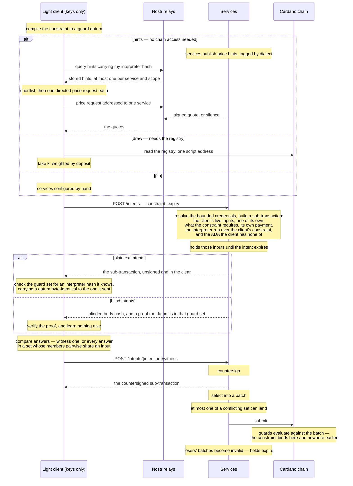

## Abstract

[CIP-0198][] specifies an off-chain mechanism by which a party that can build
a sub-transaction gets it batched and onto the chain. We propose an expansion of this protocol to allow 
light clients with limited access to the UTxO and other chain data to co-construct 
a batchable sub-tx with a service provider. 
The client states what it wants
as a constraint in an expanded version of CIP-0198's constraint
DSL, then a service resolves the client's credentials and builds a sub-transaction
on its behalf, sending it back to the client to sign. The client's
constraint is included in that sub-transaction as a required top-level
guard, ensuring on-chain that the client's intent is satisfied by the constructed 
transaction.

The design proposed here adapts
[Cavefish: Communication-Optimal Light Client Protocol for UTxO Ledgers](https://eprint.iacr.org/2026/217)
to the Dijkstra era of Cardano. Cavefish gives the two-party
light-client/service-provider construction, and the predicate blind
signatures the blind variant rests on.

The base variant of the protocol is executed fully in plaintext, allowing the client
to inspect the transaction body. A further variant is proposed that uses cryptographic
techniques to make it more difficult for the client to force the service provider
to perform unpaid computation.

## Motivation: Why is this CIP necessary?

[CIP-0118][] lets a sub-transaction reach the chain without its author paying
fees or holding ADA, and [CIP-0198][] builds the off-chain layer that finds
someone to carry it. Both still assume an author who can construct a
sub-transaction, which means resolving inputs, which means chain state: an
indexer, a node, or a trusted provider standing in for one.

This limitation excludes clients most likely to hold no Ada, i.e. ones 
with no node, no indexer, no account with a provider. This CIP 
proposes a way for such clients to transact.
That is, it makes possible a trustless wallet that stores only its keys. 
Wallets that do not follow the chain may have an outdated or unverified selection 
of receipts (output references). The decentralized protocol we propose allows them to 
construct a transaction in a trustless exchange requiring minimal communication. 

Adding the functionality we propose here reduces reliance on centralized chain followers,
and brings additional business opportunities to SPs, including allowing those 
already providing off-chain nested tx services to serve an expanded set of clients 
with a bigger variety of needs.

### What this changes

| Component | Change | Why |
|---|---|---|
| [Constraint language](#constraint-language-extensions) | new version: restrictions, an exact output set, a validity window | A client that builds nothing must constrain what the builder *did*, and almost all of that is negative |
| [`net_change`](#constraint-language-extensions) | counts every money-moving field, not just inputs and outputs | One ceiling has to bound every way value can leave, or the ones it misses are unbounded |
| [Interpreter scope](#constraint-language-extensions) | a sub-transaction guard, not a top-level one | A guard that saw the batch would over-constrain every co-participant, and would first have to work out which entry it belongs to |
| [Intent message](#the-intent-message) | new: a constraint plus a reply address and an expiry | An offer carries a built sub-transaction; a client that cannot build one has nothing to put in an offer |
| [Filter keys](#intent-filter-keys) | four new keys, derived from the intent | Services subscribe to the intents they can fill, rather than receiving all and declining most |
| Service profile (CIP-0198, *service profile*) | declares the client models served, the dialects spoken, and the fee | A client cannot otherwise tell whether to ask, or what it will be charged |
| [Rejection reasons](#the-exchange) | new codes, and a refusal may carry a profile | "No" is useless to a client that cannot see why; a profile tells it where to go next |
| [Protocol constants](#protocol-constants) | caps on bound entries and list length, an intent TTL and rate limit | Bounds are flat but not few, and an intent carries no spend input to make it costly |

A blind version of the client is outlined here, but not fully specified or 
prototyped. 

Examples of the constraints a light client writes, the sub-transactions
they produce, and what each costs on-chain are worked through in
[examples.md](./examples.md).


## Specification

This document uses CIP-0198's terms without redefining them:
*sub-transaction*, *top-level transaction*, *batch*, *guard*, *required
top-level guards*, *service*, *registration*, *registry*, *routing key*,
*interest filter*, and *service profile*.

**Intent**  is a constraint expressed as a DSL in a specific version of the 
guard constraint language in CIP-0198, encoded as a datum. If the constraint is 
satisfiable against the current chain state, an SP can build a transaction satisfying 
this constraint, and its satisfaction will be checked on-chain at the time of block 
validation.

**Fillable** a fillable sub-tx is one that can currently be included in the batch, 
if there is interest in doing so. It passes all off-chain checks, its inputs are still 
in the UTxO, its validity interval is not expired, etc. A fillable 
intent is one for which a fillable sub-tx can be constructed. Fillability cannot be 
always be determined, and changes with the ledger state, so we mean "not failing any 
fillability checks which the checking party is capable of performing, for the given 
ledger state at this time".

A **light client** holds its key(s) and no chain state. It is capable of specifying 
an intent. 

**Client capability**

| | Knows | Can build an offer unaided | Can defect |
|---|---|---|---|
| **C0** | its keys | no | no |
| **C1** | its keys and its own receipt history, but not which receipts are still unspent | no | once |
| **C2** | its current UTxO set | yes | — |

C0 and C1 are the target clients. C2 may engage in the protocol, but only in a 
way that wastes a minimal amount of SP's work while gaining nothing to its own benefit,
i.e. it would be easier for this client to build their own transaction than to
waste time querying an SP.

### The intent message

An `intent` travels on either binding. On Binding
A (CIP-0198, *Binding A — HTTPS*) it is the body of an HTTPS `POST /intents`.
On Binding B (CIP-0198, *Binding B — Nostr*) it is an event of kind
`NOSTR_INTENT_KIND` carrying the same bytes, and the reply is an event of
kind `NOSTR_INTENT_REPLY_KIND` addressed to the client's event key — which
is how a client with no reachable HTTPS endpoint, a phone, gets an answer
at all.

**An intent on Binding B is DIRECTED, never broadcast.** It carries exactly
one `p` tag naming the service it is for, and a service ignores one
carrying more or none. One event draws at most one reply, so no intent can
be used to amplify traffic on relays this protocol does not run. That is
also why an intent is addressed only after [hints](#finding-a-service) have
narrowed the field: the whole-market view comes from reading stored events,
which emits nothing.

The response on either binding is a sub-tx missing the LC's signature, and
neither intent nor response is in an envelope. The fully signed
sub-transaction a client gets back is an ordinary offer, which can then be
wrapped in an envelope.

**The Binding B events.** Three, all carrying their payload
base64-encoded (CIP-0198, *Binding B — Nostr*) like every other payload on
this binding.

| | `NOSTR_INTENT_KIND` | `NOSTR_INTENT_REPLY_KIND` | `NOSTR_REGISTRY_MIRROR_KIND` |
|---|---|---|---|
| `content` | the `intent` bytes | the unsigned sub-tx, or a [rejection](#the-exchange) with its cost | registry entries, each a service's registration key and endpoints |
| `tags` | exactly one `p`, the service's event key; one `expiration` within `MAX_INTENT_TTL` | one `e` naming the intent event, one `p` naming the client's key, one `expiration` | a `d` tag identifying the mirror's set, and one `expiration` |
| `pubkey`, `sig` | the client's event key | the service's event key | the mirror operator's key |
| found by | nothing — it is addressed, not published under a topic | the client's subscription on `#e` for its own intent | its kind, across the relays the client pinned |

A service ignores an intent event carrying more than one `p` tag or none,
so no single event can draw more than one reply. The client's event key is
**fresh per intent** and shared with nothing else it does: the intent names
its credentials, so a key reused across intents links them to each other
and to whatever else that key signed.

A mirror event is addressable — a mirror's newest set replaces its last
under the same `d` tag — while the two intent events are ephemeral, since
each is worth delivering only while its counterpart waits.

```cddl
intent =
  #6.121([ intent_version   : uint
         , network_id       : uint
         , interpreter      : hash28           ; the dialect, which IS the version
         , constraint                          ; as under Constraint language
         , offered          : [* asset]        ; what the client will part with
         , needed           : [* asset]        ; what it wants in return
         , response_address : address          ; where value comes back to
         , expiry           : uint             ; POSIX milliseconds
         , top_level        : bool             ; fill as a top-level tx,
                                               ; so no interpreter runs
         ])
```

**A top-level transaction instead.** Setting `top_level` asks the service
to build a complete transaction rather than a sub-transaction. No guard
needs be included, as the client can check satisfaction
[locally](#checking-an-answer-locally), making it a cheaper option.

A valid intent message is such that :
- it deserialises, 
- `network_id` matches, 
- the constraint is within the [shape caps](#protocol-constants), 
- `expiry` within `MAX_INTENT_TTL`, 
- size within `MAX_INTENT_BYTES`, and 
- the credentials its bounds name resolve. 

**Why `offered` and `needed` are useful but not binding.** Both are derivable
from the constraint, however, this is complicated. 
Declaring them lets a service triage
before it evaluates the intent's satisfiability. 

**`response_address`** is where value comes back to, as the client's
address is specified nowhere else. It is the address
`Bounds::output_structure` names as `change_to`, matched whole — so the
staking part of the client's change is pinned by the same clause that closes
the output set.

**`expiry` and `Bounds::valid_within` are different clocks**, and an intent
should set both. `expiry` bounds how long a service may answer, and is capped
by `MAX_INTENT_TTL`; `valid_within` bounds when the resulting batch may land,
and is the only one a guard enforces.

The **`intent_version`** ensures that the intent is correctly interpreted by the SP.

### Finding a service

A light client needs service providers to
address, possibly several (see [multi-SP
protocol](#single-and-multi-sp-protocol-versions)). There are three ways to address SPs, and the 
`broadcast` and `pin` options below do not require up-to-date chain state access :

1. **Draw** Read the registry to choose SPs to send intent to.
2. **Read hints** Query relays for services' price
   hints (CIP-0198, *price hints*) tagged with the client's dialect, then
   send a directed price request (CIP-0198, *price discovery*) to relevant services.
3. **Pin** Services cached locally.

**New service profile filed**
A service must be able to say in its profile (CIP-0198, *service profile*)
whether it answers intents at all and on what terms, or a client cannot tell
before disclosing its credentials. That is a new profile field, and so a
`schema_version` bump in the registration.

**Reading hints.** A hint query is served from relay storage.
The price request that follows goes to one
service each, and the client
dials out over HTTPS to whoever answers.
Services tag their hints with hashes of constraint language guard script 
interpreters they support.
A service offering free fulfilment to a class of
intents advertises that as a scoped hint, 
see [filtering intents](#filtering-intents) and [other payment
options](#other-payment-options).

**A light client cannot verify a hint the usual way.** [CIP-0198][] has a
publisher check a hint's signature against the **live registration** it
names, which needs chain state. A light client has none, so for it hint
verification reduces to the pinned-key case: it can trust a hint from a
service it has pinned out of band, and must otherwise treat one as
unattributed. That is a third reason an LC prefers a directed quote and
cross-checks several, alongside the two under [the
exchange](#the-exchange).

**Bootstrapping: pin a relay set, not a registry.** Discovery rests on
relays, and the registry naming them is on-chain where an LC cannot read
it, so something must be pinned out of band. Not a discovery endpoint: that
makes one party's view the whole market, and a service has no reason to
list its competitors.

A client pins relays instead — it already pins them for
hints (CIP-0198, *price hints*), and treat the union across them as the
market. The registry reaches those relays by **mirroring**: anyone with
chain access republishes its entries as `NOSTR_REGISTRY_MIRROR_KIND`
events, each giving a service's registration key and endpoints. A mirror's
signature says who republished an entry, not that the service is
registered. 

A client additionally needs to pin :
- interpreter hashes it accepts, 
- protocol parameters its fee bounds are computed from, 
- system start and slot length

We treat the last one as a constant, as it changes very rarely. 
The other two get updated at refusal, which 
carries the current service profile.

**Addressing a specific SP on HTTPS.**
A client that knows a service at all is assumed to know its service profile, 
including its filter keys, at least from some prior point in time. 
If a client sends an intent to an SP that does not match its current 
service profile, an SP responds with its updated service profile service.


### The exchange

| Endpoint | What it answers |
|---|---|
| `POST /intents` | Optional. Body is an intent. Answers `{intent_id, subtx}` — an unsigned sub-transaction satisfying the constraint — or a rejection reason (CIP-0198, *Binding A — HTTPS*). |
| `POST /intents/{intent_id}/witness` | Body is the client's witness over that sub-transaction. Answers with the **countersigned sub-transaction**, which the service then batches and submits. |



The countersigned sub-transaction comes back because it is an ordinary
[CIP-0198][] offer, and the client can publish one over Binding
B (CIP-0198, *Binding B — Nostr*) without any chain state. A service that goes
quiet after countersigning therefore costs the client a delay rather than the
whole exchange. The sub-transaction and not the batch, which would disclose
other clients' sub-transactions.

#### Blind vs Plaintext intents

The protocol above includes two versions: a secure (`blind`) version, and a 
simplified (`plaintext`) 
version, which comes with some security trade-offs. The `blind` secure version 
does not allow the LC to inspect the full sub-tx body. This prevents the LC from 
modifying the body in any meaningful way before signing (see LC 
[exposure](#what-the-client-risks-plaintext)).
Instead, the LC only sees the transaction ID (which it signs), and a proof that the 
pre-image body necessarily includes its guard datum, i.e. intent specification. 
The details of the cryptographic implementation of this check are sketched
under [blind intents](#blind-intents), and described in full in
[Cavefish][], which builds it from the predicate blind signatures of
[Fuchsbauer and Wolf][pbs]: a signature the LC issues over a message it has not
seen, together with a proof that the message satisfies a stated predicate — here,
that the body runs the interpreter over its datum.

#### Additional considerations

- When a service replies to an LC, its own
inputs included in the sub-tx should be committed to an answer that may never 
be witnessed, and stay
committed until the intent expires. This is a hold beginning before any batch
exists, where CIP-0198's liquidity rule (CIP-0198, *liquidity strategy*) is
written around batch construction and expires on `FUNDING_HOLD_TTL`. 

- Fee and collateral are supplied by the SP, the client only pays the tip (which 
it obtains by communicating with the SP or inspecting the sub-tx response).

- An SP holds the sub-tx built for the client, i.e. its `intent_id` until `expiry`.
The sub-tx enters the batch-building lifecycle once its returned signed by the client.


### Single and Multi-SP protocol versions

The protocol we propose can be executed as a **single** or a **multi-SP protocol**.

**Single SP**. The LC answers exactly one SP (this may be because of the specific services 
that SP provides, e.g. a DApp subsidy). The protocol completes exactly as stated, 
with no additional considerations. 

**Mutually exclusive responses**. From the set of sub-tx responses an LC receives 
to a given intent `i`, there exists (disjoint) subset(s) of responses such that no two 
sub-txs in a given subset can be posted on-chain simultaneously. We call any set `S`
with this property a set of *mutually exclusive* responses to `i`. `S` is *maximal* when 
no additional response from the full set of responses can be added to it without 
it no longer being mutually exclusive. 

**Multi-SP**. The LC may respond to multiple sub-txs constructed for it by different 
SPs, which we call a *multi-sp* version of the LC protocol. If an LC signs a mutually 
exclusive set of transactions, at most one of the signed txs will be posted on-chain.
In the plaintext version of a multi-SP protocol, mutual exclusivity can be ensured 
by picking all transaction that have pairwise intersecting sets of inputs with other 
transaction in the subset.
In the blinded version of a multi-SP protocol, a mutually exclusive set is necessarily
made up of exactly one sub-tx, as there is no easy way to asses mutual exclusivity 
without access to inputs. 
In a multi-SP protocol, an LC may have different motivations for signing multiple 
transactions in such a set, in particular, ensuring liveness and optimality.

**Liveness**. The more SPs an LC responds to, the more likely one of 
the signed sub-txs will eventually be posted on-chain. There is no way to track 
how many SPs responded with the same `TxId` to sign, so it is not a consideration 
in the blinded multi-SP protocol. In the plaintext multi-SP version, to maximize 
liveness, an LC would sign all sub-txs in the largest possible mutually exclusive set.

**Optimality**. An LC may have a way to compare transactions based on their own 
personal preferences expressed as a function `lc_value : SubTx -> Nat`.
Such a function is **not** applicable in the blinded protocol version, where
only the `TxId` and guard inclusion are visible.
In the plaintext version, an LC may make decisions on which sub-txs to 
sign based on how they choose to define their own `lc_value`. The default 
definition of the `lc_value` function is parametrized by a token (default being 
Ada) and a key, and returns the amount of this token output to that key's address
in the sub-tx's outputs. 

**The default strategy**, balancing optimality and liveness, 
is for an LC is to specify a 
a cutoff (for a specific intent) of the min acceptable value of `lc_value`, 
and respond to the largest mutually exclusive subset of responses that satisfy 
this constraint. This cutoff is expressed as a percent deviation from the maximum 
`lc_value` across all responses, and sub-txs above this cutoff is called *optimal*. 
The LC computes the largest mutually exclusive set containing only optimal 
sub-txs, and responds to SPs by signing all of them.

**Checking exclusivity and optimality**. All checks required to assess 
mutual exclusivity and optimality can be performed without access to current chain 
state.

### Fulfillment strategies

How a service goes about filling an intent is not necessarily transparent 
to the client (only whether it was fulfilled or not by a given sub-tx is).
A service is free to refuse, stating that it is unsatisfiable with no proof.

The default `FulfilmentStrategy` strategy we specify as part of this CIP is: 
— a backtracking search over `AnyOf` branches that checks every
bound against each finished plan, and that is **complete within the [shape
caps](#protocol-constants)**

The existing default strategy is used for input selection here.
If a plan exists inside the resources the
service is willing to commit, it finds one. 

### Filtering intents

#### Intent filter keys

The following additional filter keys apply specifically to intents:

| Key | Meaning |
|---|---|
| `Dialect(interpreter)` | the language the constraint is written for |
| `InvokesScript(hash)` | a `Spends` whose address has a script payment part — spending from a script runs it |
| `PaysToScript(hash)` | a `PayTo` whose address has a script payment part. Paying to a validator does not invoke it: same interaction from the DApp's side, different key |
| `HoldsToken(policy)` | either, naming a UTxO by the token it holds |
| `OfferedPolicy(policy)` | the client parts with the asset: its `net_change` **ceiling** is above zero |
| `NeededPolicy(policy)` | the client receives the asset: its `net_change` **ceiling** is below zero. The ceiling, not the floor — a negative ceiling compels value to arrive, while the floor merely permits it, so only the ceiling states a requirement |
| `DelegatesTo(pool)` | the client's inputs and change output delegate to this pool |

**Carrying filter keys for intents**
Carrying these on Binding B (CIP-0198, *Binding B — Nostr*) needs two Nostr
event kinds beyond `NOSTR_OFFER_KIND`, one for a directed intent and one for
its reply. Both are addressed to a single key rather than published under a
topic, so relays index them by recipient and no key here is a broadcast
address. Relay size and rate limits apply. 

**Misapplied keys.** An SP can check if each of the above keys is applied correctly 
by either doing the required lookups in the ledger state, or inspecting 
the datum. Intents with misapplied keys are dropped.
Nostr relays do not check filter keys.

**Rejection reasons.** A refusal is the only thing a light client learns
from a service that will not act, so each reason names **what to do next**
rather than only what went wrong. A bare "no" leaves an interface with
nothing to say but *try again*, and for half of these reasons trying again
is exactly what will not work.

| Reason | Carries | What the client does next | Retry as-is? |
|---|---|---|---|
| *insufficient-funds* | a value | change their intent or give up | never |
| *script-failed* | script hash (of failing script) | fix intent to ensure script validation | never |
| *misrouted* | — | the declared `offered`/`needed` contradict the constraint, or it arrived under a key the constraint does not derive: correct the message | never |
| *underpriced* | price, maybe ExUnits (if calculated by SP) | raise the ceiling to the reported cost through this service's hint (CIP-0198, *price hints*) | at the new price |
| *terms-changed* | the current profile (CIP-0198, *service profile*) | re-read it and decide again | at the new terms |
| *unsatisfiable* | — | try elsewhere, or relax the constraint | elsewhere |

The **value** in the *insufficient-funds* response indicates, for 
each each asset ID it contains, 
the quantity by which client falls short in the amount of asset with 
that asset ID (added up from all the spending enabled by the intent they 
defined, e.g. from the client's address).

**Retrying.** The client raises its ceiling to the reported fee plus the
value supplied, priced through that service's published
hint (CIP-0198, *price hints*) — its `base` and ladder already carry the
margin, so there is no separate tip to add and no second place a service
states a price.


### Risks 

#### What the client risks (plaintext)

An LC constructs an intent using a third-party UI,
checks that a response sub-tx includes their intent, 
and the ledger guarantees that the sub-tx actually satisfies it.
Because the LC is not expected (or perhaps not even capable) of performing 
additional verifications on the response sub-tx, it is particularly important 
that the intent construction process is clear and reliable, covering 
all relevant edge cases and contingencies. Most notably, the intent 
must be precise about the relocation of tokens it expects across credentials,
including setting `net_change`.

An intent can and should specify additional constraints to prevent things like: 
splitting change across
many outputs to multiply min-UTxO, attaching datums that inflate the sub-tx, etc. 
To further mitigate this, and LC can compare answers from multiple SPs, rejecting 
all but the optimal transactions. For example, this can be done if the SPs respond
with a firm quote, which is already signed under the registration key
and already bounded by `MAX_QUOTE_TTL`. That needs an amendment:
`POST /quote` (CIP-0198, *firm quotes*) describes an offer by its assets,
size and ExUnits estimate, none of which a client holds before the service
has built anything, so either `/quote` takes an intent or `POST /intents`
answers with a quote of its own. 

An LC is exposed to most of the same risks a sub-tx publisher in the the basic 
aggregator model, but may not be capable of cancelling their intent by spending 
their own UTxOs (e.g., if the LC is not aware of their UTxOs).

An intent names the credentials to
draw on, so asking *k* services discloses them to all *k* and links the
client's requests to one another. 

#### What the service risks (plaintext)

A client can take the answer and never return the witness. This may result in wasted work 
for the SP. In addition, it may allow the LC to use this (uncompensated) 
work done by the SP to build a transaction that does what the LC needs, but does not also 
pay the SP for their work. 

**Uncompensated work** is something an SP already does in the nested transactions 
off-chain service layer. For example, `GET /hints`, `GET /interest`,
`GET /profile`, `GET /status` and `POST /quote` are all unauthenticated, all
cost the operator work, and all can be walked away from. An operator willing to
answer those can construct a sub-tx on the same terms, in fact, this already happens 
when giving firm quotes (CIP-0198, *firm quotes*).

**Uncompensated benefitting of the client** A client may take advantage of an SPs 
work done when constructing a sub-tx an SP constructed for them. In particular, 
the LC can construct another (semi-valid) sub-tx containing some of the same inputs
as the original SP, but excluding the SP's inputs and outputs.

This may bring the following advantages to clients with different capabilities:

- **C2** already knows how to construct a (semi-valid) sub-tx, and therefore gains 
  nothing extra from this strategy (here, the SP still does wasted work)

- **C0, C1** may be able to guess what input belongs to the SP, especially if they obtain 
  multiple responses from different SPs, all including their own UTxOs 
  (the rest being the client's). The overlapping inputs in the response sub-txs
  are very likely LC's. Note that rebalancing a transaction with the inputs and 
  outputs of the SP removed is not straightforward to guess, as the LC does not 
  know how much Ada/tokens are contained in each of their UTxOs. For an LC that 
  is capable of doing this without guessing, see the C2 case above. 

**DDoS**. A request whose sole purpose is to create a DDoS attack on the SP 
may come to an SP, and is indistinguishable from a real request. 
The severity of this threat is comparable to the same 
threat in the basic sub-tx batcher model. The structure and mitigation strategies 
for DDoS attacks on a an SP are similar to the basic sub-tx batcher case.
One difference is worth naming: an intent carries no spend input, so the sybil
cost the offer checks (CIP-0198, *stateless checks*)
rest on is absent and rate limiting is the only defence. `POST /quote` has the
same shape and the same absence. It is why an intent goes to a named service
rather than being published openly, where there would be nobody to rate-limit
against.

As a result of responding to an 
intent (likewise, a sub-tx to be batched), an SP may have to hold certain 
UTxOs included in the sub-tx (in the case of replying to an intent) or 
in the batch (in the case of batching a sub-tx). Holding SP UTxOs hostage in 
this way is one of the outcomes of a DDoS attack, which is also indistinguishable 
from a situation where the request (intent or sub-tx) was already fulfilled by 
another SP but not yet posted.

This is also what a client [asking several services at
once](#single-and-multi-sp-protocol-versions) costs: each holds liquidity
against its own answer, and every service that loses the race has built a
batch that is now invalid. They lose the work, never the funds — the same
trade as ordinary offer competition in the off-chain nested transactions
service layer. Two protocol parameters bound it: `MAX_LIVE_OFFERS_PER_UTXO`
is a per-service cap that nothing here exceeds, and `MAX_INTENT_TTL` bounds
how long a hold can last.

Another way a malicious publisher may interfere with SP's operations is by 
sending multiple unfillable requests (or at least requests the responses to which 
the LC does not intend to engage with). This does not hold SP UTxOs hostage, but 
it forces the SP to do an arbitrary amount of wasted work. 
The danger of this threat is also comparable to the situation in the basic sub-tx 
batcher, which also may have to do wasted work on batches that will never be 
completed as a result of bogus requests.

#### Blind intents

A blind intent lets a client be served without disclosing what it is doing.
The client sees one thing: a proof that the preimage of the sub-tx `TxId`
runs the interpreter it named, of the version it named, over the datum it
sent. The guard runs on that datum as part of
validation, so a batch containing the response sub-tx is applied only if it
satisfies the intent — the same guarantee as a plaintext intent, reached
without the client seeing the body. The guard-and-datum proof is a
predicate blind signature [Fuchsbauer and Wolf][pbs], the primitive
[Cavefish][] adapts.

The
client learns nothing from the hash it signs beyond roughly the size of
the transaction; equally, including anything it could use to build the
sub-tx itself, so a service's work cannot be used on-chain 
while depriving it of payment for said work. 
The defection that the plaintext version of the protocol addresses with
[alternate payment options](#other-payment-options) is simply not
available here. A service may still, however, perform fully useless 
uncompensated work: proofs generated for a transaction nobody posts.

Signing blind means the constraint is the client's whole protection, since
it cannot inspect what it signed. An intent that leaves an edge case open
has no second chance to catch it, which raises the value of
[`audit`](#intent-filter-keys) reporting what a constraint does not cover.

A blind intent costs more to post. It carries the full datum, where a
plaintext intent may carry [only the chain
checks](#the-chain-checks-dialect) or none, so the interpreter it runs is
larger — see the [comparison](./examples.md#with-and-without-the-guard-datum).
Moreover, there is additional work the service must perform in the blind version
as compared to the plaintext: it must construct the blind signature.
Thus, a service has a straightforward reason to price them higher.


### Constraint language extensions

Some points about the constraint language changes:

- the interpreter guard ensures that no votes, outputs, certificates, withdrawals,
mints, or guards that are not explicitly specified by the 
corresponding constraints below can be included in the intent-satisfying sub-tx

- `Spends` does not have this restriction. This is in order to allow an arbitrary 
SP to respond to the client's intent and include their own input in the inputs set

- an intent is a guard of its own sub-transaction, not a top-level guard. This ensures 
its constraints cannot be violated by placing it in a certain kind of batch.  

- A constraint may require, through `Guards`,
a second guard that *is* top-level and does see the batch — possibly in
another version of this language, or another language.

| Code name | Constraint | Holds when |
|---|---|---|
| `Bounds::net_change(list of (asset, min, max))` | imbalance, two-sided | `inputs + mint + withdrawals − outputs − withheld` lies within `[min, max]` for each asset |
| `Bounds::valid_within(not_before, not_after)` | validity window | the validity interval lies within the two, either end optional. Without it a signed sub-transaction is an open-ended option, and a light client cannot cancel |
| `Bounds::output_structure(change_to)` | the whole output set | exactly one output at `change_to` holding everything unaccounted for, and exactly one per `PayTo` **naming an address**. That is every output there may be — a `PayTo` naming an account creates none, and the SP takes none here, being paid by the imbalance. Addresses are matched on their exact bytes, staking part included, so this also pins where the client's stake goes and no separate staking bound is needed |
| `Restriction::CertificatesOnly(certificates)` | certificates | the sub-tx's certificates are exactly these. **Empty forbids all** |
| `Restriction::WithdrawalsOnly(credentials)` | withdrawals | every withdrawal names a reward account in the list. **Empty forbids all**, except the interpreter's own account: the guard runs as a zero-withdrawal from it, so an allowlist excluding it would forbid its own enforcement |
| `Restriction::MintOnly(mint)` | minting | the sub-tx's mint field is exactly this — asset and quantity, negative to burn. **Empty forbids all** |
| `Restriction::VotesOnly(credentials)` | governance votes | every vote is cast by a voter in the list. **Empty forbids all.** The only thing a sub-tx can do with the client's authority that moves no value, so no `net_change` ceiling can see it |
| `Requirement::PayTo(payee, asset, amount, datum)` | a payment | exactly `amount` of `asset` reaches `payee`: an **address**, matched on its exact bytes, or an **account**, credited by direct deposit. A `datum` applies only to an address, an account having none |
| `Requirement::AcntWdrls(credential)` | spending from an account | the sub-transaction withdraws from that account. Excludes signature witnesses (client  is expected to provide those) |
| `Requirement::Spends(selector)` | names a UTxO | the sub-transaction consumes an input matching a [`Selector`](#selector). Existential, never exhaustive: it says nothing about inputs it does not name, so a service may add its own. Excludes signature witnesses (client  is expected to provide those) |
| `Requirement::TopGuards(credential, maybe datum, maybe redeemer)` | top-level guard | `credential` can be script (then `datum` and `redeemer` are required), or a public key hash that must sign |

**`withheld`** is every lovelace leaving without becoming an output: certificate 
deposits net of refunds, direct deposits, proposal deposits and the treasury donation. 
The ledger's value equation minus the fee, which the top-level pays. 
Positive amount is what the 
batch absorbs, which pays the SP, negative is what it must supply. 

**CDDL**

Constructor alternative *n* encodes as CBOR tag `121 + n`. Appending a
constructor is a new language version, which is a new interpreter hash; a
decoder meeting a tag it does not know EXCLUDES the intent rather than
defaulting.

```cddl
constraint       = #6.121([bounds, requirement])

bounds           = #6.121([ maybe<ex_units>
                          , maybe<uint>              ; tx_size
                          , [* net_change]
                          , maybe<valid_within>
                          , maybe<output_structure>
                          , [* restriction]
                          ])

ex_units         = #6.121([uint, uint])              ; mem, steps
net_change       = #6.121([asset, maybe<int>, maybe<int>])    ; min, max
valid_within     = #6.121([maybe<uint>, maybe<uint>])         ; POSIX ms
output_structure = #6.121([bytes])                   ; change_to

restriction      = #6.121([[* certificate]])         ; CertificatesOnly, exact
                 / #6.122([[* credential]])          ; WithdrawalsOnly, allowlist
                 / #6.123([[* mint_entry]])          ; MintOnly, exact
                 / #6.124([[* credential]])          ; VotesOnly, allowlist

mint_entry       = #6.121([asset, int])              ; negative to burn

certificate      = #6.121([credential])              ; register stake
                 / #6.122([credential])              ; unregister stake
                 / #6.123([credential, hash28])      ; delegate to a pool
                 / #6.124([credential, credential])  ; delegate vote to a DRep

requirement      = #6.121([payee, asset, uint, maybe<datum>])  ; PayTo
                 / #6.122([credential])                        ; Guards
                 / #6.123([[* requirement]])                   ; All
                 / #6.124([[* requirement]])                   ; AnyOf
                 / #6.125([])                                  ; no requirement
                 / #6.126([selector])                          ; Spends
                 / #6.127([credential])                        ; AcntWdrls

payee            = #6.121([bytes])                   ; an address
                 / #6.122([credential])              ; an account

credential       = #6.121([hash28])                  ; key
                 / #6.122([hash28])                  ; script
asset            = #6.121([])                        ; ada
                 / #6.122([bytes, bytes])            ; policy, name
datum            = #6.121([bytes])                   ; the serialised datum
                 / #6.122([hash32])                  ; or just its hash
maybe<a>         = #6.121([]) / #6.122([a])          ; absent first
```

**Well-formedness.** A decoder MUST refuse, not repair:

1. **Keyed lists must be sorted, and unique by key** 
2. **No bound states an empty range.** 
3. **The [shape caps](#protocol-constants) hold.**

`maybe<>` puts ABSENT at alternative 0. That is PlutusTx's `Maybe` and the
opposite of Aiken's `Option`, which puts `Some` there.

**How the SP is paid.** 

1. **Out of the imbalance.** The client leaves some asset's `net_change`
   ceiling above zero without additional constraints on it.
   The SP takes the difference in its own
   sub-transaction. This is the route for broadcast and for multi-SP, where the
   client does not yet know who will answer.
2. **An explicit `PayTo`.** The client reads the address and fee off the
   profile and names them. Paying to an SP's account is cheaper for the 
   client, and does not require min-UTxO coverage. 
   The SP then checks its payment is present. 
   `output_structure` includes it like any other
   payment.

The SP states its fee in its published hints (CIP-0198, *price hints*):
a `base` and a ladder per asset pair, which already carry its margin, so
there is no separate tip and no second place a price is stated. A third
route is for the SP not to be paid at all: see [other payment
options](#other-payment-options).

**A light client cannot price itself from hints alone.** 
An LC sets a ceiling with room in it and lets the service correct it.
That is what the measured [*underpriced*](#the-exchange) refusal is for.
A quote
asked for in advance does the same thing a round earlier, at the cost of a
round.

#### Other payment options

A service may not require a payment from the LC 
in the form of tokens, instead the may filter LC queries they answer based 
on the following constraints:

| Model | Status | [Filter keys](#intent-filter-keys) | How checked |
|---|---|---|---|
| DApp subsidy | expressible | `InvokesScript(validator)`, `PaysToScript(validator)`, `HoldsToken(beacon)` — the three together are the rule in full | Any intent *spending from* or *paying to* the DApp is filled free. Both name the DApp by script credential or by its token, so the service scans the constraint's `Spends` and `PayTo` for its own |
| Delegators only | expressible | `DelegatesTo(pool)` — one key, declared by the client and verified on arrival | The spent UTxOs at the client's credentials delegate to the pool, and the client's change output delegates to it too. The service resolves those credentials anyway, so the check is free |
| Fee folded into the rate | expressible | `OfferedPolicy(asset)`, `NeededPolicy(asset)` | The service fills intents carrying those keys for free, taking its margin in the exchange rate |

Note that delegation to a service gets a client a free intent fulfillment in the **future**, 
when the client decides to spend the UTxOs delegating to the specific pool. It is 
difficult to enforce as a constraint on delegating outputs. 

The above alternative payment options mitigate the possibility of a client 
making use of uncompensated work.
Moreover, each option also restores repeat play, which an anonymous defector 
otherwise escapes.

#### The chain-checks dialect

**The guard script and datum in plaintext vs blind intents** 
In the blind protocol version, the guard datum (and associated guard 
interpreter script) are always required. 
A plaintext intent, on the other hand, requires the inclusion into 
the sub-tx filling its intent a datum that specifies only the features 
of a sub-tx that cannot be checked off-chain (i.e. checks requiring resolved 
inputs). A special simplified interpreter guard script is also used in this 
case.

**Two clauses** cannot be checked off-chain from a sub-tx alone, including 
more than one of these implies conjunction between them:

| Clause | Why the body is not enough |
|---|---|
| `net_change` | needs the VALUE of every (resolved) input |
| `Spends` | needs their ADDRESSES |

`AcntWdrls` is not among them. A withdrawal names its account **in** the
body, where an input names only a reference the client cannot resolve, so
it is the client's to check.

So we define a second, smaller script-interpreted language for interpreting exactly 
those constraints (a subset of the above constraint language). 

```cddl
chain_checks = #6.121([ [* net_change]
                      , [* selector]      ; Spends
                      ])
```

Note that accounts are excluded in the dialect's `Spends`, since 
the LC is fully aware of the amounts its spending fom them. 

#### Checking an answer locally

**Ensuring on- and off-chain check consistency**
The LC specifies a constraint in the full intent language, then
`ChainChecks::of` reduces a full constraint to this datum, and
`babel intent reduce` writes it. At this point, the language version 
(i.e. guard script hash) and the datum hash (hashed reduced intent) 
are fixed, so upon receiving a sub-tx, the client can check that 
in addition to satisfying the full set of intent constraints, the sub-tx 
carries that exact datum under that exact script hash. 
`babel_intent::verify` is that checker, and `babel intent verify` drives it.

**Top-level transactions**. The checks the client performs on the transaction 
body of a top-level intent-satisfying transaction are sufficient 
to ensure that the transaction the SP has built fully satisfies the LC's intent. 
The guarantees that cannot be checked locally for a sub-tx, and are 
instead checked by a simplified [on-chain guard](#the-chain-checks-dialect), 
are no longer necessary for a top-level-tx:
- the net change is always zero
- the destination of all assets moved by the transaction is fully specified 
(by outputs, account payments, certificates, etc.), and the source is limited to 
the script witnesses and keys willing to sign the transaction (including the 
client's and SP's)

**Bounds need shape caps.**  Two caps added in
[Protocol constants](#protocol-constants) — one on total entries, one the 
length of a list (for bounds that take a list as a parameter, e.g. `net_change`,
`MintOnly`).

`ex_units` and `tx_size` stay service-enforced, and the SP is responsible 
for the resulting fee. 

[**Measured per example**](./examples.md#with-and-without-the-guard-datum).

#### Selector

A selector is used to indicate which UTxOs are allowed to be spend by the transactions.
The UTxOs can be specified (in the selector) by narrowing the following:

| Narrowing | Holds when |
|---|---|
| **address** | the UTxO's address equals these bytes, payment and staking.  |
| **payment credential** | the UTxO's payment credential equals it; the staking part is not compared |
| **assetID** | the UTxO holds a non-zero quantity of it, intended for use for contract state token NFTs |
| **datum** | the UTxO carries this datum. The author writes either the datum or its Blake2b-256 **hash**, whichever is shorter, and the output may hold either — all four pairings naming the same datum match |

**Admissible combinations.** These are the type, not a rule written beside
it, so a selector naming nothing cannot be written:

| | no datum | with datum |
|---|---|---|
| address | ✓ | ✓ |
| credential | ✓ | ✓ |
| assetID | ✓ | ✓ |
| address + assetID | ✓ | ✓ |
| credential + assetID | ✓ | ✓ |

**CDDL**

```cddl
place    = #6.121([bytes])                          ; address, exactly
         / #6.122([credential])                     ; payment credential

selector = #6.121([place, maybe<asset>, maybe<datum>])   ; at a place
         / #6.122([asset, maybe<datum>])                 ; wherever it is
```

`datum` is defined under [the constraint
language](#constraint-language-extensions): either the datum or its hash,
and the two match the same UTxOs.

A selector that names a script credential or a beacon policy yields a
[filter key](#intent-filter-keys).

### Protocol constants

Additions to [CIP-0198][]'s set. `MAX_INTENT_TTL` is capped by
`MAX_QUOTE_TTL`: both bound how long a service is exposed to terms it has
already quoted.

| Code name | Constant | Value | Basis |
|---|---|---|---|
| `MAX_INTENT_BYTES` | Size in bytes of the largest intent | TBD | An intent is a constraint, two asset lists, an address, an interpreter hash and three integers, so it is smaller than an offer |
| `MAX_BOUND_ENTRIES` | Keyed bound entries one constraint may carry | Proposed `64` | Each is re-checked against every input or output, so the list length is a cost multiplier. Joins the shape caps (CIP-0198, *protocol constants*), which currently cover only the requirement tree |
| `MAX_BOUND_LIST_LENGTH` | Entries in a list a single bound takes | Proposed `32` | The same cost, inside a bound rather than across them |
| `MAX_INTENT_TTL` | Furthest ahead an intent may set its `expiry` | TBD, at most `MAX_QUOTE_TTL` | The service resolves inputs in order to answer, so an intent outliving that resolution is answered against state that has moved |
| `INTENTS_PER_MINUTE` | Intents a service answers one requester per minute | Not announced | Each costs a resolution and a build, and an unreturned witness costs the whole of it |
| `NOSTR_INTENT_KIND` | Nostr event kind carrying a directed intent | TBD, an ephemeral kind per [NIP-01][] | An intent is worth answering only while its client waits, so relays need not store it. No routing-key kind is needed: it is addressed by `p` tag, not published under a topic |
| `NOSTR_INTENT_REPLY_KIND` | Nostr event kind carrying the sub-transaction a service returns | TBD, an ephemeral kind | The same, for the reply — which is how a client with no reachable HTTPS endpoint receives one |
| `NOSTR_REGISTRY_MIRROR_KIND` | Nostr event kind carrying mirrored registry entries | TBD, an addressable kind | A [light client cannot read the registry](#finding-a-service); a mirror lets it learn which keys to believe hints from. Addressable, so a mirror's newest set replaces its last |

## Rationale: How does this CIP achieve its goals?

We outlined the full set of changes necessary for the infrastructure proposed 
for the off-chain nested transactions service layer to additionally support 
intent satisfaction.

### Why these changes, in one line each

- [Restrictions and the closed output set](#constraint-language-extensions):
  a client that builds nothing can only be protected by bounding what the
  builder did.
- [The full value equation](#constraint-language-extensions): a ceiling that
  missed a field would leave that field unbounded.
- [Sub-transaction scope](#constraint-language-extensions): the weakest
  assumption that makes every clause hold under batching.
- [The intent message](#the-intent-message): an offer carries a built body,
  and this client has none to carry.
- [Intent filter keys](#intent-filter-keys): derived from the constraint, so
  a relay cannot be told one thing and a service another.
- [Two payment routes](#constraint-language-extensions): the imbalance needs
  no address, so a client can price before it knows who will answer; an
  explicit payment is checkable by the SP for free.
- [Protocol constants](#protocol-constants): an intent carries no spend
  input, so nothing else makes asking costly.

**Pluggability**
In the reference implementation, the `IntentLanguage` and the
`FulfilmentStrategy` traits can be easily swapped out for other ones. 
The tests substitute an unrelated toy language
and a second strategy to keep the claim honest.

### Open questions

- Finish blind protocol version specification.
- Whether a BLIND intent can bound direct deposits (body field 25). A
  plaintext client reads them off the body, and a `CertificatesOnly` naming
  a stake certificate means the deposit-carrying Conway form, so the
  remaining gap is blind intents alone. Settle before deploying that
  variant.

## Path to Active

### Acceptance Criteria

- [ ] [CIP-0198][] is Active with the amendments this document names merged.
- [ ] Both interpreters are audited and agree with the off-chain evaluator on
      published conformance vectors.
- [ ] A keys-only client transacts end to end on a public network, with the
      constraint enforced by the guard rather than by good behaviour.
- [ ] That client, having witnessed a pairwise-conflicting set of answers,
      sees exactly one land.
- [ ] Two independent implementations interoperate: one's client, the other's
      service.
- [ ] [Blind intents](#blind-intents) are specified or withdrawn.

### Implementation Plan

- [x] Client side: compile a constraint, check the returned guard set,
      partition conflicting answers (`babel-intent`, driven by `babel intent`).
- [x] Encoder, decoder and off-chain evaluator, with vectors pinning the tags
      and one test per exposure (`babel-intent`).
- [x] The intent message, with filter keys derived rather than declared
      (`message`).
- [x] The [substitution](#rationale-how-does-this-cip-achieve-its-goals) interfaces, exercised by an
      unrelated second language in the tests (`language`).
- [x] The [local checker](#checking-an-answer-locally), its arithmetic pinned
      by test to the canonical imbalance (`verify`).
- [x] The [chain-checks dialect](#the-chain-checks-dialect) and the client's
      guard-set check (`chain_checks`, `verify::check_guard`).
- [ ] `POST /intents` and `POST /intents/{intent_id}/witness`, optional for a
      service so that absence is conformant.
- [ ] The constraint-to-sub-transaction build: resolve, satisfy, respect every
      bound, carry the datum into the guards.
- [ ] **Both on-chain interpreters.** Nothing is enforced against an
      unchecking client until they exist.
- [ ] Body accessors for withdrawal accounts, certificates and voters, so the
      restriction clauses become locally decidable.
- [ ] Broadcast discovery: the routing-key and event kinds, and whether public
      relays will carry the traffic.
- [ ] A normative CDDL for the language, and the constants, once both settle.
- [ ] A predicate blind signature scheme, or withdrawal of the variant.

## Versioning

Two things in this document carry a version, each travelling with what it
versions:

- `intent_version`, the software version for filling intents;
- the interpreter script hash;

A party meeting a version it does not recognise declines, as it does in
CIP-0198. A client cannot tell before asking which interpreters a service
satisfies unless it reads the registry, which is the discovery problem
[Finding a service](#finding-a-service) addresses.

## References

- [CIP-0198][] "Nested Transactions - Service Layer" — the service layer this
  document extends; source of the constraint language, the registry, the
  service profile, Binding A and Binding B.
- [CIP-0118][] "Nested Transactions" — the ledger feature underneath both;
  source of sub-transactions, guards, required top-level guards, and
  `NoOverlappingSpendInputs`, on which the multi-SP signing rule depends.
- *Cavefish: Communication-Optimal Light Client Protocol for UTxO Ledgers*.
  Kiayias, Roeschlin, Vinogradova and Chaidos. IACR ePrint 2026/217,
  <https://eprint.iacr.org/2026/217>. Light-client intent fulfilment with blind-signed,
  input-hidden transactions; the design [blind intents](#blind-intents)
  reduces to a single predicate.
- Fuchsbauer and Wolf. *Predicate Blind Signatures*. Eurocrypt 2024. The
  primitive Cavefish adapts, and the one blind intents would need.
- [Tx3][] — transaction description language. A build language rather than a
  predicate language, mined here for the vocabulary of what a transaction has
  to be able to say.

[CIP-0118]: https://cips.cardano.org/cip/CIP-0118
[CIP-0198]: ../CIP-0198/README.md
[Cavefish]: https://eprint.iacr.org/2026/217
[pbs]: #references
[NIP-01]: https://github.com/nostr-protocol/nips/blob/master/01.md
[Tx3]: https://docs.txpipe.io/tx3
[RFC 2119]: https://www.rfc-editor.org/rfc/rfc2119
[RFC 8174]: https://www.rfc-editor.org/rfc/rfc8174

## Copyright

This CIP is licensed under [CC-BY-4.0][].

[CC-BY-4.0]: https://creativecommons.org/licenses/by/4.0/legalcode
