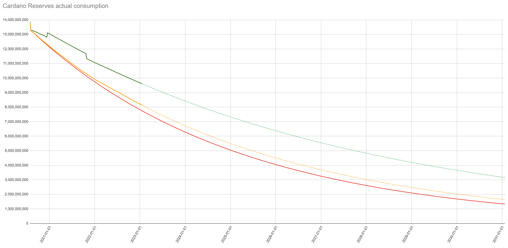

## Abstract

Cardano’s reward rules leave rewards unallocated when stake is inactive, exceeds a pool’s reward saturation cap, or belongs to a pool that fails its declared-pledge check. This CIP redistributes that reward capacity among eligible pools using their capped reward weights, rather than returning it to the reserves. The cap continues to constrain each pool’s relative reward weight, while changes to the saturation cap (stakePoolTargetNum or maxPledgeLeverage parameters) can shift rewards toward pools less constrained by those caps.

## Motivation: Why is this CIP necessary?

Many users interpret staking rewards as akin to bank interest. If that were the intent, the ledger would not need operator selection, delegation, or performance‑based rewards. Yield could simply accrue automatically. In Cardano, **staking is voluntary and active**. It is how the protocol decides who gets to make blocks, and rewards compensate the combination of (a) **committing stake** to secure the network and (b) **selecting and monitoring** a competent, honest operator. "On a high level, the goal of the incentives mechanism is to incentivize stakeholders to follow the protocol and thereby to guarantee the secure and efficient operation of Cardano" (SL‑D5 §5.1)

Redistributing rewards associated with inactive and capped-out stake provides two participation incentives: higher rewards can encourage delegation to return when stake becomes inactive, and tighter reward caps can shift payouts toward less-saturated pools instead of sending the saturation-related shortfall to reserves. This makes parameter changes that affect pool saturation caps (stakePoolTargetNum or maxPledgeLeverage) much more responsive by incentivizing delegators to move quickly to take advantage of dynamic rewards.

## Specification

### Current behavior (for context)

The maximum pool reward function uses pool stake and declared pledge relative to total stake. It caps reward-bearing stake at the applicable saturation limit. Actual pool rewards also depend on meeting declared pledge and observed block production. Unallocated residual rewards return to reserves under the reward-update rules (SL-D5 §11.10).

Inactive stake, reward-bearing stake capped by stakePoolTargetNum or maxPledgeLeverage, failed declared pledge, and the pledge-dependent reward term are distinct contributors to that residual. This CIP redistributes the reward capacity excluded by the first three while retaining the pledge-dependent reward term and the zero-reward outcome for a pool that fails its declared-pledge check.

### How to read the reward calculation

The calculation separates account eligibility, pool reward weights, and final payments:

| Part | Rule |
| --- | --- |
| Account eligibility | Use the prevailing ledger rules to determine which accounts contribute stake to the rewards snapshot. |
| Pool reward weight | For a pool that meets its declared pledge, multiply its capped stake by its existing block-performance multiplier. A failed-pledge pool contributes zero weight. |
| Final pool payment | Scale the existing pledge-dependent maximum reward by one common factor, then apply the existing performance, rounding, and pool allocation rules. |

“Normalized” means expressing the pool reward weights as proportions of their total. Those proportions sum to one before each recipient's retained pledge-dependent reduction. They describe shares of reward capacity but do not guarantee that the entire pot is paid out.

### Capped reward weights

Use the same rewards snapshot, protocol parameters, and observed block counts as the existing reward calculation. Define:

- $R$: the pot supplied to the pool reward calculation, after the existing monetary-expansion adjustment for network-wide block production, addition of fees, and treasury cut. The production adjustment applies to monetary expansion, not to fees.
- $S$: the existing total-stake denominator; $A$: the existing total active stake; $\alpha=A/S$.
- $\sigma_i$: pool $i$'s total stake divided by $S$; $s_i$: its declared pledge divided by $S$; $z_0=1/k$.
- $c_i$: the pool's reward-bearing capped stake, expressed relative to $S$.
- $\pi_i$: the existing apparent-performance multiplier, with $\pi_i=0$ for a pool that produced no blocks.

If $S=0$, $A=0$, or $R=0$, distribute no pool rewards and retain the existing final accounting rules. Do not evaluate ratios with a zero denominator.

The symbols k and L below refer to the saturation parameters named `stakePoolTargetNum` and `maxPledgeLeverage`, respectively. Use valid inputs: $a_0\ge0$, a positive integer k, and $0\le A\le S$ and $1\le L\le10{,}000$ for L.  The lower bound for L is necessary for the nonnegative reward expression and budget proof below. An implementation must enforce that bound when enabling this cap.

For the consensus calculation, express $R$, $B_i$, and subsequent reward amounts in lovelace; unrounded amounts are rational lovelace. The examples below explicitly convert to ADA for display.

Under the existing k and L caps:

$$
c_i=\min(\sigma_i,z_0,Ls_i).
$$

An oversaturated pool's entire delegated stake can still contribute to leader election, while only its capped portion enters the reward expression.

Let $E$ be the set of registered pools in the rewards snapshot that pass the existing declared-pledge check. Let the common normalization denominator be:

$$
N=\sum_{j\in E} \pi_j c_j.
$$

Exclude pools that fail their declared-pledge check from $N$, as well as giving them zero rewards. This makes their excluded reward capacity available to the remaining eligible pools. Do not include the pledge bonus or the full pool reward entitlement in $N$.

Each term $\pi_i c_i$ is a pool reward weight; its normalized share is $\pi_i c_i/N$. Because all $c_i$ values use the same total-stake denominator $S$, their relative weights can also be understood using capped ADA amounts. With performance multipliers of one, pools capped at 50 ADA and 20 ADA share reward capacity in the ratio 50:20, or approximately 71.43% and 28.57%. A pool that fails its declared pledge adds zero to both the allocation and its denominator.

Use the existing observed-performance multiplier in this denominator as well as in the payment calculation. That multiplier can exceed one when a pool produces more blocks than its stake would predict. Normalizing only capped stake and then applying performance could therefore exceed the pot. Including the same performance adjustment in $N$ keeps the common payout budget consistent, including epochs with very uneven production. Compute $N$ with exact arithmetic before rounding individual rewards.

### Normalized rewards

The new scaling factor is $1/N$, shared by every eligible pool for this rewards snapshot. Each pool keeps its own pledge-dependent reward expression.

Let $B_i$ be the existing unrounded maximum pool reward before its performance multiplier. Apply the existing declared-pledge check: if it fails, set $B_i=0$. For a pool that meets its pledge, retain the existing reward expression, including its `1 + a₀` denominator. In the Shelley formula, with $s'_i=\min(s_i,z_0)$:

$$
B_i=\frac{R}{1+a_0}\left(
c_i+s'_ia_0\frac{c_i-s'_i\frac{z_0-c_i}{z_0}}{z_0}
\right).
$$

For $N>0$, replace the unrounded maximum by:

$$
\widehat B_i=\frac{B_i}{N}.
$$

Then apply the existing maximum-reward coin rounding, the existing performance multiplier $\pi_i$, and the existing pool reward allocation and rounding rules. Specifically, the integer pool pot before operator and member allocation is:

$$
P_i=\left\lfloor\pi_i\left\lfloor\frac{B_i}{N}\right\rfloor\right\rfloor.
$$

Both floors operate on lovelace amounts. Performance is applied once to the pool payment; its use in $N$ determines the common scaling factor. Scale the unrounded maximum rather than an already rounded pool or delegator payment. Before rounding, the pool reward is therefore:

$$
Q_i=\frac{\pi_i B_i}{N}.
$$

All eligible pools can receive normalized rewards, including oversaturated pools through their capped weights. The cap applies to the pool as a whole. It does not identify particular delegators as being above the cap. All eligible delegators in that pool share the resulting payment under the existing allocation rules. Additional stake above the cap does not increase the pool's capped stake and spreads the resulting payment over more stake. Pool costs and margins are unchanged.

A failed declared pledge still gives zero pool rewards. Its weight is excluded from $N$, so the remaining eligible pools share the available reward capacity under their own retained pledge terms. This does not guarantee that the additional payout equals the failed pool's hypothetical reward: each recipient's pledge-dependent reduction still applies. If $N=0$, including when every block-producing pool fails its declared pledge or has zero capped weight, distribute no pool rewards and retain the existing residual-return behavior. Never divide by zero.

This changes where the reward capacity associated with inactive stake, capped-out stake, and failed-pledge pools goes: it increases normalized rewards for eligible pools instead of being reserved for excluded weights. The recipients' pledge-dependent reductions remain. The residual $\Delta r_2$ and final accounting rules are retained, including the existing treatment of rounding and unregistered reward accounts.

### Budget and limiting cases

For an eligible pool with $R>0$ and $c_i>0$, define $h_i=B_i/(Rc_i)$; take $h_i=0$ otherwise. This is algebraic shorthand for the retained pledge-dependent expression, not an additional ledger field or calculation. A fulfilled pledge and, when enabled, $L\ge1$ imply $0\le s'_i\le c_i\le z_0$. Consequently the pledge bonus inside the parentheses defining $B_i$ lies between zero and $a_0c_i$, giving $1/(1+a_0)\le h_i\le1$. The allocation can be written:

$$
Q_i=R\left(\frac{\pi_i c_i}{N}\right)h_i.
$$

The weights $\pi_i c_i/N$ over $i\in E$ sum to one when $N>0$; pools outside $E$ receive zero. Therefore:

$$
\frac{R}{1+a_0}\le\sum_{i\in E}Q_i\le R.
$$

These bounds apply before coin rounding and account allocation. At $a_0=0.3$, the unrounded allocation is between approximately 76.9231% and 100% of $R$; the remaining pledge-dependent portion is between zero and approximately 23.0769%. Rounding and omitted account payments can further reduce the final amount credited, so the lower bound does not apply to final payments. The existing nonnegative rounding and allocation rules cannot increase the upper bound. Unallocated rewards return through the existing final accounting.

For a snapshot with recorded blocks, under the current performance rule, $\pi_i=\beta_i/(\sigma_i/\alpha)$ for a positive-stake block-producing pool, where $\beta_i$ is its share of all blocks actually produced. Thus:

$$
N=\alpha\sum_{i\in E:\,\sigma_i>0}\beta_i\frac{c_i}{\sigma_i},\qquad 0\le N\le\alpha\le1.
$$

If no cap binds for these pools, $N=\alpha\sum_{i\in E:\,\sigma_i>0}\beta_i$. When every recorded block comes from a positive-stake pool represented in $E$, their block shares sum to one, giving $N=\alpha$ and inverse-active-stake normalization. With active stake also at 100%, $N=1$ and current rewards, including their rounding, are unchanged. The identity needs all these conditions: blocks from failed-pledge pools or producers absent from the rewards snapshot do not enter $N$. With oversaturated pools, $N$ reflects the capped weights, so saturation-related capacity is redistributed even when all stake is active.

This is not normalization by $\sum_i B_i$. It does not force total payouts to $R$ or to $R/(1+a_0)$ independently of the retained pledge term. It adds no protocol parameter and does not change governance voting power.

### Ledger integration

The additional consensus calculation is one common denominator $N$ per rewards snapshot and the scaling of each eligible pool's unrounded maximum by $1/N$. Its inputs are the pool stake, applicable caps, pledge-fulfillment check, and observed block performance already used by the reward calculation. The weights are derived values for that snapshot.

Compute $N$ before finalizing pool rewards, then reuse the existing pool-to-delegator allocation. A ledger implementation must preserve the specified rounding order and demonstrate that exact aggregation fits within the existing staged reward-calculation window. The arithmetic budget proof does not establish that implementation cost.

### Pledge terminology

- **Unmet declared pledge** means the pool owners' eligible stake delegated to their pool is less than the pledge declared in the pool registration. Under the existing pledge-fulfillment check, such a pool receives no pool rewards even if it produces blocks. This is an eligibility failure, not a description of a pool that declares a low pledge and meets it.
- **Unpledged delegated stake** is stake delegated to a pool that is not part of the owners' pledge. It still contributes to the pool's stake and can earn delegation rewards; its presence does not mean that the pool's declared pledge is unmet.
- **Rewards forgone through lower pledge** are the additional rewards a pool could have earned with a larger, fulfilled pledge under the pledge-dependent reward formula. These are distinct from rewards withheld because the pool fails to meet its declared pledge.

For example, a pool with 75M ADA in total stake and a declared, fulfilled pledge of 5M ADA has 70M ADA of unpledged delegated stake. It meets its pledge. The rewards it could earn by pledging more are a separate matter from failing the declared-pledge check. The 70M ADA should not be described as an "unmet pledge," nor should all rewards attributable to that delegated stake be described as returning to reserves.

The retained pledge-dependent reduction depends jointly on pool size, declared pledge, and the applicable cap rather than a fixed percentage of unpledged ADA. Retaining this expression does not assert that increasing pledge strictly increases rewards at every unsaturated pool size.

The [ledger's pledge-fulfillment check](https://github.com/IntersectMBO/cardano-ledger/blob/d6eec237df7884aa7ee9854b4b1a83679d9eb99b/eras/shelley/impl/src/Cardano/Ledger/Shelley/Rewards.hs) and [pledge-dependent maximum reward function](https://github.com/IntersectMBO/cardano-ledger/blob/d6eec237df7884aa7ee9854b4b1a83679d9eb99b/libs/cardano-ledger-core/src/Cardano/Ledger/State/SnapShots.hs) implement these two different concepts. This CIP retains the pledge-dependent reward expression and zero rewards for a failed declaration, while excluding failed-pledge pools from the redistribution weights.

## Rationale: How does this CIP achieve its goals?

- **Responsive yields.** Inactive and capped-out stake no longer reduces the allocation budget merely by contributing no reward weight. Normalization raises rewards for participating capped weights, providing an incentive for delegation to return or move to a pool offering a better reward per ADA.
- **Support for saturation changes.** When increasing k, or decreasing an adopted CIP-50 L, reduces some pools' capped weights relative to others, normalization shifts reward capacity toward the less-constrained pools. If all performance-adjusted capped weights change by the same proportion, their normalized shares stay unchanged. Final payments also depend on the retained pledge term. Oversaturated pools can still share through their below-cap portion.
- **Pledge incentives preserved.** The existing pledge-dependent expression and its `1 + a₀` denominator remain. A low but fulfilled pledge is distinct from a failed declaration, and neither is erased by normalizing the full reward entitlements to a predetermined total payout.

### Option to adjust Rho

Redistributing reward capacity associated with inactive stake, capped-out stake, and failed-pledge pools reduces the corresponding return to reserves. With Rho unchanged, reserves deplete faster by the extra amount paid out. The recipients' retained pledge terms and existing final accounting can still leave residual returns. If no eligible pool has positive normalization weight, no pool rewards are paid. The network-wide production adjustment remains in place before the rewards pot is formed. If the community prefers to preserve its current rate of emissions, it can reduce Rho through a separate governance action, trading away some or all of the yield uplift. This CIP leaves that choice and any new Rho value out of scope.

### Prior rationale and revised censorship assessment

The Shelley-era design explicitly worried about an incentive for large pools to **censor delegation certificates** if rewards were distributed in ways that made existing actors worse off when new delegations appeared. To mitigate this, the specification chose (a) to normalize reward shares by **total stake** rather than active stake so that new delegations do not dilute incumbents’ proportional rewards. Also, (b) to send **undistributed** rewards back to reserves. See *Shelley Delegation & Incentives Design Spec.*, SL‑D1 v1.21 (2020‑07‑23), §5.5.1 “Relative Stake: Active vs Total” (p. 35), and change log rev. 17 (“undistributed rewards go to the reserves”). The spec also anticipated concerns about pools rejecting or disadvantaging delegation transactions (Appendix D.2, p. 52).

**Why this is acceptable to revisit now.** Today’s network conditions and incentives make sustained censorship of delegation transactions economically implausible and strategically dominated by other attack vectors:

- **Healthy stake distribution & coordination threshold.** With broad dispersion of block‑producing power, a would‑be censor would need to withhold a large number of small delegation transactions across many blocks and coordinate with many other producers to move rewards meaningfully. Any unilateral attempt simply fails whenever other producers include those transactions.
- **Externality of “success.”** Where censorship reduces reward-bearing capped stake and increases normalized payouts, the benefit is shared among other rewarded pools. This dilutes the censor's private payoff while increasing incentives for others to include the transactions. The effect depends on which pools and reward weights are affected.
- **Richer targets exist.** In a DeFi‑enabled ecosystem, selective censorship of high‑value transactions (e.g., liquidations/arbitrages) offers a concentrated, private payoff from censoring few targeted transactions, whereas delegation censorship requires suppressing many of them for marginal gains.
- **Operational risk and visibility.** Prolonged, coordinated censorship would be conspicuous, invite social and governance backlash, and likely degrade a censor’s reputation and delegation flow, offsetting any transient gain.

These factors support redistributing the rewards associated with inactive and capped-out stake while keeping incentives aligned with **active participation**. The saturation caps still constrain relative reward weights, and the existing pledge-fulfillment and block-performance rules remain in effect.

### Evidence and modeling

The historical reserve-consumption comparison below illustrates the gap between theoretical monetary expansion and realized reserve depletion. It does not isolate the inactive-stake and saturation components or forecast this CIP's effects. In particular, this proposal retains residual returns attributable to the other reward rules, so no curve should be treated as its expected reserve trajectory without further modeling.

*Source: [Reserve-consumption comparison by C1cADA Markus](https://x.com/C1cADA_Markus/status/1636023370532749314).*

#### Illustrative reward calculation

Retain the following historical inputs for illustration, with monetary amounts in ADA; they are not a current mainnet forecast:

- $S = 35,698,219,658$ (total stake)
- $\text{Reserves} = 6,955,875,027$
- $k = 500 \;\Rightarrow\; z_0 = 0.002$
- $a_0 = 0.3$
- $\rho = 0.003$
- $\tau = 0.2$

Ignoring transaction fees and missed blocks, the rewards pot after treasury is:

$$
R = (\rho \cdot \mathrm{Reserves}) \cdot (1 - \tau) = 16{,}694{,}100.0648.
$$

Consider a pool with total stake $x=35,000,000$ ADA, **including** a declared and fulfilled pledge $y=1,000,000$ ADA. Pledge is part of the pool stake, so it is not added to $x$ again when calculating ROI. Assume an apparent-performance multiplier of one and ignore pool costs and margins.

$$
\sigma = \frac{x}{S} \approx 0.000980441051, \qquad
s = \frac{y}{S} \approx 0.000028012601
$$

$$
\sigma' = \min(\sigma,z_0), \qquad s' = \min(s,z_0)
$$

The existing unrounded maximum pool reward is:

$$
B = \frac{R}{1+a_0}\left(
\sigma' + s'a_0\frac{\sigma' - s'\frac{z_0-\sigma'}{z_0}}{z_0}
\right) \approx 12{,}642.580060.
$$

The new unrounded maximum is:

$$
B_{\mathrm{dynamic}} = \frac{B}{N}.
$$

A numeric result requires the common denominator $N$, using the network's capped stakes and observed performance; it cannot be inferred from this single pool. **For illustration only**, assume $N=0.65$ and retain the pool's performance multiplier of one. Then:

$$
B_{\mathrm{dynamic}} = \frac{B}{0.65} \approx 19{,}450.123169.
$$

Use the exact unrounded expressions, rather than their displayed rounded decimals, in these illustrative calculations. At the ledger's maximum-reward floor, the current amount is 12,642.580059 ADA and the normalized amount is 19,450.123169 ADA.

Holding the illustrative unrounded epoch-return rates constant and compounding over 73 five-day epochs gives:

$$
\mathrm{ROI}_{\mathrm{annual,current}}
= \left(1+\frac{B}{35{,}000{,}000}\right)^{73}-1
\approx 2.6715\%
$$

$$
\mathrm{ROI}_{\mathrm{annual,dynamic}}
= \left(1+\frac{B_{\mathrm{dynamic}}}{35{,}000{,}000}\right)^{73}-1
\approx 4.1390\%.
$$

The difference in this assumed scenario is about **1.4675 percentage points**, not a network-wide APY prediction. When no cap binds and every recorded block comes from a positive-stake pool represented in $E$, $N=\alpha$; when active stake is also 100%, $N=1$ and current rewards are unchanged. The `1 + a₀` denominator is present in both calculations; the uplift comes from the normalization of eligible performance-adjusted capped weights.

#### Effect of tightening a saturation cap

Consider a hypothetical network using rounded, historical-scale amounts: $S=36$ billion ADA and $R=16.8$ million ADA per epoch, with $a_0=0.3$. For example, this pot results from 7 billion ADA in reserves, $\rho=0.003$ and $\tau=0.2$, assuming full network-wide production and no transaction fees. These are illustrative inputs, not a current mainnet snapshot or a proposed parameter change.

Suppose 21.6 billion ADA (60% of $S$) is delegated across 2,300 eligible pools as follows. Each pool's total stake includes its declared and fulfilled pledge. Assume apparent-performance multipliers of one and that any leverage cap is nonbinding. Hold stake, pledge, performance, and $R$ fixed while increasing k from 500 to 1,000. The global reward cap $S/k$ falls from 72 million to 36 million ADA:

| Pool group | Number of pools | Stake per pool | Pledge per pool | Capped stake per pool, k = 500 | Capped stake per pool, k = 1,000 |
| --- | ---: | ---: | ---: | ---: | ---: |
| Large | 100 | 100M ADA | 1M ADA | 72M ADA | 36M ADA |
| Medium | 400 | 20M ADA | 500,000 ADA | 20M ADA | 20M ADA |
| Small | 1,800 | 2M ADA | 100,000 ADA | 2M ADA | 2M ADA |

The total capped stake falls from $100\times72\mathrm{M}+400\times20\mathrm{M}+1{,}800\times2\mathrm{M}=18.8$ billion ADA to 15.2 billion ADA. Thus $N$ falls from $18.8/36\approx0.522222$ to $15.2/36\approx0.422222$. This uses capped stake across the entire hypothetical network, not just two example pools. The 14.4 billion ADA outside active delegation and the stake above each pool's cap contribute no reward weight.

The table compares the existing, unnormalized reward calculation with this CIP. Amounts are ADA per epoch, before coin rounding and account allocation, displayed to two decimal places. Network totals are calculated from unrounded amounts, not the displayed per-pool values:

| Quantity | Existing calculation, k = 500 | Existing calculation, k = 1,000 | Dynamic Rewards, k = 500 | Dynamic Rewards, k = 1,000 |
| --- | ---: | ---: | ---: | ---: |
| Reward for one large pool | 25,953.85 | 13,030.77 | 49,698.85 | 30,862.35 |
| Reward for one medium pool | 7,194.17 | 7,209.07 | 13,776.08 | 17,074.11 |
| Reward for one small pool | 718.23 | 718.52 | 1,375.34 | 1,701.75 |
| Total pool rewards | 6,765,874.35 | 5,480,038.41 | 12,955,929.60 | 12,979,038.35 |
| Remaining portion of $R$ returned to reserves | 10,034,125.65 | 11,319,961.59 | 3,844,070.40 | 3,820,961.65 |

For example, a medium pool's capped stake remains 20 million ADA. Its share of reward capacity rises from $20\mathrm{M}/18.8\mathrm{B}$ to $20\mathrm{M}/15.2\mathrm{B}$, so it receives a larger share of the same pot under Dynamic Rewards. The large pools remain eligible through their below-cap portions, but their capped weights fall relative to the other pools. Their full 100 million ADA per pool still contributes to leader election and shares the resulting pool payment under the existing allocation rules.

Under the existing calculation, tightening the cap increases the return to reserves by about 1.29 million ADA per epoch in this scenario. Under Dynamic Rewards, the medium and small pools instead receive substantially more, while total pool rewards remain around 13 million ADA. The remaining approximately 3.8 million ADA is attributable to the recipients' retained pledge-dependent reductions. The small difference in total payouts between the two Dynamic Rewards columns arises because changing k also changes $z_0$ in the retained pledge expression; this CIP does not fix total payouts at a predetermined amount. With $a_0=0$, Dynamic Rewards would allocate the entire 16.8 million ADA before rounding in both cases.

A tighter CIP-50 L can produce the same redistribution mechanism without changing k. In this same hypothetical network, hold k at 500 and reduce L from 72 to 36. The large pools' capped stake falls from 72M to 36M ADA; the medium pools' capped stake falls from 20M to 18M ADA; and the small pools remain at 2M ADA. Total capped stake falls from 18.8B to 14.4B ADA. Using the retained global $z_0=1/500$, a small pool's Dynamic Rewards payment rises from 1,375.34 to 1,795.58 ADA per epoch, while a large pool's payment falls from 49,698.85 to 32,440.44 ADA. This illustrates why redistribution depends on each pool's stake and pledge: a change to L need not affect the same pools, or produce the same payouts, as a change to k.

## Path to Active

### Acceptance Criteria

- **Reward conformance** – Tests must cover redistribution after tighter k and CIP-50 L caps, oversaturated pools sharing only through capped weights, preserved recipient pledge-related reserve returns, failed-pledge pools receiving zero and being excluded from normalization, redistribution to the remaining eligible pools, all pools failing pledge, zero normalization weight, uneven block production, and conservation of the rewards pot. Tests must enforce the stated parameter domain, cover lovelace rounding at both pool stages and final account allocation, and distinguish the unrounded budget bounds from final payments. When no cap binds and every recorded block comes from a positive-stake pool represented in $E$, the current performance rule must reproduce inverse-active-stake normalization; with full active stake as well, current rewards must be unchanged. Include blocks from producers absent from the rewards snapshot to test the limits of that identity.
- **Ledger integration** – A reference implementation must preserve the specified rounding order, apply performance once to each pool payment, and benchmark exact normalization on realistic pool snapshots within the existing reward-calculation window.
- **CIP Editor Approval** – Cardano CIP Editors must confirm that the specification is complete, unambiguous, and internally consistent with existing CIPs.
- **Endorsement by Technical Bodies** – The Cardano Parameter-Change Proposals (PCP) Committee and the Intersect Technical Steering Committee (TSC) should both recommend the proposal as technically sound and aligned with the protocol’s long-term roadmap.
- **Stakeholder Concurrence** – A majority of stake pool operators (SPOs), ecosystem tooling maintainers, dReps, and other infrastructure providers must signal readiness to upgrade.
- **Governance Ratification** – The on-chain Hard-Fork Governance Action must pass the requisite dRep and Constitutional Committee thresholds, establishing legal-constitutional legitimacy and stakeholder support for the change.

### Implementation Plan

- **Community Deliberation (Preparation Phase)**
  - Publish the finalized CIP and present it to the PCP committee, TSC, CIP Editors, and wider community channels (Discord, X, Cardano Forum, etc.).
  - Collect structured feedback on redistribution through capped reward weights, its incentive effects, and reserve depletion, and iterate until broad technical consensus emerges.
- **Specification & Code Integration (Development Phase)**
  - Compute the common normalization denominator from the rewards snapshot, applicable caps, and observed performance, then integrate the normalized reward calculation into cardano-node and related libraries (ledger, CLI, wallet APIs). Retain the pledge term, pledge-fulfillment check, caps, and existing rounding and final accounting rules.
  - Submit pull requests to the canonical repositories; obtain code reviews from IOG, CF, and community contributors.
  - Release a new protocol version that includes the changes made in this CIP.
  - Use a dedicated pre-production testnet that mirrors main-net parameters but enforces the new changes, allowing SPOs and exchanges to test end-to-end flows.
- **Readiness Sign-off (Testing Phase)**
  - Require at least two weeks of uninterrupted testnet stability plus green results from regression and property-based tests.
  - Monitor ecosystem dApps and tooling to confirm that major node implementations, explorers, wallets, and exchange integrations support the new rule set.
- **On-chain Governance (Ratification Phase)**
  - File the Hard-Fork Governance Action on-chain for the rewards calculation change, targeting the next hard fork event.
  - Mobilize dRep outreach to ensure quorum and super-majority passage; concurrently, the Constitutional Committee validates procedural compliance.
- **Hard-Fork Activation (Deployment Phase)**
  - Upon successful vote, the hard fork event is automatically triggered upon epoch turnover.
  - Monitor main-net metrics during the changeover epoch; provide real-time support for any late-upgrading SPOs.

## References

- Kant, P.; Brünjes, L.; Coutts, D. *Design Specification for Delegation and Incentives in Cardano — Shelley* (SL‑D1 v1.21, 23 Jul 2020). Especially §5.5.1 “Relative Stake: Active vs Total” (p. 35); Appendix D.2 “Won’t stake pools reject delegation certificates that delegate away from them?” (p. 52); and change log rev. 17 (“Undistributed rewards go to the reserves, not to the treasury.”).
- Corduan, J.; Vinogradova, P.; Güdemann, M. *A Formal Specification of the Cardano Ledger* (Shelley Ledger: SL‑D5 v1.0, updated 23 Mar 2023). Section 11: Rewards and the Epoch Boundary — overview (§11.1), snapshots (§11.5), epoch transition (§11.8), rewards distribution (§11.9), and reward update/return‑to‑reserves residual (∆r₂) (§11.10).
- Wiley, R. [*CPS-0022: Lost Stake*](../CPS-0022/README.md) (2025).

## Acknowledgements

This CIP could not have been created without the support, assistance, and input of all participants in the community-led SPO Incentives Working Group.

- Stef M [RABIT]
- Rich Manderino [ECP]
- Wayne Cataldo [OTG]
- Homer [AAA]
- Chad [BBHMM]
- Mark H [UPSTR]
- Carlos Lopez de Lara [Input|Output]
- Pedro Lucas
- Seomon
- OYSTR Pool

## Copyright
This CIP is licensed under [CC-BY-4.0](https://creativecommons.org/licenses/by/4.0/legalcode).
